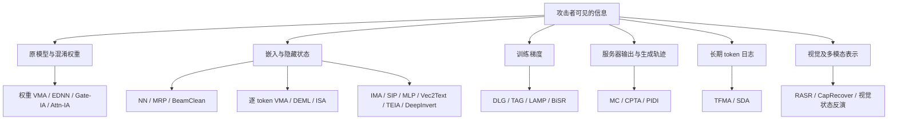

# 从防御论文追溯隐私攻击：分类、数学原理与实现

调研日期：2026-11-12。重点是当前论文库中的 **prompt/表示反演、模型与 token 混淆恢复、分割微调泄露**。优先追溯防御论文真正引用或评测的攻击，再补充相关基础方法与 2026 年新工作。

配套材料：[论文与代码索引](ATTACK_PAPERS_AND_CODE.md) · [可运行的 NumPy 基础实现](attack_baselines_numpy.py) · [原有论文分类](../README.md)。本次阅读了本地防御/攻击论文的相关章节及 17 篇补充攻击全文，核对了公开代码入口；没有进行大模型 GPU 实验，也不将代数自检视为论文复现。

## 1. 先回答 TWIST 的 VMA、NN、IMA 分别是什么

| 名称 | 在 TWIST 中的主要用途 | 所需信息 | 核心操作 | 本文位置 |
|---|---|---|---|---|
| NN | 从观测表示猜原 token | 同一坐标空间的词嵌入表 | 找距离最近的词向量 | [§4.1](#a-nn) |
| VMA | 从原权重和混淆权重恢复词表对应关系 | 公开原模型、变换后模型 | 消去部分变换，排序消除列置换，匹配行，多层投票 | [§4.3](#a-weight-vma) |
| IMA | 学习“受保护表示→原输入” | 可构造的明文—表示训练对 | 训练反演网络，再解码 token | [§6.1](#a-ima) |
| IA | 利用变换保留的统计量识别 token | 原/混淆权重及其结构 | 构造 Gate/Attention 不变量指纹 | [§4.4](#a-ia) |
| ISA | 根据观测隐藏状态优化候选输入 | 可微前缀模型或替代模型 | 匹配隐藏状态，优化连续输入表示 | [§5.3](#a-isa) |
| TFMA / SDA | 利用多次请求的统计泄露 | 混淆 token 日志、语言先验 | 频率匹配或序列解密 | [§8](#statistics) |

**VMA 必须分清具体版本。** TWIST §7.2 和同路线 AloePri 附录 D.1 强调的是权重/映射恢复；其参考论文 [Hidden No More](https://proceedings.mlr.press/v267/thomas25b.html) 的核心 Algorithm 1 则是逐 token 前向匹配隐藏状态。OSNIP 评测使用的也属于后者。这两个实现共享匹配思想，但输入、前提和计算过程不同，本文分别描述。

**IMA 也不是固定架构名称。** TWIST 引用的是 [InvBERT](https://arxiv.org/abs/2109.10104)。AloePri 附录 D.1 将其适配成 2 个 decoder layer、8 个 attention head 的 Qwen2 反演模型。这个结构是技术报告的实验配置，不是 InvBERT 原论文的统一配置，也不能据此补全 TWIST 未报告的训练超参数。

## 2. 分类与防御论文的对应关系

这些类别可以组合：BiSR 同时利用表示和梯度，PIDI 同时利用输入端、输出端和生成历史。分类依据是攻击实际消费的信息，不是算法是否训练了一个网络。

### 2.1 优先级依据：现有防御到底测了什么

| 防御/评测论文 | 原文涉及的攻击或指标 | 本地 PDF 定位 | 阅读时需注意 |
|---|---|---|---|
| [TWIST](../README.md#paper-03) | 权重 VMA、IA、NN、IMA、ISA；长期 TFMA、SDA | 第 10–13、24 页 | 单次输入恢复与长期频率泄露是两套实验 |
| [AloePri](../README.md#paper-02) | 同上，并给出权重组合、IA 和 IMA 适配说明 | 第 12–16、26–27 页 | 提供 TWIST 同路线的实现补充，保留版本区别 |
| [SnD](../README.md#paper-14) | L2 最近邻 token 反演、属性推断 | §4.3.2，第 7 页 | MI 估计使用 kNN，不等于另一个 token 重建攻击 |
| [SGT](../README.md#paper-11) | NN、MRP、BeamClean | §6，第 7 页 | TWIST 对 SGT 做 IMA 测试，不能倒写成 SGT 自己提出/完整评测了 IMA |
| [OSNIP](../README.md#paper-12) | KNN Top-1/5/10、逐 token VMA | §4.1，第 6 页 | Top-k 命中率与完整 prompt 恢复率不同 |
| [Privacy Adapters](../README.md#paper-10) | Luo 等的 MLP 分类攻击、Qu 等的优化攻击、对防御重新训练的攻击器 | §6.1，第 7 页 | 重新训练攻击器与只测训练过程中的对手要分开 |
| [DualGuard](../README.md#paper-06) | SIP、TAG、LAMP、BiSR、CPTA | §4.1，第 5 页 | TAG/LAMP 带星号的是对分割场景改造的版本 |
| [PrivPair](../README.md#paper-09) | Direct Forward、TAG、LAMP、BiSR | 第 10–11 页 | 服务器已有尾部解码器是关键条件 |
| [PrivTune](../README.md#paper-07) | 激活反演、梯度反演、NN；监督属性分类、梯度属性推断、聚类 | §III，第 3 页 | 其编号是本论文内的 Attack-0…5，不是跨论文通用名称 |
| [FedSEA-LLaMA](../README.md#paper-08) | 合谋客户端提供配对数据，服务器训练反演解码器 | 第 4 页 | 属于学习式反演，不应因“decoder”另造一个攻击类别 |
| [COVERT](../README.md#paper-01) | 非自适应/自适应视觉隐藏状态反演；讨论 EDNN、CapRecover | §5.3，第 10–12 页；参考文献 | 视觉注意力反演是其评测适配，原 ISA 论文主要研究文本状态 |
| [PIDI/ADMI](../README.md#paper-15) | MC、SIP、VMI、BiSR 的前向组合和 PIDI | §4、§6，第 3–4、7 页 | PIDI 的威胁模型是推理期，无真实训练梯度 |

### 2.2 复现实验中必须显式记录的条件

| 条件 | 含义 | 主要影响 |
|---|---|---|
| 原始模型/分词器可得 | 知道公开基座及其 embedding table | NN、EDNN、VMA、SIP、优化反演 |
| 真实客户端参数可得 | 知道微调后客户端与保护模块参数 | 完全白盒优化；不等于只知道基座 |
| 同部署配对数据可得 | 有同一部署/同一密钥下的 `(明文, 受保护表示)` | IMA、分类反演的强条件 |
| 只能模拟保护机制 | 知道算法，但没有真实密钥 | Shadow/SIP/DeepInvert；存在分布和映射差异 |
| 可查询隐藏表示 | 查询自己的文本能返回目标层状态 | Luo 分类攻击、InvBERT、Vec2Text 等；查询预算需报告 |
| 梯度可见 | 明确是参数梯度还是切分点激活梯度 | DLG/TAG/LAMP/BiSR |
| 多次观测可积累 | 同一部署下请求日志、重复词、输出轨迹可关联 | TFMA/SDA、PIDI、联合攻击 |

**知道混淆算法，不自动意味着能生成真实密钥下的配对数据。** 对秘密词表置换尤其如此：用另一把随机置换训练出的 token 标签通常不能直接迁移。应分别报告“真实配对”“代理配对”“无配对”三种情况。

## 3. 统一符号

所有公式使用行向量约定；为便于比较，部分原文公式已改写符号，改写不代表新增的论文定理。

| 符号 | 定义 |
|---|---|
| $x=(x_1,\ldots,x_n)$，$\mathcal V$ | 输入 token 序列、词表 |
| $E\in\mathbb R^{\lvert\mathcal V\rvert\times d}$ | 词嵌入表，$E[v]$ 是 token $v$ 的向量 |
| $e(x)\in\mathbb R^{n\times d}$ | 按 token 查表得到的嵌入序列 |
| $F_\ell$ | 从嵌入到第 $\ell$ 个观测位置的实际前缀计算，包含相应位置编码与 mask |
| $H=F_\ell(e(x))$，$Z$ | 原隐藏状态、攻击者实际看到的受保护状态 |
| $Z=\mathcal M_k(H;\xi)$ | 密钥 $k$、随机性 $\xi$ 下的保护机制 |
| $B$，$C$，$U=B(Z)$ | 服务器主体、客户端尾部、服务器返回状态 |
| $g_U=\nabla_U\mathcal L(C(U),y)$ | 训练时客户端传回的切分点梯度 |
| $\bar F,\bar C$ | 攻击者可得的公开/代理前缀和尾部；与真实客户端模型可能不同 |

## 4. 几何与模型变换恢复

### 4.1 NN/KNN，以及 SGT 的 MRP

**来源与对象。** SnD §4.3.2、SGT §6、OSNIP §4.1 均涉及词向量匹配；相关基础工作见 [Song & Raghunathan, CCS 2020](https://arxiv.org/abs/2004.00053)。不需要训练一个反演网络。

对上传向量 $z_i$，最简单的恢复是：

$$
\hat x_i=\arg\min_{v\in\mathcal V}\|z_i-E[v]\|_2^2.
$$

余弦版本为 $\hat x_i=\arg\max_v\cos(z_i,E[v])$。只有比较对象均做单位范数归一化时，余弦排序才与 L2 排序等价；隐藏状态和 embedding 不在同一坐标空间时，直接 NN 只是一个弱基线。

**实现步骤。** 取出与目标分词器一致的嵌入表；过滤 padding 等评测中约定排除的位置；分块计算距离；取 Top-k 候选；用原分词器还原文本。大词表可用 FAISS 或矩阵乘法实现，避免构造 `(token数, 词表大小, 维度)` 三维差值张量。

$$
D_{iv}=\|z_i\|_2^2+\|E[v]\|_2^2-2z_iE[v]^\top.
$$

Top-k ASR 只判断真实 token 是否落在候选集合，不能直接当成 Top-1 或完整句恢复。最近邻距离小也不能证明恢复的是唯一原文。

**MRP 的额外信息。** SGT 发现有的变换把原词推到“远邻”，使只测 NN 的结论偏乐观。用独立校准集统计原词的距离排名：

$$
R_i=1+\sum_{v\ne x_i}\mathbf1\{D_{iv}<D_{i,x_i}\},\qquad
r^*=\arg\max_r\widehat{\Pr}(R=r).
$$

测试时输出距离排序中第 $r^*$ 个词。它需要校准配对数据或已知排名分布；不能用测试集真实 token 选择 $r^*$。这里严格按“从近到远的 rank”实现，$r^*=|\mathcal V|$ 才表示最远邻，避免 SGT 段落中 nearest/farthest 的措辞混用。

本地函数：`nearest_rows`、`nth_neighbor`。

### 4.2 EDNN：对坐标差分做近邻

**来源。** [An Inversion Attack Against Obfuscated Embedding Matrix in Language Model Inference，EMNLP 2024](https://aclanthology.org/2024.emnlp-main.126/)，§2–3、算法 1。AloePri/TWIST 的 IA 参考这条不变量攻击路线。

原攻击针对特定 glide-reflection 实现：每个词的平移/反射方向是全 1 向量，因此可写成 $\tilde e_i=e_i+c_i\mathbf1$。构造循环差分：

$$
\Delta(e)=e-\operatorname{roll}(e,1),\qquad
\Delta(e+c\mathbf1)=\Delta(e).
$$

所以即使原空间 NN 失效，仍可求：

$$
\hat m(i)=\arg\min_{v\in\mathcal V}
\|\Delta(\tilde E[i])-\Delta(E[v])\|_2^2.
$$

**实现步骤。** 读取原/混淆 embedding table；沿特征维做相同方向的循环移位；分别相减；在差分空间按行匹配；得到“混淆行号→原 token”的映射；据此解码请求。左右循环方向只要两边一致，不影响该不变量。

**适用限制。** 这是针对特定结构的精确不变量；对一般旋转、逐维独立平移、任意非线性映射并不自动成立。微调或加噪后匹配依靠差分指纹的间隔，需重新实测。

**代码核对。** [ACL 官方附件](https://aclanthology.org/attachments/2024.emnlp-main.126.software.zip) 包含 `ednn_attack/ednn.py`。其 `key` 用于核验恢复结果的正确率，差分匹配本身不需要解密密钥。使用原代码时应核对距离矩阵的行列方向；本文基础实现明确让查询行表示混淆行。

本地函数：`ednn_mapping`。

### 4.3 TWIST/AloePri 的权重侧 VMA：排序、匹配、投票

**来源。** 本地 TWIST §7.2，第 10 页；AloePri 附录 D.1 与表 9，第 26 页；匹配思想追溯 [Hidden No More](https://proceedings.mlr.press/v267/thomas25b.html)。下面描述的是防御评测的权重侧适配。

假设通过组合可见权重消掉部分内部线性变换，得到：

$$
Y=P X Q+N,
$$

其中 $P,Q$ 为行、列置换，$N$ 是噪声或近似误差。无噪声时，逐行排序消去列置换：

$$
\operatorname{sort}_{row}(PXQ)
=P\operatorname{sort}_{row}(X).
$$

因此先在排序后的行之间匹配恢复 $P$；按恢复的行顺序对齐后，再匹配列恢复 $Q$。**等式仍保留 $P$**，不能把左侧直接写成 $\operatorname{sort}_{row}(XQ)$。这是对附录叙述的维度/置换关系澄清。

**从哪里得到 $X,Y$？** AloePri 表 9 列出 embedding、LM head、Q/K、FFN、MoE router 的组合。典型原模型侧候选为：

$$
X_1=EW_{head},\quad X_2=EW_{gate},\quad
X_3=(EW_q)(EW_k)^\top.
$$

混淆侧使用配套的混淆权重构造 $Y_j$。每个组合都要先核对内部变换能否相消，以及剩余是否确实为置换；存在任意未消去的线性变换时，直接排序没有上述保证。噪声、缩放和 block/head permutation 的影响按具体组合分析。

**实现流程。**

1. 读取公开 checkpoint 和服务器可见的混淆 checkpoint，核对 tensor shape、归一化及 tied embedding。
2. 按每层/每个可消去变换的权重组合构造指纹矩阵。
3. 逐行排序；对每个混淆行找原模型中的最近指纹，记录候选与距离间隔。
4. 多层独立获得映射 $\hat m_\ell$，再投票：

$$
\hat m(c)=\arg\max_v\sum_{\ell}\mathbf1\{\hat m_\ell(c)=v\}.
$$

5. 如果目标是全局双射，用 assignment 约束处理多个混淆 token 竞争同一原 token 的冲突；独立 NN 不保证一一对应。
6. 用得到的映射解码待测 token，分别统计全 token、敏感实体和跨请求恢复率。

**工程边界。** $EW_{head}$ 可能是 $|\mathcal V|^2$ 大小，不宜盲目在 GPU 上整体构造。未知列置换下，两侧独立抽取不同列会破坏排序不变量；分块计算、选择较窄的有效权重组合，均需保留同一个数学匹配问题。本文提供排序匹配与投票的基础实现，未复刻 TWIST 未公开的全部权重组合与超参数。

本地函数：`sorted_row_mapping`、`majority_mapping`。

### 4.4 IA：Gate-IA 与 Attn-IA

**来源。** AloePri 附录 D.1，第 26–27 页；TWIST 将其作为 IA 评测。EDNN 是相关不变量思路，Gate-IA/Attn-IA 是此处的结构适配，不能都写成 EDNN 的同一个公式。

**Gate-IA。** 在理想无噪声情况下，令 $G_\ell=EW_{gate,\ell}$，混淆对应 $\tilde G_\ell=PG_\ell Q_\ell$，其中 $Q_\ell$ 是特征置换。构造每个词的跨层均值指纹：

$$
s(v)=\left(\operatorname{mean}G_1[v,:],\ldots,
\operatorname{mean}G_L[v,:]\right).
$$

均值不随列置换改变，因此按 $\|\tilde s(c)-s(v)\|$ 匹配恢复 token。实施时先从各层 gate 权重构造投影，再聚合和匹配。它依赖真实模块变换关系，不能随意把“任意权重矩阵均值”当成同一攻击。

**Attn-IA。** 用维度一致的块投影形式表达附录的二次型不变量。设某 attention/RoPE 块的全词表投影为 $Q\in\mathbb R^{|\mathcal V|\times r}$，某词对应行 $q_v$；变换后 $\tilde Q=PQA$，$A\in\mathbb R^{r\times r}$ 可逆。若 $C=Q^\top Q$ 满秩，则：

$$
s(v)=q_v C^{-1}q_v^\top,
$$

$$
(q_vA)(A^\top C A)^{-1}(q_vA)^\top
=q_v C^{-1}q_v^\top.
$$

跨层、head、block 收集标量形成指纹，再最近邻或全局匹配。实现用线性方程求解代替显式求逆；应检查秩和条件数。一般可逆变换下，任意添加 $\lambda I$ 并不保持这个精确等式，应作为数值近似单独报告。未知的 head/block 置换与参数噪声会使对应关系更难恢复，正是防御需评估的部分。

本地函数：`gate_fingerprint`、`attention_fingerprint`；附有可逆变换不变量的数值自检。

## 5. 已知前向计算的序列搜索与优化

### 5.1 Hidden No More / OSNIP 的逐 token VMA

**来源。** [Hidden No More，ICML 2025](https://proceedings.mlr.press/v267/thomas25b.html)，§4–5、算法 1、附录 E；OSNIP §4.1。

Decoder-only 的因果性意味着位置 $i$ 的状态只依赖前缀。若已恢复 $\hat x_{<i}$，逐词尝试：

$$
\hat x_i=\arg\min_{v\in\mathcal V}
\left\|F_\ell(e(\hat x_{<i}\Vert v))_i-H_i\right\|_1.
$$

**算法。** 从空前缀或已知系统前缀开始；按 proposal LM 的概率排序词表；批量运行候选到目标层；用 L1 距离选择候选；满足校准阈值 $\varepsilon$ 可提前接受，否则保留全局最近者；追加 token 后继续。缓存只保留被接受前缀的 KV，不能把不同候选生成的缓存混在一起。

前向候选量约为 $O(n|\mathcal V|)$，每个候选仍有前缀模型计算成本。proposal 排序和 KV cache 是加速手段；提前截断 Top-k 是近似，可能漏掉正确 token。特殊 token、BOS、chat template、位置编号、目标层和 dtype 必须与观测匹配；双向 BERT 不满足该前缀独立性。

**置换变体。** 特征维被置换时，改比较：

$$
\|\operatorname{sort}(\hat H_i)-\operatorname{sort}(H_i)\|_1.
$$

序列行被置换时，对剩余未匹配行共同搜索，接受后移除对应行。两种置换同时存在时，将这两项组合。排序只消除置换，不消除任意线性混淆。

这条攻击要求可模拟与目标一致或足够接近的前缀。面对随机/秘密保护模块，应明确如何模拟、是否采用期望匹配及是否有同部署样本；对原始基座匹配失败，不能自动推断受保护表示对其他攻击也安全。

原软件链接当前返回 404，见[代码核验记录](ATTACK_PAPERS_AND_CODE.md#code-status)。本地 `greedy_prefix_match` 通过回调实现核心搜索，调用者须提供真实的前缀模型和位置设置。

### 5.2 Qu 等的 PIA / DEML：约束优化与自适应离散化

**来源。** [Prompt Inversion Attack against Collaborative Inference of Large Language Models，IEEE S&P 2025](https://arxiv.org/abs/2503.09022)，§5；[官方 DEML](https://github.com/ygZhou02/DEML)。Privacy Adapters 用它作优化攻击基线。

直接优化 `softmax(token logits) × embedding table` 可能梯度很弱；直接优化任意连续嵌入又可能偏离合法 token 流形。论文采用：

$$
\min_{U\in\mathbb R^{n\times d}}
\|F_\ell(U)-H\|_F^2
+\lambda\sum_i\min_{v\in\mathcal V}\|U_i-E[v]\|_2^2.
$$

还按嵌入表逐维范围裁剪：

$$
L_j=\min_vE[v,j],\quad R_j=\max_vE[v,j],\quad
U_{ij}\leftarrow\operatorname{clip}(U_{ij},L_j,R_j).
$$

**流程。** 冻结前缀参数；初始化候选嵌入；迭代计算状态匹配损失和词表约束、更新嵌入；从优化后的每个向量取近邻候选 $S_e$；用语言模型根据已恢复前缀提出语义候选 $S_s$；在二者并集内重新前向，用**观测激活**校准最终 token：

$$
\hat x_i=\arg\min_{v\in S_e\cup S_s}
\|F_\ell(e(\hat x_{<i}\Vert v))_i-H_i\|_2^2.
$$

它与逐 token VMA 的联系很直接：完整词表校准具有很大成本，连续优化帮助缩小候选集合。仅在 embedding 空间做一次 NN，不等于完整 DEML。

代码入口：`invert.py` 中 `get_hidden_state`、`invert_and_find_best`、`main`；其中 `top_k_cos` 与 `top_k_ppl` 控制两类候选。论文目标与具体代码中的约束代理、归一化、过滤规则应一起记录，不把论文一个目标式等同于所有实现细节。

**已读代码的区别。** 当前公开 `invert.py` 的主要更新路径实现了加权 cosine 状态损失与范围 ReLU 罚项，另有 MSE 分支和可选固定范围 clipping；不能声称它逐字实现了论文式 (13) 的完整“对词表取最小距离”正则。复现时应明确采用论文目标版还是该公开代码版。

### 5.3 ISA：ER、TBS，以及黑盒替代模型

**来源。** [Depth Gives a False Sense of Privacy: LLM Internal States Inversion，USENIX Security 2025](https://www.usenix.org/conference/usenixsecurity25/presentation/dong-tian)，§4、算法 1；[作者 Zenodo artifact](https://doi.org/10.5281/zenodo.15605325)。TWIST/AloePri/COVERT 都引用这条路线。

**ER：Embedding Recovery。** 浅层先恢复连续输入嵌入，再投影回词表：

$$
U^*=\arg\min_U D(F_\ell(U),H)+\lambda\mathcal L_{dm}(U,E),
\qquad \hat x_i=\arg\max_v\cos(U_i^*,E[v]).
$$

论文的分布匹配项用随机特征网络 $\phi$，约束候选与词表嵌入的分布，例如：

$$
\mathcal L_{dm}=\mathbb E_\phi
\left\|\operatorname{mean}\phi(U)-\operatorname{mean}\phi(E_{batch})\right\|_2^2.
$$

它约束的是随机特征的均值，不等同于只匹配原始范数。

**TBS：Token Basis Selection。** 深层直接优化输入容易不稳定。对 embedding table 做 SVD，取 $d\times d$ 正交基 $B$，优化较低维的坐标 $Z$，而不是每个位置 $|\mathcal V|$ 个 token logits：

$$
U(Z)=\phi_z(ZB),\qquad
Z^*=\arg\min_Z D(F_\ell(U(Z)),H)+\lambda\mathcal L_{dm}.
$$

$\phi_z$ 使用有界的变量变换，作者实现提供 atan 方案；$Z$ 的维度是 $n\times d$。这是词嵌入空间的基展开，并非 LoRA 或词表软选择。

**黑盒扩展。** 若目标可能来自公开基座，用自己的 `(文本, 目标状态)` 查询对训练替代前缀：

$$
\min_{\theta_A}\sum_{x\in D_A}
\|F_{\theta_A,\ell}(e(x))-H_{target}(x)\|_F^2,
$$

再对替代模型做 ER/TBS。若无法获得合适基座，训练投影模块加 encoder-decoder，将目标状态翻译回输入，属于生成式反演。

**实际入口。** artifact 的 `white-box-inversion/attack_batch.py`，`--attack` 选择方法；参数包含 `--access-layer-id`、`--num-steps`、`--lr`、`--tbs-changevar`。`black-box-inversion/replication/replicate.py` 训练替代模型。artifact v2 不含全部预训练结果，且其参数说明将 DM 标为当前仅用于 TBS；因此“论文 ER 带分布项”和“某次脚本运行确实启用了分布项”要分开。

## 6. 学习式反演：从分类到序列恢复

### 6.1 IMA / InvBERT：训练一个逆向映射

**来源。** [InvBERT](https://arxiv.org/abs/2109.10104)，§3–4；TWIST 的 IMA 引用它。关键训练数据为 $D_A=\{(Z^{(j)},x^{(j)})\}$，而不是只有无标签目标状态。

**逐位置分类。** 原 tokenizer 已知时，训练 MLP 或带上下文的网络，输出 $n\times|\mathcal V|$ logits：

$$
\min_\psi\mathbb E_{(Z,x)\sim D_A}
\left[-\sum_{i\in\text{valid}}\log p_\psi(x_i\mid Z)\right].
$$

**Seq2Seq。** 原分词器未知或需要真正的序列解码时，使用攻击者 tokenizer 与 encoder-decoder：

$$
\mathcal L_{seq}=-\sum_i\log p_\psi(x_i\mid Z,x_{<i}).
$$

这两条分别对应原论文的 InvBERT Classify 与 InvBERT Seq2Seq。AloePri 的 2-layer Qwen2 是它对 IMA 的再实现。若模型预测的是原嵌入，常用可实现目标为 $\|D_\psi(Z)-e(x)\|_F^2$，之后再词表匹配；这属于统一实现选项，不补称原文已报告该损失的全部细节。

**复现流程。** 固定目标前缀与部署保护机制；用公开文本生成训练对；按文档划分训练/验证/测试以防邻近句泄漏；冻结目标，仅训练反演器；测试时输入真实观测 $Z$；报告 Top-1、实体恢复、句子 Exact Match，并单列 OOD 测试。

**成立条件。** 黑盒“可查询”与“完全没有模型查询”不同；若训练只用了另一把秘密置换，必须验证标签坐标如何对齐，不能直接把代理生成对当成真实部署配对。原文的 Seq2Seq 同样需要可获得的训练对。

### 6.2 SIP 与 NaMoE：用公开基座模拟未知客户端

**来源。** [BiSR，CCS 2024](https://arxiv.org/abs/2409.00960)，§3.1、§3.3；DualGuard、PIDI 等直接引用。SIP 全称是 Semi-white-box Forward Inversion Paradigm。

攻击者不知道真实微调 head $F$，但知道结构及公开预训练 $\bar F$。冻结 $\bar F$，从辅助文本构造 $\bar H=\bar F(e(x))$，只训练解码器：

$$
\min_\psi\mathbb E_{x\sim D_A}
\operatorname{CE}\big(D_\psi(\bar F(e(x))),x\big).
$$

训练标签是**同位置原 token**，不是语言模型训练中左移一位的 next-token 标签。推断时用真实客户端的 $H$ 替换 $\bar H$。decoder 可以是 Linear、GRU/LSTM 或 Transformer；“SIP”描述的是这个半白盒训练范式，而非唯一网络。

**NaMoE 的抗噪训练。** 为多个噪声机制/幅度训练专家 $D_{\psi_j}$；再冻结专家，训练门控，在未知噪声输入上融合预测。统一表达为：

$$
D(H)=\sum_j\alpha_j(H)D_{\psi_j}(H),\quad
\alpha(H)=\operatorname{softmax}(G(H)).
$$

不要只用干净状态训练 SIP，再把带噪测试结果当作最强学习攻击。实际需报告噪声生成位置、训练幅度覆盖范围，以及融合对象是 logits 还是概率。

**局限。** SIP 依赖公开 head 与真实 head 的表示相近，即论文的 not-too-far 条件；DualGuard 正是在主动破坏这个条件。若可取得同部署配对，应增加重新训练的防御感知反演器，不只测旧 SIP。

代码：[SplitLLM](https://github.com/StupidTrees/SplitLLM) 的 `sfl/model/attacker/sip/`；`inversion_training.py` 负责训练，`inversion_models.py` 含专家/GRU/Transformer 等结构，`sip_attacker.py` 执行攻击。

### 6.3 Luo 等的 Prompt Inference：A1/A2/A3

**来源。** [Prompt Inference Attack on Distributed Large Language Model Inference Frameworks，CCS 2025](https://arxiv.org/abs/2503.09291)，§4、算法 1–3。Privacy Adapters 采用其中分类攻击的思路。

**A1：大量同分布查询。** 用公开输入查询目标状态，把每个 `(隐藏向量, 对应 token)` 作为分类样本，训练 $p_\psi(v\mid h_i)$。网络可逐位置输出，减少自回归误差传播。其目标为：

$$
\mathcal L_{cls}=-\sum_{(h_i,x_i)\in D_A}\log p_\psi(x_i\mid h_i).
$$

**A2：跨分布、覆盖缺失 token。** 找出辅助语料未覆盖的 token；把每个目标 token 放到随机位置，前面拼随机上下文；查询这些合成序列，增加其状态样本，再训练分类器。这里是对**词表覆盖和状态分布**的主动补全，不是只把原语料随机打乱。

**A3：有限查询、无辅助语料。**

1. 构造包含所有 token 的随机序列，在总 token 查询预算 $q_b$ 内取得带标签 anchor states；该设置仍需大致覆盖词表。
2. 对目标状态比较各 token anchor 群的平均距离；在 Top-k 距离经 softmax 得到的候选分布上计算熵。

$$
d_v(h)=\frac1{|A_v|}\sum_{a\in A_v}\|h-a\|_p,
\quad p_v\propto\exp(-d_v/c),\quad
\mathcal H(p)=-\sum_vp_v\log p_v.
$$

3. 只将低熵、高置信预测加入 anchor 集；训练并反复更新带正则的非线性分类器，继续吸收高置信样本。
4. 对余下位置，仅在近邻阶段给出的 Top-5 候选内做语言模型 beam search；已确定 token 固定不变。原算法 3 的缺失位置束评分为累计 $\log p_{LM}(v\mid\text{当前前缀})$。

**代码/配置区别。** 原论文实验描述是 6 层 MLP；Privacy Adapters 的评测描述采用 4 层 MLP。二者不能在模型大小和预算上直接视为完全相同。尚未从该论文确认独立的公开实现仓库；本文给出算法流程与原文定位。

### 6.4 Vec2Text：猜测、重嵌入、纠正

**来源。** [Text Embeddings Reveal (Almost) As Much As Text，EMNLP 2023](https://aclanthology.org/2023.emnlp-main.765/)，§3；[官方代码](https://github.com/jxmorris12/vec2text)。它主要恢复**单个句子/文档向量**，与逐 token hidden state 的接口不同。

已知目标向量 $z=f(x)$ 且能查询 $f$：

$$
\hat x=\arg\max_{x'}\cos(f(x'),z).
$$

先用训练好的基础反演模型生成 $\hat x^{(0)}$。然后反复重嵌入并纠正：

$$
z^{(t)}=f(\hat x^{(t)}),\qquad
\hat x^{(t+1)}\sim p_\psi(\cdot\mid z,z^{(t)},z-z^{(t)},\hat x^{(t)}).
$$

三个向量分别经 MLP 扩展为伪 token 序列，与当前假设文本的词向量拼接，输入 encoder-decoder。训练时用基础模型产生的假设构造纠正训练集，对真实文本做 teacher forcing CE。

推断使用**序列级 beam**：每轮保留若干完整文本假设，各自生成若干纠正候选，重新调用目标 embedder，按与 $z$ 的相似度筛选。目标 embedder 的查询预算必须计入；只拿其名称但无查询接口时，不能直接照搬此流程。

代码入口：`vec2text/api.py`、`models/corrector_encoder.py`、`trainers/corrector.py`。模型 checkpoint、目标向量维度、归一化和最大文本长度必须相容。

### 6.5 TEIA：没有新查询，但有少量已泄露配对

**来源。** [Transferable Embedding Inversion Attack，ACL 2024](https://aclanthology.org/2024.acl-long.230/)，§3；[官方代码](https://github.com/coffree0123/TEIA)。PrivTune 引用了这篇论文。它本身不只是一个 NN 攻击。

条件为：目标 embedder 不可查询，但有小规模泄露集 $D_L=\{(x,f(x))\}$。冻结公开 surrogate encoder $f_0$，训练 adapter $A$ 得 $\hat f=A\circ f_0$。对批量目标/代理向量 $H_P,H_S$：

$$
\mathcal L_{intra}=\operatorname{MSE}(H_P,H_S),\qquad
\mathcal L_{inter}=\frac1{N^2}\|\bar H_P\bar H_P^\top-\bar H_S\bar H_S^\top\|_F^2,
$$

其中 $\bar H$ 是逐行归一化矩阵。第一项对齐向量，第二项对齐文本之间的相似关系。

进一步用 discriminator $D$ 对齐目标向量和外部文本的代理向量分布：

$$
\min_A\max_D\;
\mathbb E_{h\sim H_P}\log D(h)
+\mathbb E_{\hat h\sim\hat f(D_{ext})}\log(1-D(\hat h)).
$$

交替训练 discriminator、adapter 和 embedding-to-text decoder。decoder 在泄露配对及代理生成配对上用标准序列 CE 训练，再对目标向量做迁移恢复。

**实现关键。** “无模型查询”仍需要已有配对锚点；不能解释成完全没有 `(文本, 目标 embedding)` 信息。官方入口 `research/model/adv_attack_model.py`，实际项目入口与参数见索引；仓库 README 提示代码迁移尚在进行。

### 6.6 DeepInvert：有标签 shadow + 无标签真实状态

**来源。** [DeepInvert，2026 年预印本](https://arxiv.org/abs/2608.04477)，§4–5。作为较新的补充工作，不将其预印本结果写成所有防御均已被独立复现攻破。

它利用 $D_s=\{(Z_s,x_s)\}$ 与服务器日志中的无标签 $D_u=\{Z_u\}$。监督部分是 token CE；无监督部分对同一目标状态做弱/强遮罩增强，用 EMA teacher 的弱视图预测监督 student 的强视图：

$$
\mathcal L_s=-\sum_i\log p_{\theta_s}(x_{s,i}\mid Z_s^w),
\qquad \theta_t\leftarrow\alpha\theta_t+(1-\alpha)\theta_s.
$$

按 teacher 弱视图的 Top-k 索引截取两侧分布，构造一致性目标。以明确重归一化的实现约定写成：

$$
I_i=\operatorname{TopK}(p_{\theta_t}(\cdot\mid Z_u^w)_i),\qquad
\mathcal L_u=\frac1n\sum_i
D_{KL}\!\left(\operatorname{Norm}_{I_i}p_{\theta_s}(\cdot\mid Z_u^s)_i
\;\|\;\operatorname{Norm}_{I_i}p_{\theta_t}(\cdot\mid Z_u^w)_i\right).
$$

上式保留原文 student-to-teacher 的 KL 方向；Top-k 子分布如何归一化应在复现中明确，不能把未归一化的截断和默认为标准 KL。

**训练流程。** 初始化相同 teacher/student；构造多 shadow 状态训练集；每个 epoch 先做一段监督更新，再做一段无监督更新；逐步提高无监督步骤比例 $\tau_i$；每步更新 EMA。原文采用交替日程，不能只用固定 $\mathcal L_s+\lambda\mathcal L_u$ 代表其最终算法。

**信息边界。** 无标签真实状态可来自服务器已观察的日志，不能在复现程序里偷偷读取这些日志对应的真实 token。当秘密置换导致 shadow/target 标签错位时，还需论文 §5 的机制适配；半监督学习不是自动的任意密钥解密器。尚未核实独立公开代码，见索引。

## 7. 梯度、输出端与双向组合

### 7.1 DLG 与 TAG：优化能产生同一梯度的候选

**来源。** [DLG，NeurIPS 2019](https://arxiv.org/abs/1906.08935)；[TAG，EMNLP Findings 2021](https://aclanthology.org/2021.findings-emnlp.305/)。DualGuard/PrivPair 使用了这些方法的分割场景改造。

**原始参数梯度问题。** 已知模型 $f_\theta$、观察到 $g_\theta=\nabla_\theta\mathcal L(f_\theta(e(x)),y)$。DLG 同时优化 dummy embeddings $U$ 和 soft dummy labels $Y$：

$$
\min_{U,Y}\left\|
\nabla_\theta\mathcal L(f_\theta(U),Y)-g_\theta
\right\|_2^2.
$$

TAG 改进距离函数，对不同层采用 L2 与 L1 组合，前层可给更大的 L1 系数：

$$
\mathcal J_{TAG}=\sum_j
\left(\|g_j'(U,Y)-g_j\|_2
+\alpha_j\|g_j'(U,Y)-g_j\|_1\right).
$$

**实现步骤。** 缓存同一训练步的模型权重与梯度；随机初始化候选向量和标签 logits；通过 softmax 使 dummy labels 合法；前向计算候选任务损失；对模型参数求 dummy gradient 并保留计算图；再对梯度差关于候选求导；更新候选，最后投影回词表。PyTorch 关键是内层 `torch.autograd.grad(..., create_graph=True)`，否则无法通过梯度损失更新候选。

**分割版有不同未知量。** 服务器已知返回状态 $U$，观察到的是客户端传回的 $g_U$，而非客户端全部参数梯度。此时可仅优化标签分布：

$$
\min_Y
D\!\left(\nabla_U\mathcal L(\bar C(U),Y),g_U\right).
$$

自回归训练满足 $y_i=x_{i+1}$，恢复标签可暴露输入的下一位置。要处理 `ignore_index`、response-only loss mask、均值归约与左移位置，不能默认每个位置都有训练梯度。

**不要混淆两种公式。** 对直接可见的 softmax logits 梯度，单样本 CE 有 $g_{logit}=p-\operatorname{onehot}(y)$，可直接识别标签；对更早隐藏状态的梯度，还乘有未知/已知 Jacobian，不能直接套用该结论。

代码：[DLG 原作者仓库](https://github.com/mit-han-lab/dlg) 的 `main.py`；[LAMP 官方仓库](https://github.com/eth-sri/lamp) 提供 TAG/DLG 基线；[SplitLLM](https://github.com/StupidTrees/SplitLLM) 的 `dlg_attacker.py` 提供切分点梯度适配。后者的 L2 平方加 L1 实现与 TAG 原论文的范数写法有区别，需注明使用版本。

### 7.2 LAMP：梯度匹配加语言先验

**来源。** [LAMP，NeurIPS 2022](https://arxiv.org/abs/2202.08827)，§4、算法 1；[官方代码](https://github.com/eth-sri/lamp)。

LAMP 交替执行连续嵌入优化和离散序列搜索。连续损失为：

$$
\mathcal L_{rec}(U)=\mathcal L_{grad}(U)+\alpha_{reg}
\left(\frac1n\sum_i\|U_i\|_2-
\frac1{|\mathcal V|}\sum_v\|E[v]\|_2\right)^2.
$$

$\mathcal L_{grad}$ 可采用 TAG 距离或按层 cosine 梯度距离。范数约束避免候选向量仅靠变大而降低梯度损失。

每完成一段连续优化，把嵌入投影到 token；随机产生“交换两个位置、移动单词、移动子序列、将前缀移到末尾”等候选。用联合评分决定是否接受：

$$
S(x')=\mathcal L_{rec}(e(x'))+
\alpha_{LM}\left[-\frac1n\sum_i\log p_{LM}(x_i'\mid x_{<i}')\right].
$$

只接受评分改善者，再继续连续优化。语言先验用于改善词序和自然性，不能取代梯度约束，否则可能得到流畅但非原文的句子。

**条件差异。** 原始 LAMP 在其分类任务实验中假设标签已知，并解释二分类、小 batch 时可枚举标签组合；分割 LLM 的 TAG*/LAMP* 可能优化未知标签，且使用公开尾部替代真实尾部。两者的观测对象、假设和实现均不同，应分列报告。

官方 `attack.py` 及 `lamp_cos.sh` / `lamp_l1l2.sh` 是阅读入口，具体可运行命令依赖该仓库的数据与 checkpoint。

### 7.3 MC / CPTA / Direct Forward：接上公开尾部

**来源。** DualGuard §3.2.2 的 CPTA；PrivPair 的 Direct Forward；PIDI §4.1 的 MC。名称不完全相同，这里归纳它们在当前 LLM 设置中利用的共同路径。

服务器已得到主体输出 $U$，再执行公开预训练尾部 $\bar C$：

$$
\hat p_{i+1}=\operatorname{softmax}(\bar C(U)_i),\qquad
\hat y_{i+1}=\arg\max_v\hat p_{i+1,v}.
$$

**实现。** 从公开基座恢复本地尾部的层、归一化和 LM head；输入服务器实际返回状态，保留 mask 与 position IDs；读取对应位置的输出分布；按真实任务的 label shift 对齐。若服务器本来持有完整 $C$，可直接使用，无需学习尾部。

**限制。** 微调后尾部与公开尾部偏离会降低恢复率。真实生成若采用采样，预测出的最大概率 token 未必是用户真正采样的 token；下一轮上传状态是否包含真实生成 token，会进一步改变可恢复性。因此必须同时报告“下一 token 分布推断”和“真实响应恢复”。

相关项目中一般的 Model Completion 可能还包含训练补全模块；不能把所有同名 MC 都归结为这里的零训练尾部拼接。代码核验见索引的 `ModelCompletion_LLM.py`。

### 7.4 BiSR：SIP 初始化 + 前向/反向增强

**来源。** [BiSR，CCS 2024](https://arxiv.org/abs/2409.00960)，§3.2；[官方 SplitLLM](https://github.com/StupidTrees/SplitLLM)。

先由 SIP 给出 token 分布和初始文本。反向增强利用已知服务器返回状态 $U$，优化 dummy label logits $A$：

$$
Y(A)=\operatorname{softmax}(A),\quad
\min_A\beta\|g_U'(A)-g_U\|_2+
(1-\beta)\|g_U'(A)-g_U\|_1,
$$

$$
g_U'(A)=\nabla_U\mathcal L(\bar C(U),Y(A)).
$$

将恢复的标签按 next-token 偏移对齐为输入，查 embedding table 得到前向增强的初始化；随后优化：

$$
U_{in}^*=\arg\min_{U_{in}}
D_{cos}\big(\bar F(U_{in}),H\big).
$$

原论文提供独立 `BiSR(b)`、`BiSR(f)` 和先反向再前向的 `BiSR(b+f)`。不能把任意加权的“前向损失+反向损失”写成论文唯一原始算法。噪声自适应的 NaMoE 负责改善第一阶段初始化。

**预算与适用性。** 反向版本需要训练梯度；只有推理记录时，可复用 SIP/前向优化，但不能宣称仍运行了相同信息条件的完整 BiSR。记录 proxy head/tail 与真实微调模型的差异，分别分析初始化与增强增益。

### 7.5 PIDI：在推理期同时恢复输入和响应

**来源。** [本地 PIDI/ADMI 原文](From_Prompts_to_Responses_Dual-Sided_Data_Leakage_and_Defense_in_Split_Large_Language_Models.pdf)，§4，第 3–4 页；[正式论文页面](https://proceedings.mlr.press/v306/gu26o.html)。

它观察 head 上传状态 $H$ 与 body 返回状态 $T$。先用 SIP 估计输入 $\hat X$，用公开 tail 的 MC 估计响应 $\hat Y$，形成初始 token 序列，再查表转换为连续嵌入：

$$
U^{(0)}=e(\hat X\Vert\hat Y),\qquad
\mathcal L_{inv}(U)=\|\bar F(U)-H_{observed}\|_F^2.
$$

这里 $H_{observed}$ 必须是能按真实自回归轨迹对齐、覆盖相应 token 的观测；不能仅有首轮 prompt 状态却假设已获得完整真实响应的 head 状态。

**Patched Model Inversion。** 将长度 $L$ 的候选分成连续 patch $P_1,\ldots,P_N$，从左到右优化：

$$
U_{P_k}^*=\arg\min_{U_{P_k}}
\left\|\bar F\big(U_{P_{<k}}^{fixed}\Vert U_{P_k}\big)_{P_k}
-H_{P_k}\right\|_F^2.
$$

之前 patch 固定，当前 patch 更新，后缀依因果性可不参与；全部 patch 精修后再解冻做一次全局优化。最后投影回词表，分别统计输入和响应恢复率。

**容易写错的地方。** 概述段落有 MC/SIP 指代次序不清的表述，复现应按 §4.1 的分项与图 2：**输入用 SIP，响应用 MC**。处理 patch 时保持完整前缀、原 position IDs 和 causal mask；把每个 patch 当作位置从零开始的独立句子，会改变攻击目标。

PIDI 本身不需要真实训练梯度。论文给出 VFLAIR-LLM 项目链接，但当前核验的主分支未定位到独立 PIDI/PMI 实现入口；现有 vanilla inversion 文件不能直接当作完整 PIDI 发布代码。

## 8. 统计泄露与语言先验

### 8.1 TFMA：固定置换下的频率匹配

**来源。** TWIST §7.6；AloePri 附录 D.1。目标是长期复用的 token 映射；原文没有为 TFMA 指定一篇唯一的现代首创论文。

统计混淆日志中各符号的频率 $q(c)=n_c/N$，用参考语料得到 $p(v)$。简单实现将两侧分别按频率从高到低排序，再对齐相同排名。更一般的独立 token 似然写法为：

$$
\hat m=\arg\min_{m\text{ 为双射}}
-\sum_c n_c\log p(m(c)).
$$

**流程。** 固定原分词器与词表；按同一 key epoch 聚合日志；估计参考分布；频率匹配或 assignment；输出候选映射；在独立请求上验证。为缓解频率估计误差，可保留相邻排名候选，分别报告 Top-1/10/100。

**条件。** 语言、主题和分词器变化会改变参考分布；不同 key 的日志混合会损害稳定映射。随机替换、一对多映射和每请求换 key 需另设概率模型，不能沿用同一个确定性置换结论。

本地函数：`frequency_rank_mapping`。

### 8.2 SDA：频率编码后的序列解密

**来源。** [Can Sequence-to-Sequence Models Crack Substitution Ciphers?，ACL 2021](https://aclanthology.org/2021.acl-long.561/)，§3；TWIST/AloePri 将其迁移到混淆 token 序列。

直接给每个随机 key 下的密文符号学习固定 embedding，符号含义会在样本间冲突。原文先按密文内频率排名重新编码：

$$
r(c)=\operatorname{rank}_{desc}\operatorname{count}(c),\qquad
s=(r(c_1),\ldots,r(c_n)).
$$

再训练：

$$
\min_\psi\mathbb E_{x,\pi}\left[-\log p_\psi(x\mid r(\pi(x)))\right].
$$

**实现步骤。** 用公开明文反复生成随机替换 key；产生密文；做频率排名编码并明确 ties 的规则；用 `(排名序列, 明文)` 训练 Transformer encoder-decoder；测试以同样方式编码未知 key 的密文，再束搜索解码。需要保存重复符号结构，不能把 frequency rank 错写成首次出现次序编号。

**版本边界。** 原始工作重点是字符级 1:1 substitution，使用 6 层 encoder + 6 层 decoder；AloePri 附录将其描述为面向 token 的 Transformer causal LM 适配，不是原始模型配置。迁移到 LLM token、一对多（homophonic）或多对一替换时，词表、tokenizer 和训练分布都需重新适配，不能照搬其历史密码成绩。作者公开仓库当前仅含 Gutenberg 数据，不含完整模型实现。

### 8.3 BeamClean：噪声似然 × 语言先验

**来源。** [BeamClean: Language Aware Embedding Reconstruction，2025 预印本](https://arxiv.org/abs/2505.13758)，§4、算法 1；被 SGT §6.2 引用。

条件是获得 noisy token embeddings 与原 embedding table，并有一个语言先验模型；不要求知道目标 LLM 的全部深层权重。令 $q_\eta(z\mid x)$ 为拟合的噪声观测模型：

$$
\hat x=\arg\max_x\sum_i
\left[\log q_{\hat\eta}(z_i\mid E[x_i],x_{<i})+
\log p_{LM}(x_i\mid x_{<i})\right].
$$

噪声参数也从可见序列估计，而非默认知道客户端噪声：

$$
\hat\eta=\arg\max_\eta\log\sum_x
q_\eta(Z\mid e(x))p_{LM}(x).
$$

**可实施流程。** 初始化噪声模型；保留 $B$ 个前缀假设；对每个位置，利用当前假设更新噪声参数；给各词计算观测似然和 LM 先验的累计对数分数；扩展 beam 并截断；返回最佳序列。实践中用 `logsumexp`，避免连乘下溢。

以各向同性 Gaussian 为例，残差 $r=z-E[v]-\mu$ 的对数似然包含 $-\|r\|_2^2/(2\sigma^2)-d\log\sigma$。估计 $\sigma$ 时不能省掉归一化项。径向 Laplace 对应 L2 范数，独立逐坐标 Laplace 对应 L1 范数，应与真实噪声设定区分。

原文每步若遍历全词表，候选打分量仍含 $|\mathcal V|$，约为 $O(nB|\mathcal V|)$；其简化的复杂度表述没有展开该因子。词表截断、先验 tokenizer 与目标 tokenizer 之间的翻译都应单独记录。论文主要验证输入无关 Gaussian/Laplace 噪声；不能由其通用参数化直接宣称已攻破任意学习式、全序列相关保护。

## 9. 多模态：像素恢复与敏感语义恢复分开

### 9.1 RASR：对称重建 + 隐藏状态一致性精修

**来源。** [本地 RASR 原文](Inverting_the_Hidden_Unveiling_Multimodal_Privacy_Leakage_in_Collaborative_LVLM_Inference.pdf)，§V，第 5–6 页。

利用已知 visual-prefix 长度，把截获状态分为 $H_v,H_t$。视觉分支近似逆转原前向路径：

$$
I\rightarrow Z\rightarrow V\rightarrow H_v,
\qquad \hat I=R_{vis}(R_{align}(R_{llm}(H_v))).
$$

视觉分支以原图 MSE 训练，文本分支以同位置 token CE 训练：

$$
\mathcal L_{vis}=\frac1{|\Omega|}\|\hat I-I\|_2^2,\qquad
\mathcal L_{text}=-\frac1m\sum_i\log p_\psi(x_i\mid H_{t,\le i}).
$$

文本分支虽用 causal mask，但预测 token 不反馈，所有位置可在一次前向中输出。视觉分支的中间恢复态是 latent transitions，原文没有对每一层都加中间激活监督。

**精修。** 冻结原多模态前缀 $\Phi$，以初始重建为起点：

$$
\min_{I',x'}D(\Phi(I',x'),H),\qquad
I^{k+1}=\Pi_{\mathcal N(I^0)}
\left[I^k-\eta\nabla_{I^k}D(\Phi(I^k,\hat x^0),H)\right].
$$

固定精修后的图像，对文本低置信位置优化一个连续词向量；取其 8 个 L2 最近词，用前向隐藏状态差逐个校准，从左到右替换。视觉初始邻域投影、低置信阈值和真实分词位置均是复现细节。

原文实验在 Qwen3-VL 与 LLaVA 上使用分别训练的 1-layer causal reconstructor；这些是具体配置，不应默认适配所有 VLM。尚未从本地版本确认独立公开仓库。

### 9.2 CapRecover：不重建图片也能泄露内容

**来源。** [CapRecover，ACM MM 2025](https://arxiv.org/abs/2507.22828)，§3；[官方实现](https://github.com/Jus1mple/Image2CaptionAttack)。COVERT 的参考文献包含该工作。

将中间视觉特征 $F$ 映射到固定维度，经过 Q-Former/跨模态对齐，再用冻结语言模型生成描述：

$$
F'=g_\phi(F),\quad Z=QFormer_\psi(Q,F'),\quad
p(c\mid F)=\prod_t p_{LM}(c_t\mid c_{<t},WZ).
$$

用公开图文配对构造 `(中间特征, caption)` 训练集；冻结 victim visual encoder 与生成 LM，只训练 feature projector、Q-Former/alignment 等可训练部分：

$$
\mathcal L_{caption}=-\sum_t\log p(c_t^*\mid c_{<t}^*,F).
$$

训练使用真实 caption 监督；测试只能用中间特征及约定的公共 prompt，不能提供真实 caption。标签恢复版本改为分类 CE。空间特征先用相应网络投影，单个向量可用线性映射。

这条攻击的成功指标是内容描述/标签恢复，与像素 MSE 不同；图片看起来不可辨识，并不自动说明敏感语义安全。代码入口 `src/models/feature_mappers.py`、`src/models/qformer_opt.py`、`src/core/trainer.py`。

### 9.3 COVERT 评测中的视觉状态/注意力反演变体

本地 COVERT §5.3 描述了非自适应与尝试 attention head permutation 的自适应反演，引用 ISA 路线。统一目标可写为：

$$
\min_{I',\pi\in\Pi_{allowed}}
D\big(A_{public}(I'),\pi^{-1}(A_{observed})\big)+\lambda R(I').
$$

$A$ 是攻击所用的视觉注意力/隐藏状态；$R$ 是另行声明的图像先验或约束。实现需指定能看到哪些 attention tensor、如何搜索 head 对应关系、是否知道真实视觉模块，以及优化原图还是生成模型 latent。该式是对评测目标的统一表达，不是声称已拿到一个名为“COVERT Attack”的独立公开算法。

## 10. 属性推断与其他隐私目标

### 10.1 表示/梯度属性推断 AIA

**来源。** [Song & Raghunathan，CCS 2020](https://arxiv.org/abs/2004.00053)，§4；SnD、PrivTune 直接涉及。梯度属性/群体性质推断可进一步参考 [Melis 等，S&P 2019](https://arxiv.org/abs/1805.04049)。

**监督表示分类。** 收集带敏感属性 $a$ 的 shadow 数据，按相同部署产生 $Z$，对有效 token pooling：

$$
\bar z=\frac1{\sum_i m_i}\sum_i m_i z_i,\qquad
\min_\psi\mathbb E[-\log p_\psi(a\mid\bar z)].
$$

训练 MLP/线性分类器，按用户或文档划分集合，评估 AUROC、macro-F1、平衡准确率等，避免类别不均衡制造高准确率。实体/疾病可以作为属性标签，不要求完整文本恢复。

**梯度版。** 在已知属性的辅助批次上产生与目标一致的参数更新或梯度表示 $\varphi(g)$，训练 $p_\psi(a\mid\varphi(g))$；记录梯度归一化、时间窗口和其他参与者混合，不能把单样本标签识别直接泛化成用户属性推断。

**聚类版。** 无标签状态可先 K-means 等聚类，但 cluster ID 本身没有“性别/疾病”含义；仍需带属性锚点或可信语义线索完成簇到属性的对齐。

**参考编号核对。** PrivTune 的 Attack-4 引用了 Shokri 等的成员推断论文，不能据此将那篇论文称作“梯度属性推断的原始实现”；Attack-2 引用的 TEIA 也不是普通 NN 算法本身。本报告将概念描述与引用论文实际贡献分开。

### 10.2 成员推断与训练数据抽取：扩展阅读

这两项目标面向训练集中的记录，研究对象与前面“本次用户 prompt/响应”不同，实验结论应分开报告。

**成员推断。** [Shokri 等，S&P 2017](https://arxiv.org/abs/1610.05820) 用 shadow 模型构造成员/非成员预测样本，再训练二分类器。对语言模型，可实现的基础特征是平均负对数似然：

$$
\ell_\theta(x)=-\frac1n\sum_i\log p_\theta(x_i\mid x_{<i}),\qquad
\hat b=\mathbf1\{\ell_\theta(x)<\tau\}.
$$

实施时用独立、同分布非成员集校准 $\tau$，报告固定低 FPR 下的 TPR；阈值 NLL 是这里给出的基础实现，不是将其误称为 Shokri 原文唯一算法。长度、时间和主题差异会造成伪成员信号。

**训练数据抽取。** [Carlini 等，USENIX Security 2021](https://www.usenix.org/conference/usenixsecurity21/presentation/carlini-extracting) 的流程是采样生成候选、去重、按记忆可疑程度排序，再核验是否为训练集原文。可用目标模型与参考模型的似然差评分：

$$
s(x)=\log p_\theta(x)-\log p_{ref}(x).
$$

复现实验应在已知的公开/合成训练集上核验命中，区分“看起来像个人信息”“与某条真实训练记录一致”；生成一个格式正确的号码不等于成功抽取。

## 11. 如何组合成你这批防御的评测套件

### 11.1 按保护接口选择攻击

| 防御接口 | 第一组基线 | 应补强的攻击 | 主要检查项 |
|---|---|---|---|
| 文字/token 替换 | 直接读取、TFMA | SDA、带噪信道语言先验 | 固定映射是否跨请求复用 |
| 输入 embedding 加噪 | L2/cosine KNN、MRP | BeamClean、同部署 IMA/分类器 | 噪声模型、输入相关性、训练配对来源 |
| 隐藏层表示保护 | MLP/SIP | ER/TBS、DEML、逐 token VMA、防御感知 IMA | 前缀模型和真实保护计算是否可得 |
| 模型+token 联合变换 | 权重 VMA、EDNN/IA 中适用的指纹 | 多层组合、长期 TFMA/SDA、代理/配对学习 | 权重变换确实相消吗，token 映射是否未知 |
| 分割训练 | SIP、Direct Forward | 切分点 TAG/LAMP、BiSR | 可见的是哪一种梯度，loss mask 与 shift |
| 自回归 U 形推理 | 公开 tail MC | PIDI、跨步联合反演 | 真实生成 token 是否回流，输出侧是否可对齐 |
| VLM 图像/文本表示 | 文本反演、视觉重建 | RASR、CapRecover、合适的注意力反演 | 像素、实体及语义恢复分别计量 |

“应补强”是基于威胁模型的评测设计建议，不表示这些攻击已在每个现有防御上取得成功。尤其不能用任意线性变换下失败的原空间 NN，作为全部反演攻击失败的证据。

### 11.2 推荐实施顺序

1. 用小模型的公开/合成文本跑通 NN、MRP、EDNN 和同位置 MLP，检查分词器、层号、模板、shift、mask。
2. 对冻结模型部署补 ER/TBS、DEML/逐 token VMA；对秘密部署同时区分真实配对与 shadow 配对。
3. 对训练方案再补切分点梯度攻击，对生成协议补 MC/PIDI；对图像补语义与像素两套攻击。
4. 对固定 token 映射积累跨请求统计，画 TFMA/SDA 随日志规模变化的曲线。
5. 训练独立的新攻击器作为最终测试，保留干净、保护感知、跨分布三个设置。

### 11.3 最少需要记录的实验字段

- **观测**：保护前/后哪一层、所有可见入站/出站张量、是否含 KV 或梯度、是否跨步收集。
- **知识**：基座、真实 head/tail、保护模块权重、密钥、tokenizer 各自是否可得。
- **数据预算**：同部署配对条数、proxy 条数、无标签日志条数、查询 token 总量、语料与用户划分。
- **算力预算**：训练步数、反演迭代、beam/candidate 宽度、重启次数、前向调用数、显存和时长。
- **结果**：Top-1 与 Top-k 分开；token accuracy、序列 EM、敏感实体 EM、输入与输出恢复分开；属性 AUROC；图像 MSE/感知/语义分开。
- **随机化**：key 是否复用、噪声是否重采样、评测种子与置信区间；独立噪声重复观测的平均方差可随次数降为 $\sigma^2/m$，但真实会话状态不必完全相同。

### 11.4 本次实现与验证范围

`attack_baselines_numpy.py` 包含分块 NN、MRP 的第 r 近邻、EDNN、排序权重匹配、多层投票、Gate/Attention 指纹、频率排名映射、通用前缀匹配回调和 logits 标签恢复。自检使用随机矩阵与小型因果模型验证不变量、映射方向和适用边界。

大型学习、优化和多模态攻击优先链接原作者实现；当前无法核实完整代码的条目保留伪代码级流程与公式。没有运行原作者的大模型训练脚本，没有核实全部实验数值，也没有把本次公式重写、数值稳健化建议或基础实现称为原论文发布代码。
