# LLM 隐私保护论文总结

## 总体说明

### 目标问题

在不向不可信服务器暴露用户原始数据的前提下，如何利用云端大模型完成推理或微调，兼顾任务性能、隐私与计算通信开销？

### 核心路线

共 **19 篇**，按主要贡献唯一归类；多模态扩展与通用基础工作在条目内注明。作者、版本及结果依据本地 PDF；年份优先采用明确的发表年份，否则记录本地预印本版本，不使用 PDF 模板占位年份。

| 方向 | 主题 | 篇数 | 文件夹 |
| --- | --- | ---: | --- |
| 1 | [方向1：模型与数据联合变换](#方向1-模型与数据联合变换) | 3 | [Research_Interests_1_TWIST](./Research_Interests_1_TWIST/) |
| 2 | [方向2：LLM 推理阶段隐私保护](#方向2-llm-推理阶段隐私保护) | 4 | [Research_Interests_2_SnD](./Research_Interests_2_SnD/) |
| 3 | [方向3：LLM 微调阶段隐私保护](#方向3-llm-微调阶段隐私保护) | 6 | [Research_Interests_3_LoRA](./Research_Interests_3_LoRA/) |
| 4 | [方向4：攻击方向](#方向4-攻击方向) | 2 | [Research_Interests_4_Attack](./Research_Interests_4_Attack/) |
| 5 | [方向5：其他](#方向5-其他) | 4 | [Research_Interests_5_Others](./Research_Interests_5_Others/) |

- **方向1：模型与数据联合变换**。优先收录联合变换模型权重与输入表示的方法，如 TWIST、AloePri、COVERT。
- **方向2：LLM 推理阶段隐私保护**。保护推理时的输入或中间表示；可包含离线训练的去噪器、混淆器或隐私适配器。
- **方向3：LLM 微调阶段隐私保护**。通过模型切分、参数高效微调、表示混淆等方式，保护协同训练中的私有数据。
- **方向4：攻击方向**。研究从激活、梯度或隐藏状态恢复输入与输出的攻击；兼有防御的论文按主要贡献归类。
- **方向5：其他**。收录综述、通用联邦学习防御，以及文本嵌入隐私发布等基础工作。

命名沿用现有 `Research_Interests_*` 目录与英文下划线文件名；保留原 PDF 内容。每篇约 200–300 字，配 1 张核心图。图片来自对应 PDF，图下标注原文图号与 PDF 页码。

## 论文总结

### 方向1 模型与数据联合变换

1. **TWIST: Private Tenant-Dedicated LLM Serving via Joint Model-Token Transformation**

- Authors: Qizhi Zhang et al.
- Year: 2026.10（沿用原记录）
- [TWIST_PDF](./Research_Interests_1_TWIST/TWIST_Private_Tenant-Dedicated_LLM_Serving_via_Joint_Model-Token_Transformation.pdf)

**研究背景**

租户将开源大模型部署到专属云实例时，服务商仍可看到提示词、生成结果与中间状态。密码学推理开销较大，可信硬件又限制部署，因此需要兼容现有推理引擎、兼顾任务效果与运行效率的保护方案。

**核心方法**

联合使用秘密 Token 置换、结构化可逆权重变换与离线高斯扰动，并在在线阶段随机扰动输入。相邻模块的变换相互抵消，维持计算结构；论文以 Rényi 度量差分隐私分析诚实但好奇服务商获得的信息。

**工作流程**

客户端离线变换权重并上传模型，在线发送扰动、置换后的 Token，再对返回结果逆置换。论文在 671B 模型上报告恢复率低于 5%，准确率损失为 0–3.5%，速度损失低于 10%；具体保护效果依赖其威胁模型。

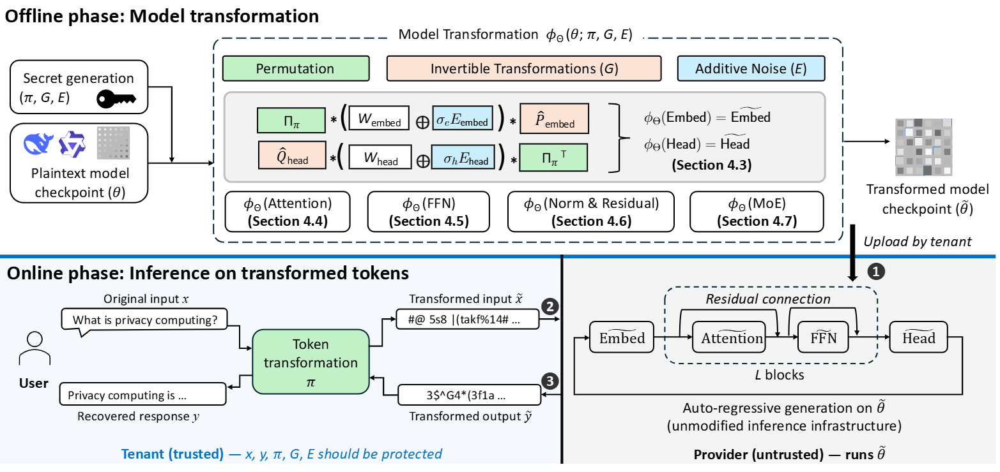

*核心图：原文 Figure 1，PDF 第 5 页。*

2. **Towards Privacy-Preserving LLM Inference via Covariant Obfuscation (Technical Report)**

- Authors: Yu Lin et al.
- Year: 2026.03（本地 v2）
- [AloePri_PDF](./Research_Interests_1_TWIST/Towards_Privacy-Preserving_LLM_Inference_via_Covariant_Obfuscation.pdf)

**研究背景**

云端大模型服务既要隐藏用户输入和输出，也要保留已有集群与推理引擎的优化。单独替换词元容易破坏语义，重型加密又增加计算成本，因此论文从模型计算与数据表示的协同关系入手，探索适合工业部署的混淆机制。

**核心方法**

提出 AloePri 协变混淆框架，将秘密词表置换与可逆线性变换同时施加到输入和模型参数。针对嵌入层、输出头、注意力与前馈网络分别设计变换，并处理残差连接的组合约束，使变换后的模型能够直接计算受保护的表示。

**工作流程**

离线生成密钥并转换模型，在线置换输入词元，云端执行标准自回归推理，客户端逆变换输出。在 DeepSeek-V3.1-Terminus 上报告准确率下降 0–3.5%，效率接近明文推理；其核心是联合重参数化，关联方向2的推理隐私。

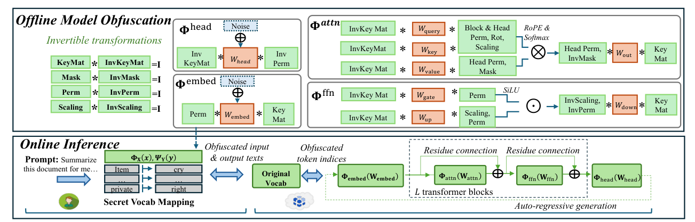

*核心图：原文 Figure 2，PDF 第 7 页。*

3. **COVERT: Privacy-Preserving Covariant Obfuscation for VLMaaS via Exact Reparameterization and Tailored Tuning**

- Authors: Wenqiang Ruan, Zirui Huang et al.
- Year: 未标注（以本地 PDF 为准）
- [COVERT_PDF](./Research_Interests_1_TWIST/COVERT_Privacy-Preserving_Covariant_Obfuscation_for_VLMaaS_via_Exact_Reparameterization_and_Tailored_Tuning.pdf)

**研究背景**

视觉语言模型的图像与文本处理结构不同，文本模型的协变混淆无法直接保护视觉编码器。即使隐藏原始图片，浅层视觉表示仍可能泄露人脸、车牌等细节，因此需要同时处理跨模态结构差异与隐藏状态反演风险。

**核心方法**

对视觉编码器实施精确重参数化，将输入变换与模型权重变换配对，文本侧结合 AloePri。进一步加入面向效用的参数调优，削弱视觉隐藏状态中的可恢复信息；单纯可逆变换与额外调优分别对应不同强度的反演攻击。

**工作流程**

客户端离线转换并调优模型，在线预处理图像与文本，云端处理受保护表示，客户端解码结果。论文报告平均准确率下降低于 3%、推理额外开销低于 6%。按核心机制归方向1，虽服务推理场景，但包含离线调优步骤。

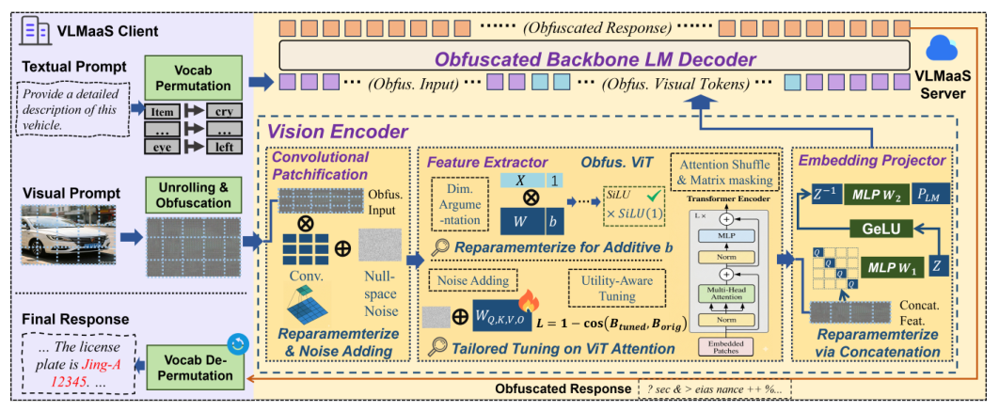

*核心图：原文 Figure 2，PDF 第 6 页。*

### 方向2 LLM 推理阶段隐私保护

1. **Split-and-Denoise: Protect Large Language Model Inference with Local Differential Privacy**

- Authors: Peihua Mai, Ran Yan et al.
- Year: 2024（ICML；本地 v4）
- [SnD_PDF](./Research_Interests_2_SnD/Split-and-Denoise_Protect_Large_Language_Model_Inference_with_Local_Differential_Privacy.pdf)

**研究背景**

嵌入服务通常要求用户上传文本，直接暴露敏感内容。客户端先加噪虽能提供本地隐私保护，却会降低云端输出表示的质量，因此论文关注如何在固定隐私预算下恢复下游任务效用，而不修改预训练语言模型的参数。

**核心方法**

将词嵌入层留在本地，对词元表示裁剪并加噪后上传。云端返回含噪输出嵌入，客户端结合原始嵌入、已知噪声与返回结果，通过预训练去噪器修正表示。隐私来自上传前的随机化，去噪器利用仅客户端掌握的信息改善效用。

**工作流程**

离线用公开语料训练去噪器，在线依次完成本地嵌入、扰动上传、云端计算与本地去噪，再用于分类等任务。相同预算下论文报告较基线平均提升超过 10%；主要面向嵌入服务，不能直接等同于完整自回归对话保护。

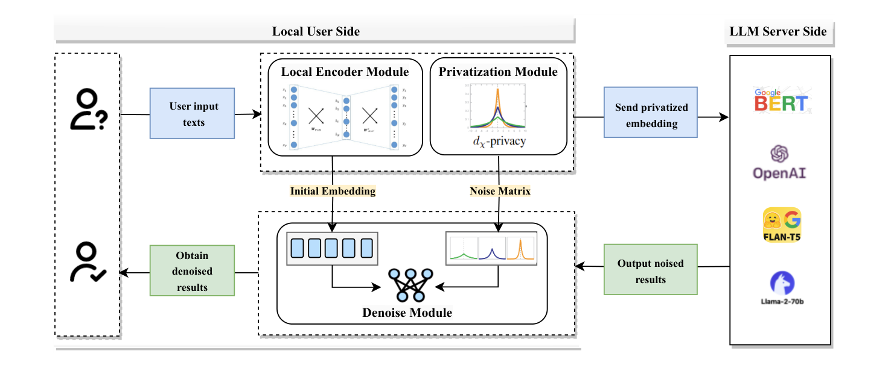

*核心图：原文 Figure 1，PDF 第 4 页。*

2. **Learning Obfuscations of LLM Embedding Sequences: Stained Glass Transform**

- Authors: Jay Roberts et al.
- Year: 2025.06
- [SGT_PDF](./Research_Interests_2_SnD/Learning_Obfuscations_of_LLM_Embedding_Sequences_Stained_Glass_Transform.pdf)

**研究背景**

在共享云基础设施上，明文提示和普通词嵌入都可能被窃取；词嵌入还可通过最近邻查询还原词元。简单遮盖敏感词容易损害语义，固定强度噪声也难兼顾任务效果，因此论文学习能够随输入序列变化的随机混淆。

**核心方法**

提出 Stained Glass Transform，根据整个嵌入序列预测噪声均值与协方差，采样后与原表示相加。训练时联合约束混淆程度与语言模型效用，并把特定变换与高斯混合模型的互信息联系起来，以估计泄漏而非只检查最近邻攻击。

**工作流程**

离线学习混淆模块，在线在客户端生成随机保护嵌入，再交给语言模型处理。论文结合词元恢复指标和标准任务评估隐私与效用。该方法保护推理输入，属于学习型表示混淆；互信息估计的条件应与实测攻击结果一并阅读。

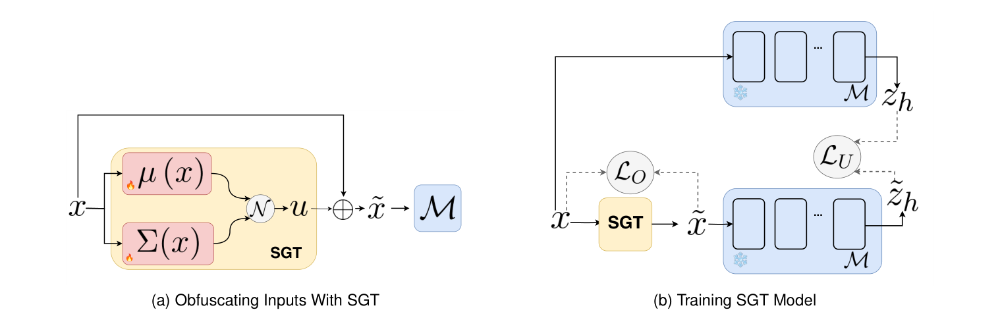

*核心图：原文 Figure 2，PDF 第 3 页。*

3. **Defense Against Prompt Inversion Attacks: An Information-Theoretic Approach for LLM Collaborative Inference**

- Authors: Sayedeh Leila Noorbakhsh et al.
- Year: 2026.06
- [Privacy_Adapters_PDF](./Research_Interests_2_SnD/Defense_Against_Prompt_Inversion_Attacks_An_Information-Theoretic_Approach_for_LLM_Collaborative_Inference.pdf)

**研究背景**

端云协同推理通过上传中间激活减轻设备负担，但攻击者可据此重建提示词。已有扰动防御缺少对泄漏与效用关系的解释，因此论文从信息论出发，研究在计算和延迟约束下压缩可恢复的输入信息，同时保留生成任务能力。

**核心方法**

在客户端冻结的 Transformer 层间插入可训练隐私适配器，以低维信息瓶颈压缩激活。通过极小极大训练抑制攻击者恢复输入，同时维持下一词预测效用，并分析瓶颈维数与重建误差的关系；不把可逆残差扰动视为充分保护。

**工作流程**

离线训练适配器与攻击器，在线由客户端压缩表示后上传，服务器继续推理。实验单独统计敏感词和普通结构词的恢复，展示隐私、效用与延迟之间的权衡。因保护目标是推理提示而归方向2，但使用前仍需要训练附加模块。

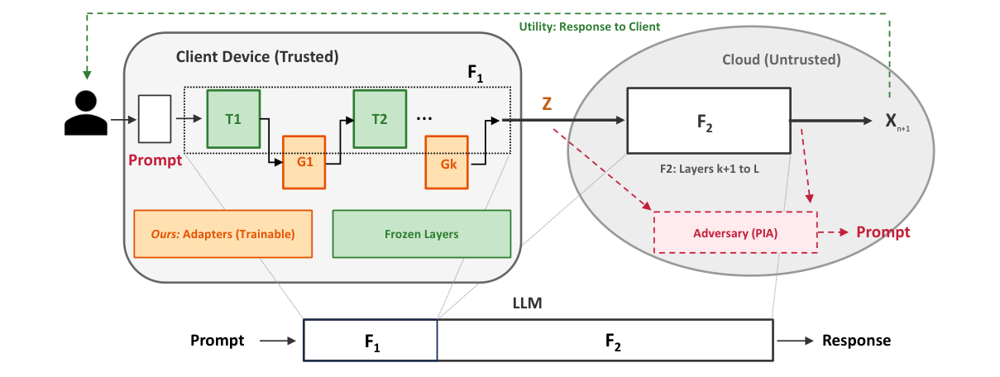

*核心图：原文 Figure 1，PDF 第 3 页。*

4. **Privacy-preserving for user-uploaded images and text in Vision–Language Models**

- Authors: Zixiang Liu et al.
- Year: 2026.04（Computers & Security）
- [VLM_Upload_Privacy_PDF](./Research_Interests_2_SnD/Privacy-preserving_for_user-uploaded_images_and_text_in_Vision-Language_Models.pdf)

**研究背景**

上传视觉语言模型的图文对常含人脸、位置等隐私。只遮盖图片或只改写文本，另一模态仍可能透露对应内容；全面遮挡又影响问答与描述任务，因此论文研究依据用户隐私指令，对图像区域与关联文本同步实施保护。

**核心方法**

借助替代模型识别文本敏感词及其对应视觉区域。图像侧对敏感区域进行分块离散余弦变换与频域处理，文本侧加入噪声并结合词性邻域约束选择替代词，从而利用跨模态对齐关系，减少遗漏及不必要的语义破坏。

**工作流程**

客户端输入保护指令，定位敏感内容并处理图文，再上传云端模型。论文在 MS-COCO、LLaVA-300K 上评估重建和属性推断，报告保护数据训练后的模型保留至少 96% 任务性能。归方向2的多模态扩展，核心在上传前的数据保护。

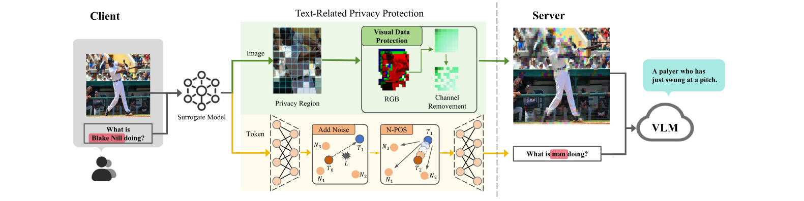

*核心图：原文 Figure 2，PDF 第 4 页。*

### 方向3 LLM 微调阶段隐私保护

1. **SplitLoRA: A Split Parameter-Efficient Fine-Tuning Framework for Large Language Models**

- Authors: Zheng Lin et al.
- Year: 2024.07（本地 v1）
- [SplitLoRA_PDF](./Research_Interests_3_LoRA/SplitLoRA_A_Split_Parameter-Efficient_Fine-Tuning_Framework_for_Large_Language_Models.pdf)

**研究背景**

联邦微调能避免集中上传私有语料，但每个客户端仍需承担大模型存储与训练负担。资源受限设备难以参与，因此论文将分割学习与低秩适配结合，把主要计算交给服务器，在保留数据本地性的同时提升协同微调效率。

**核心方法**

提出基于分割联邦学习的 SplitLoRA，将模型按层划分到客户端与服务器，并在两侧插入可训练低秩适配器。基础权重冻结，多客户端并行训练，通过交换切分处激活及其梯度完成反向传播，再聚合客户端低秩更新。

**工作流程**

客户端处理本地样本并上传激活，服务器执行后续层及梯度计算，双方更新适配器并周期聚合。实验比较达到目标精度所需时间及通信、内存开销。该工作主要贡献是高效微调框架，数据不出本地本身并不排除激活反演风险。

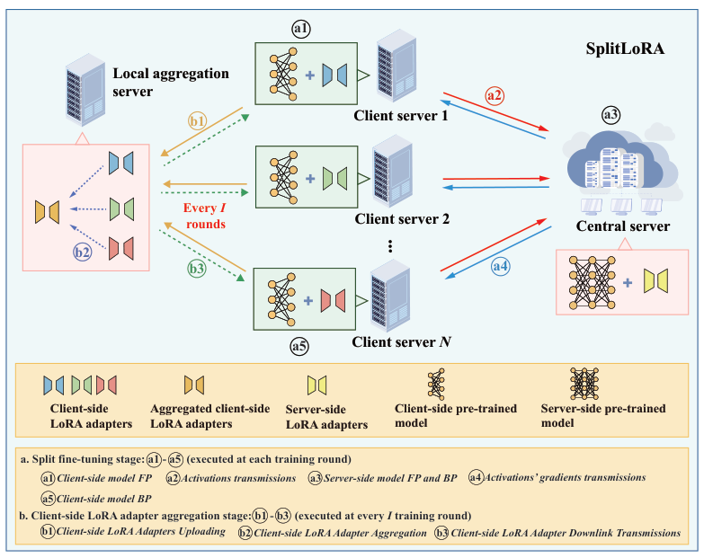

*核心图：原文 Figure 1，PDF 第 3 页。*

2. **U-SplitDoRA: an improved privacy-preserved U-shaped split parameter-efficient fine-tuning framework through weight decomposition for large language models**

- Authors: Samar Singh et al.
- Year: 2026.05（Frontiers in Artificial Intelligence）
- [U-SplitDoRA_PDF](./Research_Interests_3_LoRA/U-SplitDoRA_An_Improved_Privacy-Preserved_U-Shaped_Split_Parameter-Efficient_Fine-Tuning_Framework_Through_Weight_Decomposition_for_Large_Language_Models.pdf)

**研究背景**

常规分割微调能减轻客户端计算，但标签或输出端信息仍可能暴露；低秩适配的表达能力也存在限制。因此论文在协同训练中同时调整模型切分方式与适配方法，希望兼顾输入、标签的本地保留和资源受限条件下的适配质量。

**核心方法**

采用头部、主体、尾部三段式 U 形切分：客户端保留头尾与损失计算，服务器运行中间层。以 DoRA 替代 LoRA，将权重幅度和方向分开适配，冻结基础模型并训练相关适配参数，从而提高相同分割架构下的微调表达能力。

**工作流程**

客户端前向生成激活，服务器处理后返回，客户端计算输出与损失，再跨边界反向传播。论文在 E2E NLG、GPT-2 等设置下比较生成质量和训练耗时。保护侧重架构上的数据与标签留存，仍需结合激活、梯度泄漏评估其边界。

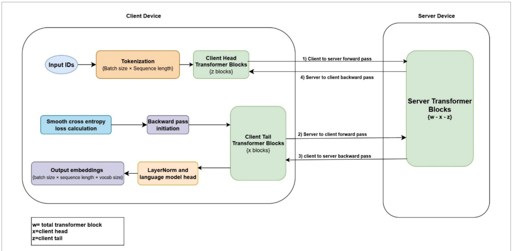

*核心图：原文 Figure 2，PDF 第 6 页。*

3. **DualGuard: A Parameter Space Transformation Approach for Bidirectional Defense in Split-Based LLM Fine-Tuning**

- Authors: Zihan Liu et al.
- Year: 2025（ACL）
- [DualGuard_PDF](./Research_Interests_3_LoRA/DualGuard_A_Parameter_Space_Transformation_Approach_for_Bidirectional_Defense_in_Split-Based_LLM_Fine-Tuning.pdf)

**研究背景**

U 形分割微调虽然把输入和标签留在本地，前向激活仍可被反演，反向梯度也可能泄露标签。仅对单个通信方向加噪难以兼顾任务性能，因此论文同时保护模型头部与尾部，研究训练过程中持续有效的双向防御。

**核心方法**

先在客户端进行局部预热，通过多任务目标把头尾模型参数移入兼顾隐私与任务效用的空间，降低前向重建和梯度匹配攻击效果。正式协同微调阶段冻结头部，并约束尾部的参数空间，防止优化过程重新恢复易攻击的表示。

**工作流程**

依次完成本地预热、分割协同训练和安全空间保持，使用多种重建攻击及下游任务评估权衡。虽然名称包含参数空间变换，其核心是微调前后的防御训练，而非等价可逆重参数化，因此归方向3，并关联方向4的双向泄漏问题。

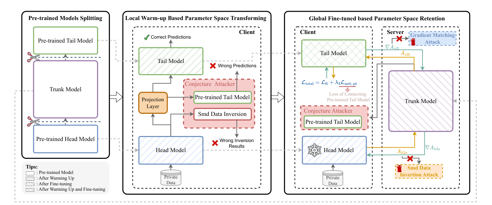

*核心图：原文 Figure 2，PDF 第 4 页。*

4. **FedSEA-LLaMA: A Secure, Efficient and Adaptive Federated Splitting Framework for Large Language Models**

- Authors: Zishuai Zhang et al.
- Year: 2026（AAAI；本地 v4）
- [FedSEA-LLaMA_PDF](./Research_Interests_3_LoRA/FedSEA-LLaMA_A_Secure_Efficient_and_Adaptive_Federated_Splitting_Framework_for_Large_Language_Models.pdf)

**研究背景**

多机构私有数据难以集中，完整联邦大模型训练又占用大量设备资源。现有分割方案还存在中间向量泄漏、逐词生成通信成本高，以及固定切分点不适应任务的问题，因此论文同时优化联邦场景中的安全、效率与划分策略。

**核心方法**

以 LLaMA2 为基础进行 U 形分割，客户端保留部分输入和输出层，服务器承担主体计算，并结合 LoRA 微调。前向隐藏状态加入高斯噪声以缓解反演；注意力掩码压缩与 KV 缓存协作减少通信，切分位置则按任务和资源条件调整。

**工作流程**

多客户端本地处理私有样本，与服务器交换受保护表示及梯度完成训练，并复用通信优化支持推理。论文在理解、摘要和问答任务上报告接近集中式模型的效果，特定设置下最高约八倍加速；具体收益取决于比较基线与配置。

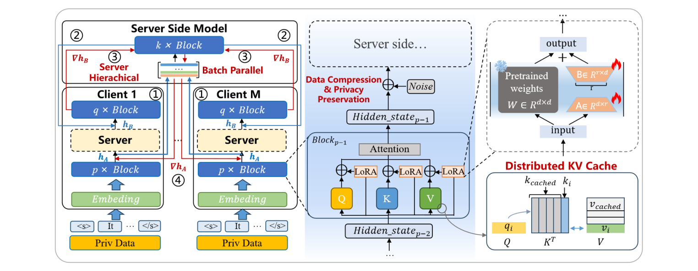

*核心图：原文 Figure 2，PDF 第 3 页。*

5. **PrivTune: Efficient and Privacy-Preserving Fine-Tuning of Large Language Models via Device-Cloud Collaboration**

- Authors: Yi Liu et al.
- Year: 2026.01（本地 v3）
- [PrivTune_PDF](./Research_Interests_3_LoRA/PrivTune_Efficient_and_Privacy-Preserving_Fine-Tuning_of_Large_Language_Models_via_Device-Cloud_Collaboration.pdf)

**研究背景**

端云分割微调保留原始语料，但上传的词元表示仍会遭遇嵌入反演与属性推断。直接增加随机噪声往往损害分类和生成性能，因此论文研究如何利用语义空间结构，将扰动定向施加到更有利于防御且较少影响任务的位置。

**核心方法**

客户端仅持有轻量底部模型，先求解扰动方向，使词元表示接近多跳间接邻居，再调整度量隐私噪声分布的均值，并按词元重要性缩放扰动。方法把语义混淆方向与噪声强度联合考虑，避免所有词元承受相同的信息破坏。

**工作流程**

本地提取表示并生成自适应噪声，上传后与云端完成协同更新。论文在五个数据集上测试嵌入反演与属性攻击，给出隐私和效用的折中结果。该机制服务微调阶段，定向噪声的经验防御表现与其形式化隐私条件需要分别理解。

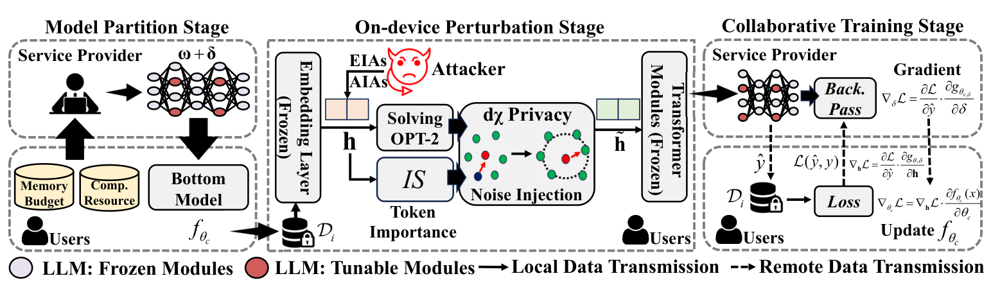

*核心图：原文 Figure 1，PDF 第 5 页。*

6. **Privacy-Preserving Split Learning for Federated LLM Fine-Tuning**

- Authors: Heng Jin et al.
- Year: 2026.09
- [PrivPair_PDF](./Research_Interests_3_LoRA/Privacy-Preserving_Split_Learning_for_Federated_LLM_Fine-Tuning.pdf)

**研究背景**

自回归训练中，标签与输入几乎是移位关系。即使采用 U 形分割，持有完整模型副本的服务器仍可能将上传激活接入解码器恢复文本，因此论文关注通用扰动防御容易忽视的直接解码路径，同时保留训练后独立部署的模型。

**核心方法**

提出 PrivPair，在客户端切分边界加入成对轻量适配器：发送前混淆表示，返回后恢复为本地尾部可用的表示。不同客户端或信任组持有不同适配器对，使服务器可见激活与其解码器不再直接兼容，训练仍能传递任务所需信息。

**工作流程**

客户端混淆后上传，服务器计算中间层，再由本地恢复并完成训练；各方聚合模型而保留私有适配器。论文评估直接解码和其他重建攻击、任务质量及设备开销。保护对象是协同微调数据，结论受服务器能力和适配器保密假设约束。

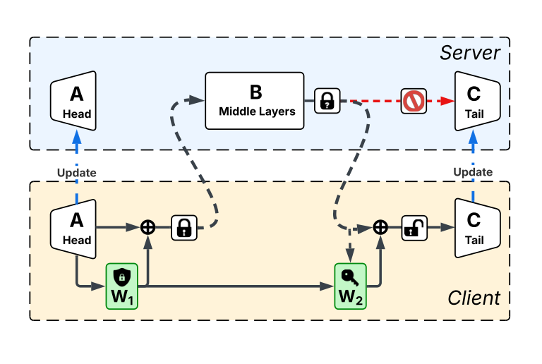

*核心图：原文 Figure 3，PDF 第 4 页。*

### 方向4 攻击方向

1. **From Prompts to Responses: Dual-Sided Data Leakage and Defense in Split Large Language Models**

- Authors: Zixuan Gu et al.
- Year: 2026（ICML）
- [PIDI_ADMI_PDF](./Research_Interests_4_Attack/From_Prompts_to_Responses_Dual-Sided_Data_Leakage_and_Defense_in_Split_Large_Language_Models.pdf)

**研究背景**

分割大模型的泄漏研究多关注输入提示，却较少分析生成回复。头尾均留在客户端也不代表双侧内容安全，尤其长序列会扩大攻击优化难度，因此论文系统研究如何同时恢复提示和响应，并验证双侧防御的必要性。

**核心方法**

提出 PIDI，两阶段结合双侧初始化与分块模型反演：先利用两端泄漏构造候选，再分块优化长序列重建。配套防御 ADMI 采用适配器本地预热和互信息正则，约束两端表示的可恢复性；它与另一篇 DualGuard 是不同论文的方法。

**工作流程**

攻击者收集切分通信中的信息，初始化提示与回复候选，再迭代对齐模型表示。实验比较不同长度、模型和任务上的双侧重建，并评估 ADMI 的防御与效用。按主要攻击贡献归方向4，防御部分同时关联方向3的隐私微调。

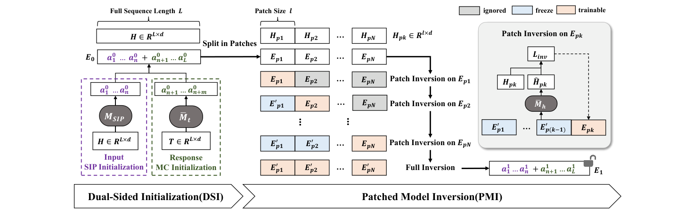

*核心图：原文 Figure 2，PDF 第 4 页。*

2. **Inverting the Hidden: Unveiling Multimodal Privacy Leakage in Collaborative LVLM Inference**

- Authors: Shuaifan Jin et al.
- Year: 2026.08
- [RASR_PDF](./Research_Interests_4_Attack/Inverting_the_Hidden_Unveiling_Multimodal_Privacy_Leakage_in_Collaborative_LVLM_Inference.pdf)

**研究背景**

视觉语言模型协同推理只上传隐藏状态，但视觉特征经过跨模态投影和深层计算后是否仍泄露隐私并不清楚。论文针对“深层表示天然安全”的直觉，分析视觉语义的可恢复条件，并研究图像与文本的联合重建风险。

**核心方法**

提出由粗到细的 RASR 攻击，按模态分别逆向追踪视觉编码、投影和文本处理路径，生成初始图像与文本，再利用隐藏状态一致性细化两种重建。理论分析在一定正则性和语义间隔条件下，说明隐私相关视觉语义仍可识别。

**工作流程**

攻击者获得切分层隐藏状态，先进行分模态初始化，再迭代匹配前向表示。论文在 Qwen3-VL 和 LLaVA 上评估，报告相较强基线图像均方误差约降低一半，文本恢复率最高达 99%；结果对应论文中的模型、数据与攻击设置。

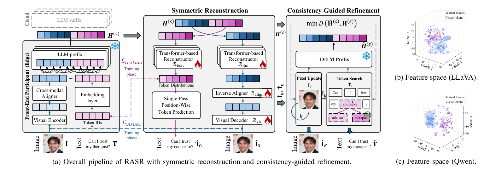

*核心图：原文 Figure 2，PDF 第 5 页。*

### 方向5 其他

1. **A Survey on Split Learning for LLM Fine-Tuning: Models, Systems, and Privacy Optimizations**

- Authors: Zihan Liu et al.
- Year: 2026.04（本地预印本）
- [SplitLLM_Survey_PDF](./Research_Interests_5_Others/A_Survey_on_Split_Learning_for_LLM_Fine-Tuning_Models_Systems_and_Privacy_Optimizations.pdf)

**研究背景**

面向大模型的分割微调研究同时涉及训练精度、系统效率与隐私攻防，单看模型切分方式难以比较不同工作。论文围绕资源受限客户端与云端协作，建立统一分析框架，帮助定位方法究竟改变训练流程中的哪个环节。

**核心方法**

从统一训练流水线出发，按模型优化、系统优化、隐私保护三个维度组织文献。模型侧关注数据异质性与更新失衡，系统侧讨论通信、调度和慢节点，隐私侧梳理激活反演、梯度泄漏等攻击及防御，并比较不同协同和聚合机制。

**工作流程**

先理解普通与 U 形分割，再沿具体训练组件查阅对应优化和攻防方案，最后比较尚未解决的问题。该文是阅读地图与分类依据，不是单一保护算法；归方向5，同时可辅助理解方向3和方向4。首页 ACM 模板年份不作出版年份使用。

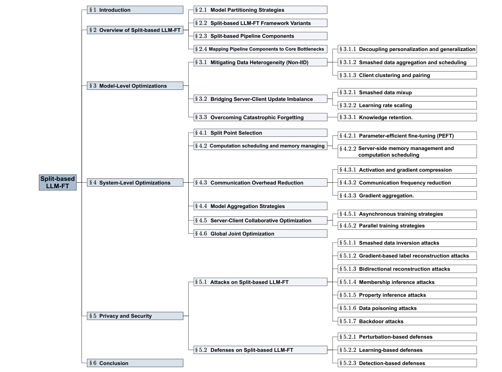

*核心图：原文 Figure 1，PDF 第 4 页。*

2. **FedAdOb: Privacy-Preserving Federated Deep Learning with Adaptive Obfuscation**

- Authors: Hanlin Gu et al.
- Year: 2024.06（本地 v1）
- [FedAdOb_PDF](./Research_Interests_5_Others/FedAdOb_Privacy-Preserving_Federated_Deep_Learning_with_Adaptive_Obfuscation.pdf)

**研究背景**

联邦学习虽然不上传原始样本，模型更新和中间特征仍可能泄露数据或标签。固定噪声与固定混淆通常损害模型精度，因此论文研究让混淆机制参与学习，随模型训练自适应调整，以改善隐私保护与任务性能之间的关系。

**核心方法**

通过秘密 passport 在网络层中产生与参数相关的缩放和平移，形成可训练的自适应混淆。框架同时覆盖横向联邦学习中的模型更新泄漏与纵向联邦学习中的特征、标签推断，并结合相应攻击能力给出理论分析和实验比较。

**工作流程**

参与方本地生成并持有 passport，在训练与联邦交互中应用混淆，评估任务精度及重建误差。该工作主要针对通用神经网络，并非专门设计给 LLM 的微调协议，因此归方向5；其学习型混淆思想可作为方向3的背景参考。

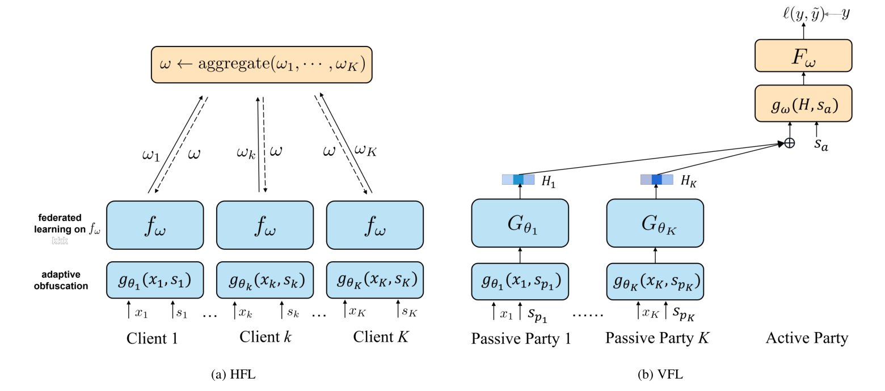

*核心图：原文 Figure 2，PDF 第 5 页。*

3. **Private Release of Text Embedding Vectors**

- Authors: Oluwaseyi Feyisetan, Shiva Kasiviswanathan
- Year: 2021（TrustNLP）
- [Private_Embedding_PDF](./Research_Interests_5_Others/Private_Release_of_Text_Embedding_Vectors.pdf)

**研究背景**

词向量携带语义信息，发布后仍可能暴露原始文本。直接在高维嵌入空间加入强噪声会扭曲距离并损害下游任务，因此论文研究如何在提供形式化隐私保证的同时，更好保留向量之间的几何关系，改善数据发布的实际可用性。

**核心方法**

先用随机投影降低嵌入维度，再在低维空间添加校准噪声，构造满足度量空间差分隐私扩展的向量发布机制。论文分析原始与私有向量之间距离、内积的近似误差，并说明投影维数、隐私参数及噪声尺度之间的效用关系。

**工作流程**

数据持有者本地完成投影与加噪，再发布私有向量供下游模型使用。实验在 GloVe、FastText 等嵌入及文本任务上比较距离保持与预测效果。该文属于基础表示隐私，而非现代生成式 LLM 的完整推理协议，因此归方向5并关联方向2。

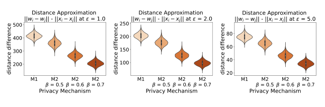

*核心图：原文 Figure 1，PDF 第 7 页。*

4. **Privacy preservation in federated learning: An insightful survey from the GDPR perspective**

- Authors: Nguyen Truong et al.
- Year: 2021（Computers & Security）
- [FL_GDPR_Survey_PDF](./Research_Interests_5_Others/Privacy_Preservation_in_Federated_Learning_An_Insightful_Survey_from_the_GDPR_Perspective.pdf)

**研究背景**

联邦学习将数据留在本地，但交换的参数仍可能携带个人信息，因此数据不集中并不自动消除泄漏风险。论文结合当时的数据保护要求审视联邦系统，强调需要同时分析参与方角色、模型交互过程与用户隐私权利的落实。

**核心方法**

综述模型反演、成员推断、投毒等威胁，以及差分隐私、安全多方计算、同态加密和安全聚合等技术。把服务器、通信链路与参与方视为不同风险来源，再讨论技术机制与数据保护原则、责任分配和系统治理之间的对应关系。

**工作流程**

先建立联邦训练与威胁模型，再按保护目标选择机制，最后检查系统与治理层面的缺口。该文提供通用背景和研究视角，不提出专门面向 LLM 的训练算法；归方向5，其法规讨论反映 2021 年论文语境，不能代替当前要求的核查。

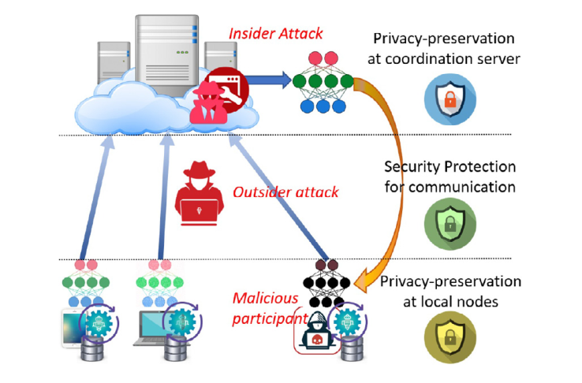

*核心图：原文 Figure 5，PDF 第 11 页。*
