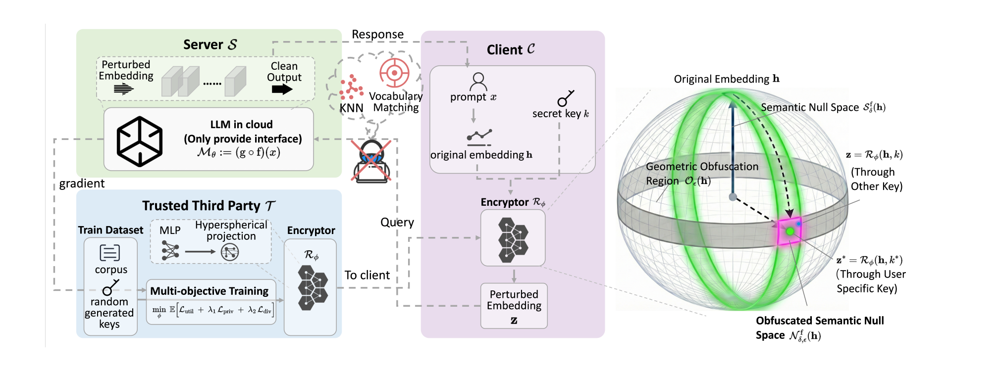

# 大模型隐私保护论文分类

新增：[攻击方法调研：分类、详细实现与数学公式](4_Attack/ATTACK_METHODS_zh.md) · [论文与代码索引](4_Attack/ATTACK_PAPERS_AND_CODE.md) · [NumPy 基础实现](4_Attack/attack_baselines_numpy.py)。从 TWIST、SnD、SGT、DualGuard 等的攻击评测与参考文献追溯，原有 PDF 分类及计数保持如下。

按当前本地 **20 篇不同论文**整理，跨方向保留相同 PDF 的实体副本，共 **24 份 PDF**。每篇只在下文完整概括一次，交叉目录提供跳转。分类以本地版本正文的方法、传输对象和训练设置为依据。

## 分类口径

| 目录 | 判断依据 | PDF 数量（含交叉） |
|---|---|---:|
| `1_Prompt` | 最终上传经替换、脱敏或改写的文字/token；当前收录的是图文联合保护论文的文本部分。 | 1 |
| `2_Embedding/Inference` | 保护嵌入或中间表示；原目标模型冻结，不需任务微调。允许离线训练独立混淆器、去噪器或少量新增隐私模块。 | 5 |
| `2_Embedding/Training` | 通过原模型首尾/视觉模块的训练，或 LoRA/DoRA 任务微调，形成保护或适配受保护表示；也收录相应分割微调基础框架。 | 8 |
| `3_Model` | 数据/token 与模型权重配套变换，如协变混淆、重参数化；单纯“有训练”不属于这一类。 | 3 |
| `4_Attack` | 提出隐私重建或泄露攻击；同时提出防御时交叉收录。 | 2 |
| `5_Others` | 综述、通用联邦学习、多模态图像保护及相关基础工作。 | 5 |

**Inference 不等于“完全不训练”**：SnD、SGT、OSNIP、Privacy Adapters 都可训练额外保护模块，但原 LLM 保持冻结。相反，LoRA/DoRA 虽冻结基座权重，仍会改变任务模型的有效权重，归入 Training。不能只按标题里的 inference、training 或 parameter transformation 分类。

当前没有独立的 SanText、CusText、DP-forward PDF，未额外下载或补造条目。图均裁自对应本地原文，PRIVEMB 使用原文算法截图；页码按 PDF 文件从 1 开始计。详细证据见[逐篇分类依据](research_notes/PAPER_CLASSIFICATION.md)。

## 交叉收录

| 论文 | 同时存放的位置 | 原因 |
|---|---|---|
| COVERT | `3_Model`、`2_Embedding/Training` | 既有模型联合重参数化，也微调原视觉编码器以保护隐藏表示。 |
| PIDI / ADMI | `4_Attack`、`2_Embedding/Training` | 同时提出 PIDI 攻击和 ADMI 训练式防御。 |
| VLM 图文上传保护 | `1_Prompt`、`5_Others` | 文本替换与图像频域保护相结合；云端需要微调适配。 |
| PRIVEMB | `2_Embedding/Inference`、`5_Others` | 无需微调的嵌入发布机制，同时是通用文本向量基础工作。 |

## 1_Prompt：文本层保护

### VLM 图文上传保护

[Privacy-preserving for user-uploaded images and text in Vision-Language Models](1_Prompt/Privacy-preserving_for_user-uploaded_images_and_text_in_Vision-Language_Models.pdf)

- **背景**：图像与文字相互对齐，只保护一种模态仍可能通过另一种模态泄露敏感内容。
- **方法**：本地代理 VLM 根据敏感词定位图像区域，用 BDCT 频域处理保护图片；文本在嵌入空间加噪并受同词性邻居约束，再检索成替换词。云端最后的视觉层和 LLM 层需微调适配。

*配图：原文图 2，PDF 第 4 页。*

## 2_Embedding / Inference：冻结原模型的表示保护

### SnD

[Split-and-Denoise Protect Large Language Model Inference with Local Differential Privacy](2_Embedding/Inference/Split-and-Denoise_Protect_Large_Language_Model_Inference_with_Local_Differential_Privacy.pdf)

- **背景**：Embedding-as-a-Service 需要把用户输入交给云端，直接传输文本存在隐私风险。
- **方法**：把词嵌入层留在本地，在上传嵌入前加入满足度量本地差分隐私的噪声；云端返回输出嵌入后，客户端借助本地扰动信息和独立去噪器恢复下游效用。

*配图：原文图 1，PDF 第 4 页。*

### SGT

[Learning Obfuscations of LLM Embedding Sequences Stained Glass Transform](2_Embedding/Inference/Learning_Obfuscations_of_LLM_Embedding_Sequences_Stained_Glass_Transform.pdf)

- **背景**：共享计算或 MaaS 中直接上传文本与词嵌入，会泄露企业的敏感输入。
- **方法**：学习依赖整个序列的随机变换，根据输入预测高斯分布的均值和协方差，采样得到受保护嵌入，并用隐私目标与输出效用损失训练独立 SGT。

*配图：原文图 2，PDF 第 3 页。*

### OSNIP

[OSNIP Balancing the Privacy-Utility-Efficiency Trilemma in LLM Inference via Obfuscated Semantic Null Space](2_Embedding/Inference/OSNIP_Balancing_the_Privacy-Utility-Efficiency_Trilemma_in_LLM_Inference_via_Obfuscated_Semantic_Null_Space.pdf)

- **背景**：大模型推理的表示保护需要同时控制反演风险、效用损失和客户端开销。
- **方法**：训练密钥条件化的混淆器，使上传表示接近原嵌入的几何正交方向，同时保持任务语义；用不同密钥产生随机化表示，服务器直接推理，无需客户端去噪。

*配图：原文图 1，PDF 第 5 页。*

### Privacy Adapters

[Defense Against Prompt Inversion Attacks An Information-Theoretic Approach for LLM Collaborative Inference](2_Embedding/Inference/Defense_Against_Prompt_Inversion_Attacks_An_Information-Theoretic_Approach_for_LLM_Collaborative_Inference.pdf)

- **背景**：端云协同推理上传的中间激活可被用来恢复 prompt，单纯扰动缺少明确的信息压缩机制。
- **方法**：在客户端冻结的 Transformer 层之间插入无残差低维瓶颈，交替训练隐私适配器与攻击器，在降低 token 可恢复性和保持后续预测效用之间权衡。

*配图：原文图 1，PDF 第 3 页。*

### PRIVEMB

[Private Release of Text Embedding Vectors](2_Embedding/Inference/Private_Release_of_Text_Embedding_Vectors.pdf)

- **背景**：直接在高维文本嵌入上加隐私噪声，会因维度较高而明显损害效用。
- **方法**：先用随机投影降维，再在低维空间加入校准噪声，发布满足度量隐私的向量，并分析距离、内积和线性任务的效用。无需微调原嵌入模型。

*配图：原文算法 1，PDF 第 5 页。*

## 2_Embedding / Training：训练或微调参与保护

本目录还收录 [COVERT](#paper-01) 和 [PIDI / ADMI](#paper-15) 的相同 PDF；完整概括见对应条目。SplitLoRA、U-SplitDoRA 标为基础框架，切分本身不构成抗反演保证。

### PrivPair

[Privacy-Preserving Split Learning for Federated LLM Fine-Tuning](2_Embedding/Training/Privacy-Preserving_Split_Learning_for_Federated_LLM_Fine-Tuning.pdf)

- **背景**：自回归训练的标签与输入高度重合，服务器可能利用已有尾部模型从传输表示还原私有文本。
- **方法**：客户端使用成对的混淆与恢复适配器，让服务器在混淆空间计算，再利用留在本地的扰动残差恢复表示；结合 STE 将适配器行为与主模型训练路径解耦。

*配图：原文图 3，PDF 第 4 页。*

### DualGuard

[DualGuard A Parameter Space Transformation Approach for Bidirectional Defense in Split-Based LLM Fine-Tuning](2_Embedding/Training/DualGuard_A_Parameter_Space_Transformation_Approach_for_Bidirectional_Defense_in_Split-Based_LLM_Fine-Tuning.pdf)

- **背景**：分割微调后的首尾模型与公开预训练模型过于接近，攻击者可利用激活和梯度重建私有文本。
- **方法**：先在本地用轻量投影连接首尾，联合优化任务与抗反演目标；正式微调时冻结已预热的头部，并约束尾部，防止回到容易被预训练模型补全的表示空间。

*配图：原文图 2，PDF 第 4 页。*

### PrivTune

[PrivTune Efficient and Privacy-Preserving Fine-Tuning of Large Language Models via Device-Cloud Collaboration](2_Embedding/Training/PrivTune_Efficient_and_Privacy-Preserving_Fine-Tuning_of_Large_Language_Models_via_Device-Cloud_Collaboration.pdf)

- **背景**：设备与云端协作微调时，简单噪声容易造成隐私与任务效用之间的明显冲突。
- **方法**：先优化 token 表示的扰动方向，使其接近间接邻居；再调整随机噪声分布并按 token 重要性缩放扰动，让云端通过 LoRA 在受保护表示上微调。

*配图：原文图 1，PDF 第 5 页。*

### FedSEA-LLaMA

[FedSEA-LLaMA A Secure Efficient and Adaptive Federated Splitting Framework for Large Language Models](2_Embedding/Training/FedSEA-LLaMA_A_Secure_Efficient_and_Adaptive_Federated_Splitting_Framework_for_Large_Language_Models.pdf)

- **背景**：联邦分割 LLM 面临中间表示泄露、逐 token 通信开销和固定切分点不灵活的问题。
- **方法**：在客户端前向隐藏状态加入高斯噪声，并结合 LoRA 微调、可调切分点、注意力掩码压缩和端云 KV cache 协作，提高训练及后续推理效率。

*配图：原文图 2，PDF 第 3 页。*

### SplitLoRA（基础框架）

[SplitLoRA A Split Parameter-Efficient Fine-Tuning Framework for Large Language Models](2_Embedding/Training/SplitLoRA_A_Split_Parameter-Efficient_Fine-Tuning_Framework_for_Large_Language_Models.pdf)

- **背景**：联邦微调大模型的客户端计算和通信负担较重，难以直接在分散私有数据上协同训练。
- **方法**：结合分割学习、联邦并行训练与 LoRA，让客户端和服务器分担计算，并聚合客户端低秩适配器。它主要提供微调框架，没有专门的表示混淆防线。

*配图：原文图 1，PDF 第 3 页。*

### U-SplitDoRA（基础框架）

[U-SplitDoRA An Improved Privacy-Preserved U-Shaped Split Parameter-Efficient Fine-Tuning Framework Through Weight Decomposition for Large Language Models](2_Embedding/Training/U-SplitDoRA_An_Improved_Privacy-Preserved_U-Shaped_Split_Parameter-Efficient_Fine-Tuning_Framework_Through_Weight_Decomposition_for_Large_Language_Models.pdf)

- **背景**：普通分割微调可能暴露输出端数据，LoRA 对权重变化的表达能力也有限。
- **方法**：将模型首尾留在客户端、中间层放在服务器，采用 DoRA 分别学习权重幅值与低秩方向更新。核心是 U 形切分与参数高效微调，不能直接视为防反演证明。

*配图：原文图 2，PDF 第 6 页。*

## 3_Model：模型与数据联合变换

### TWIST

[TWIST Private Tenant-Dedicated LLM Serving via Joint Model-Token Transformation](3_Model/TWIST_Private_Tenant-Dedicated_LLM_Serving_via_Joint_Model-Token_Transformation.pdf)

- **背景**：租户自带开放权重模型部署在专用云实例时，服务方仍能接触租户的 prompt 和生成结果。
- **方法**：离线结合 token 置换、可逆权重变换和参数噪声，在线使用配套的随机 token 变换；在保持模型结构兼容的同时，以 RmDP 分析泄露。

*配图：原文图 1，PDF 第 5 页。*

### AloePri

[Towards Privacy-Preserving LLM Inference via Covariant Obfuscation](3_Model/Towards_Privacy-Preserving_LLM_Inference_via_Covariant_Obfuscation.pdf)

- **背景**：云端大模型需要同时保护输入与输出，并尽量兼容现有推理硬件和服务引擎。
- **方法**：通过协变混淆联合变换 token、Embedding、Attention、FFN 等模块的权重，使云端能在变换后的模型上处理混淆输入，客户端再还原输出。

*配图：原文图 2，PDF 第 7 页。*

### COVERT

[COVERT Privacy-Preserving Covariant Obfuscation for VLMaaS via Exact Reparameterization and Tailored Tuning](3_Model/COVERT_Privacy-Preserving_Covariant_Obfuscation_for_VLMaaS_via_Exact_Reparameterization_and_Tailored_Tuning.pdf)

- **背景**：协变混淆在文本 LLM 上可用，但视觉编码器的结构差异与空间先验仍会暴露图像隐私。
- **方法**：为视觉卷积、ViT 和投影模块设计精确重参数化，并结合零空间扰动；对首个 ViT 块的注意力参数加噪后做效用对齐微调，降低隐藏状态反演风险。

*配图：原文图 2，PDF 第 6 页。*

## 4_Attack：隐私攻击

### PIDI / ADMI

[From Prompts to Responses Dual-Sided Data Leakage and Defense in Split Large Language Models](4_Attack/From_Prompts_to_Responses_Dual-Sided_Data_Leakage_and_Defense_in_Split_Large_Language_Models.pdf)

- **背景**：分割 LLM 的私有 prompt 与生成响应可能从两端同时泄露，长序列反演也更复杂。
- **方法**：攻击 PIDI 将双侧初始化与分块反演结合，联合恢复输入和响应；防御 ADMI 用本地适配器预热、随机信息瓶颈和尾部距离约束，再进行整体微调。

*配图：原文图 3，PDF 第 5 页。*

### RASR

[Inverting the Hidden Unveiling Multimodal Privacy Leakage in Collaborative LVLM Inference](4_Attack/Inverting_the_Hidden_Unveiling_Multimodal_Privacy_Leakage_in_Collaborative_LVLM_Inference.pdf)

- **背景**：视觉语言模型协同推理时，即使不传原图和原文，中间隐藏状态也可能保留可恢复的隐私。
- **方法**：提出由粗到细的图文重建攻击：先沿两种模态的前向路径构建对应逆向重建分支，再利用隐藏状态一致性修正文本和图像。

*配图：原文图 2，PDF 第 5 页。*

## 5_Others：综述与相关基础工作

本目录还交叉收录 [VLM 图文上传保护](#paper-13) 和 [PRIVEMB](#paper-20)。综述的“方法”栏概括其梳理框架，不表示提出了新的保护算法。

### Split LLM 微调综述（综述）

[A Survey on Split Learning for LLM Fine-Tuning Models Systems and Privacy Optimizations](5_Others/A_Survey_on_Split_Learning_for_LLM_Fine-Tuning_Models_Systems_and_Privacy_Optimizations.pdf)

- **背景**：分割 LLM 微调的模型、系统与隐私研究较分散，难以统一对比。
- **方法**：贡献是综述分类框架：将统一训练流水线与模型优化、系统效率、隐私攻防对应起来，梳理各环节的瓶颈及已有工作；没有提出单一新防御算法。

*配图：原文图 1，PDF 第 4 页。*

### FedAdOb

[FedAdOb Privacy-Preserving Federated Deep Learning with Adaptive Obfuscation](5_Others/FedAdOb_Privacy-Preserving_Federated_Deep_Learning_with_Adaptive_Obfuscation.pdf)

- **背景**：联邦学习使用固定数据或梯度混淆时，常需要以较大效用损失换取隐私。
- **方法**：在网络中嵌入私有 passport，让混淆层随模型训练自适应调整，并分别应用于横向和纵向联邦学习，保护特征及标签。

*配图：原文图 2，PDF 第 5 页。*

### FL 隐私与 GDPR 综述（综述）

[Privacy Preservation in Federated Learning An Insightful Survey from the GDPR Perspective](5_Others/Privacy_Preservation_in_Federated_Learning_An_Insightful_Survey_from_the_GDPR_Perspective.pdf)

- **背景**：联邦学习虽然保留原始数据在本地，交换的模型更新仍可能泄露隐私，不能自动满足数据保护要求。
- **方法**：从论文所讨论的 GDPR 视角梳理联邦学习威胁，以及安全聚合、差分隐私等保护技术与合规问题。它是一篇历史综述，没有单独的新 LLM 保护算法。

*配图：原文图 5，PDF 第 11 页。*
