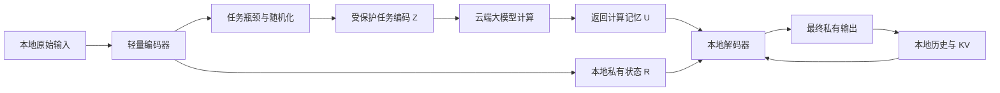

# 面向端—云—端大语言模型推理的隐私保护：研究判断与方案草案

调研日期：2026-11-06。约束：消费级 GPU、单个不可信服务器，优先平衡安全、质量和时延，允许离线训练辅助模块。

这是文献分析和待验证的研究方案，不是已经获得实验支持的新算法。已盘点本地 20 篇 PDF（合计 371 页），重点阅读直接相关工作的机制、威胁模型、关键证明和攻击设置；没有复现它们全部实验，也不声称逐页审校全部论文。README 写的是 19 篇，未列入已经存在的 OSNIP。正文提到的性能数字不跨论文直接排名。

**建议的研究主线：学习“哪些信息可以上传、哪些信息必须留在本地、什么时候需要再次上传”，而不仅是学习一种新的混淆变换。**

具体建议做“私有状态辅助的会话级瓶颈推理”：客户端保留输入细节和真实生成历史，云端处理受保护的任务表示；以完整交互记录而非单个激活作为攻击对象。先用普通 U 形切分验证局部机制，再研究少次交互、私有输出不回流的推理协议。更有机制创新潜力的扩展是“云端提供低秩响应基，客户端用秘密系数恢复私有计算”，见后文。

## 1. 先把问题界定正确

这里保护的是**推理时用户输入和输出的机密性**，不是主要保护预训练数据成员关系，也不是主要保护模型版权。DP-SGD 防训练数据记忆、TLS 防链路窃听，均不能单独解决诚实但好奇的推理服务器读取激活的问题。

建议分开报告三种保护目标：

1. 精确文本保护：不能恢复原始 token、数值、代码、姓名和输出措辞。
2. 敏感语义保护：不能推断疾病、身份、公司项目、行为意图等指定秘密。
3. 全输入保护：整个 prompt 在指定邻接关系下受到形式化保护。

三者不能混用。把姓名换成代号仍可能泄露疾病；逐 token 恢复率很低也可能完整暴露商业意图。只保护敏感字段的邻接关系不能写成“隐藏整个输入”。

主威胁模型应让服务器知道公开基础模型、算法和训练方法，看到服务器权重、全部入站/出站表示、中间层、KV cache、路由、长度与时序，并能长期保存日志和离线训练攻击器。客户端设备可信。分别设置未知客户端权重、已知客户端权重、少量同部署配对样本、跨会话数据四档能力；不能把攻击器是否得到真实明文—保护表示配对数据含糊带过。

主动修改服务器返回值是更强威胁。初稿可以先不宣称抵抗主动服务器，但必须说明：传输认证不能防止合法服务器作恶，随机挑战也不自动构成完整计算验证。训练阶段如果上传私有数据梯度，还需单独保护；最小原型先用公开/合成数据离线训练。

记服务器完整视图为

\[
V_T=(\theta_{\rm server},Z_{0:T},U_{0:T},KV_{0:T},\text{metadata},\text{history}).
\]

安全评估面对的是这个联合对象，而不是仅对某一层的一个向量做最近邻查询。

## 2. 三类方法的底层机制，以及分类需要修正的地方

### 2.1 联合变换：利用神经网络的重参数化对称性

用行向量约定，线性层为 \(y=hW\)。设 \(h'=hP\)，则选择

\[
W'=P^{-1}WQ,\qquad y'=h'W'=yQ.
\]

这说明相邻变换可以抵消，原任务可以在新坐标中计算。Transformer 难点在于逐元素非线性、RMSNorm/LayerNorm、残差、RoPE、GQA/MQA 和 MoE 路由并不允许任意矩阵自由穿过。注意力中 \(Q'=QA,K'=KA^{-T}\) 保持 \(QK^T\)，但 RoPE 仍增加相容约束；这只是代数示例，不是完整 TWIST 实现。

TWIST/AloePri 的工程价值是按模块设计可组合变换，尽量保留推理引擎。TWIST 还加入离线参数噪声和在线随机 token 机制，不能简化成“一个可逆矩阵加密”。本地 TWIST 第 3、8–9、13 页尤其关键：公开原模型是攻击者辅助信息；RmDP 使用与一致 token 重命名相关的距离；不同长度或相等模式的序列距离为无穷；形式化分析从空请求历史开始，长期频率/共现泄漏另行讨论。第 9 页也明确默认形式界较松，实用保护主要依赖攻击实验。

可逆性本身只保证正确性。若变换已知且可逆，则 \(I(X;T(H))=I(X;H)\)。秘密变换可能增加攻击难度，但服务器见到的变换后权重也必须纳入分析。正交变换还保留 Gram 矩阵，固定词表置换保留相等模式和频率；“密钥排列数量巨大”不能代替安全论证。[TWIST 官方研究记录](https://scholars.cityu.edu.hk/en/publications/twist-private-tenant-dedicated-llm-serving-via-joint-model-token-/)、[EDNN](https://aclanthology.org/2024.emnlp-main.126/)、[ObfusLM](https://aclanthology.org/2025.acl-long.58/)。

**可借鉴：**与现有计算结构相容、离线处理摊销、完整服务器视图。**不宜作为唯一新贡献：**再叠加旋转、置换或动态密钥；每次换密钥若引起整套权重和 KV 重编码，开销还需单独计算。

### 2.2 DualGuard：训练改变客户端表示和可解码关系

DualGuard 不是主要通过改变网络拓扑保护隐私，也不是严格等价的坐标变换。它先以本地轻量投影连接头尾，联合优化任务、反演抵抗和预训练尾部失效；协同微调时冻结头部，并约束尾部，防止回到容易被公开模型补全的表示空间。

它针对的核心问题是“微调后模型离公开基础模型不够远”：攻击者可以用公开 head 近似反演、用公开 tail 接在服务器输出后猜测标签/响应。论文的双向性同时涉及前向激活和反向梯度；你的推理目标没有梯度，却仍有真实生成 token 回流。[DualGuard，ACL 2025](https://aclanthology.org/2025.acl-long.835/)。

“参数距离大”与“信息少”也不同。坐标置换可以让参数距离很大而函数相同；固定攻击器失效后，重新训练的攻击器仍可能恢复。因此必须做防御感知的自适应攻击，不能只评测旧 SIP 或旧 tail。

### 2.3 SnD：效用来自客户端独有的侧信息

SnD 不是一般意义上的“在传输中加 adapter”。它在本地词嵌入上随机化，云端计算后，本地去噪器使用被扰动表示、具体扰动和返回嵌入改善效用。正文机制是径向 Laplace 噪声，密度与 \(\exp(-\eta\|z\|_2)\) 成正比；随后裁剪含噪表示。裁剪界作为公共固定参数时，裁剪是后处理。

重要的是：客户端知道 \(\widetilde H\) 和 \(N\)，所以拥有服务器没有的 \(H=\widetilde H-N\)。它没有凭空突破隐私—效用约束，而是利用双方信息不对称。主要实验是嵌入服务与下游任务，不能直接当作完整聊天推理保证。[SnD，ICML 2024](https://proceedings.mlr.press/v235/mai24a.html)。

更合适的分类是两个维度：**机制**（代数变换、学习型随机化/瓶颈、DP、密码学/可信硬件）与**保护位置**（输入、输出、梯度、缓存、完整会话）。Adapter 只是实现形式，既可执行混淆，也可执行真正有损编码。

### 2.4 已有近邻工作：不能把哪些组合再说成首创

| 工作 | 与本任务有关的已有贡献 | 新方案必须进一步回答的问题 |
|---|---|---|
| SGT | 学习序列相关高斯均值/协方差，保持固定模型效用 | 保留语义和输出后，还能隐藏多少敏感信息？ |
| OSNIP | 学习几何近正交、语义近不变的表示，使用 key-conditioned 随机化 | 几何失配能否抵抗重新训练的语义解码器及输出反推？ |
| Privacy Adapters | 无残差低维瓶颈、攻击器对抗训练 | 逐位置度量是否覆盖联合序列、输出和全部交互？ |
| ADMI / PIDI | 双侧攻击，适配器预热、随机信息瓶颈和尾部防御 | 不能把“双端 adapter + MI”称为新结构 |
| PrivPair | 本地混淆/恢复适配器，恢复器使用保留在本地的扰动残差 | “私有残差辅助恢复”本身也已有先例 |
| NOIR | 首尾留本地、随机词表/本地 tokenizer，保护 prompt 和生成代码 | 需比较真实生成协议和完整会话，而非只比较词表扰动 |
| PAPILLON | 本地模型委托云端再整合答案 | 本地私有整合也不是新思想，必须超越文本脱敏流水线 |
| PrivacyRestore | 删除敏感跨度，上传受保护恢复向量并在云端恢复效用 | 本地恢复和云端恢复的信任边界不同 |
| DEL | 投影、DP 随机量化、服务器 soft prompt | 低比特通信和量化本身不能算新贡献 |
| DP-MIND | 长上下文扰动后构建云端记忆，再本地恢复答案 | “一次随机化、后续后处理、本地恢复”已有高度相关工作 |

来源：[SGT](https://arxiv.org/abs/2506.09452)、[OSNIP](https://arxiv.org/abs/2601.22752)、[Privacy Adapters](https://arxiv.org/abs/2606.11592)、[PIDI/ADMI](https://proceedings.mlr.press/v306/gu26o.html)、[NOIR](https://arxiv.org/abs/2601.16354)、[PAPILLON](https://aclanthology.org/2025.naacl-long.173/)、[PrivacyRestore](https://aclanthology.org/2025.acl-long.532/)、[DEL](https://arxiv.org/abs/2602.11513)、[DP-MIND](https://arxiv.org/abs/2610.13132)。PrivPair 对照本地正文第 4–5 页，文献路径见末尾清单。

这些近邻意味着，创新必须落在可验证的机制或协议收益上，不能靠把已有模块重新命名。网络预印本的发表状态、代码可用性与本地版本要分别记录；本次没有完成穷尽性的优先权检索。

## 3. 从攻击原理反推防御要求

### 3.1 最近邻只是最弱的一层

若上传的是公开 embedding，遍历词表找最近向量即可恢复。到了上下文隐藏状态，因果注意力使前缀匹配成为可能：已知恢复出的前缀，对下一 token 的候选前向计算并比较隐藏状态。Vocab-matching 利用的是计算可模拟性，不只是 embedding 余弦相似度。[Hidden No More，ICML 2025](https://proceedings.mlr.press/v267/thomas25b.html)。

因此必须比较已知公开原模型和防御适配后的攻击。一个表示对原词表近正交，并不表示它不含原 token 的编码。

### 3.2 学习式反演和优化式反演

学习式攻击拟合 \(q_\phi(X\mid V)\)，可使用影子数据、同部署配对样本或未标注目标日志；优化式攻击寻找候选文本，使它经可用模型前向后与观测表示匹配，并结合语言先验。Vec2Text 用“解码—重新嵌入—修正”迭代，说明一个向量也可能保留大量原文。[Vec2Text](https://aclanthology.org/2023.emnlp-main.765/)。

DeepInvert 的 2026 预印本进一步使用标注影子数据和未标注目标嵌入的联合训练。这提示实验必须给攻击者适应防御的机会；论文报告的结果不能未经复现推广到所有防御。[DeepInvert](https://arxiv.org/abs/2608.04477)。

### 3.3 输出泄漏来自尾部补全，也来自下一步输入

在 U 形切分中，服务器得到中段输出 \(U_t\)，可接上公开尾部尝试恢复 \(y_t\)。即便当前步恢复失败，下一步客户端通常会发送包含 \(y_t\) 的前缀激活。PIDI 结合响应补全、输入侧反演初始化和分块优化，说明必须联合考虑两端及长序列。[PIDI/ADMI](https://proceedings.mlr.press/v306/gu26o.html)。

只把 LM head 留在本地远远不够；最终输出不上传，也不意味着其语义不能由云端状态推断。输出隐私需单列 exact match、敏感实体、功能/语义恢复指标。

### 3.4 多次观测改变安全性

重复观察 \(h+\eta_i\)，独立同方差噪声平均后方差降为 \(\sigma^2/k\)。真实自回归激活不完全相同，但上下文约束和重复请求仍能帮助联合估计。固定词表映射还会积累频率、共现和跨会话链接信号。

重用**已经发布的同一个随机化结果**与重新给原数据加噪发布，是不同的隐私操作；前者可属于后处理，后者需组合记账。重用同一噪声去掩盖不同原始激活还可能被差分抵消，不能混淆这三种情况。

### 3.5 服务器缓存是视图的一部分

如果 KV、注意力和内部日志确实只是已受保护上传信息及独立公共模型的函数，它们继承同一后处理保证；这不意味着它们没有泄漏，而是泄漏受同一机制约束。若训练参数、缓存初始化或控制信息还依赖未受保护的用户信息，证明链条就断了。

## 4. 三个容易误用的理论论据

**几何正交不是独立。**二维 90 度旋转满足 \(h^TRh=0\)，但 \(R\) 完全可逆。这个反例不是对完整 OSNIP 的破解，而是说明不能仅凭正交损失推导普遍隐私。

**低维不自动等于信息丢失。**有限 token 集可能被无碰撞地编码进一个连续标量。若要用容量上界，应明确量化精度和可取值集合，例如固定 \(m\) 个 \(r\) 维、每维 \(b\) bit 的编码至多有 \(mrb\) bit 熵；这仍可能足以重构敏感数据，不能替代 DP 或攻击评测。

**逐位置互信息不能一般性上界联合泄漏。**本地 Privacy Adapters 第 23–24 页 Lemma B.7 写出

\[
I(A;X_1,\ldots,X_n)\leq\sum_j I(A;X_j).
\]

该一般性命题不成立。独立均匀 bit \(X_1,X_2\) 与 \(A=X_1\oplus X_2\) 满足左侧 1 bit、右侧 0；已用四个等概率样本直接核算。原文证明中一个条件熵的不等号方向也与“条件化不增熵”相反。此处是对本地版本特定推导的判断，不是否定全部实验。正确的链式法则包含条件项 \(I(A;X_j\mid X_{<j})\)。

同样，某个学习攻击器的交叉熵是可用的训练目标，但其失败不等于已找到最强攻击器，不能自动解释为互信息已被严格压低。Fano 类全序列恢复界也不直接等于单个敏感属性的安全保证。

## 5. 推荐方案：私有状态辅助的会话级瓶颈推理

工作名可暂定 **PSBI（Private-State Bottleneck Inference）**，只用于讨论，不主张名称或方法已具备优先权。

### 5.1 核心假设

有相当一类任务，云端提供通用知识、推理结构和抽象规划，客户端负责把它们与私有细节结合。我们希望学习这种分工，而不是预先假定敏感信息只等于姓名和电话。

客户端编码器产生两条路径：

\[
H=E_\theta(X),\quad Z=\mathcal M(C_\theta(H)),\quad R=P_\theta(X,H).
\]

其中 \(Z\) 是唯一可上传的任务编码；\(R\) 是永不上传的私有状态，可包含原文、数值、实体映射、残差信息和本地历史。\(\mathcal M\) 可以是明确校准的随机机制，后接固定量化。真正上传路径不能旁路携带未压缩 \(H\)。

云端生成计算记忆 \(U=B_\psi(Z)\)。客户端生成

\[
y_t\sim D_\phi(U,R,y_{<t},KV_{\rm local}).
\]

服务器的缓存仅依赖 \(Z\) 和它自己的计算，客户端的真实输出与私有 KV 留在本地。框架为：

这保留了用户要求的“本地处理—云端大计算—本地输出”，但**不是把未经修改的 decoder-only 模型随便切三段就能工作**：普通尾部每步仍需要云端中间层；这里需把返回表示训练成可供本地生成反复使用的记忆。它是有训练成本和质量风险的架构研究。

### 5.2 创新应落在可反驳的三个假设上

**假设 A：私有状态可以补偿更强的上传信息削减。**相同上传隐私预算下，带私有状态的客户端比无私有状态客户端保持更高生成质量。PrivPair、SnD、ADMI 已提供相关启发，新增部分应是任务条件的序列编码、真实多步生成和严格完整视图评估。

**假设 B：云端计算结果可以跨多个私有生成步复用。**把每 token 的新披露减少为每段或每任务的少数披露，并同时测量通信、质量和隐私。DP-MIND 已使用后处理思想，所以新意不能是重新陈述后处理定理；应体现为可学习的潜变量接口与更强的生成任务覆盖。

**假设 C：云端输出一个可组合的计算表示，比输出唯一明文答案更适合隐私恢复。**后面的低秩响应基是对此的一种具体实现候选。它让服务器计算通用响应方向，而把选择这些方向的秘密系数保留在客户端。

### 5.3 怎么训练，而不是只画一个结构图

离线采用公开或合成指令数据，加入反事实样本组：任务结构相同，但姓名、数值、私有背景或代码变量不同，正确输出随私有信息变化。

初始训练目标可设为

\[
\min_{\theta,\phi,\psi}\max_\omega\;
L_{\rm task}+\lambda_d L_{\rm distill}
+\lambda_p\mathbb E\log q_\omega(S\mid V)
+\lambda_c L_{\rm counterfactual}
+\lambda_b L_{\rm communication}.
\]

攻击器最大化秘密 \(S\) 的条件对数似然，防御器最小化它；符号不要写反。\(S\) 分别取输入、输出和敏感属性，并给攻击器完整轨迹。对抗损失是经验补强，正式保证来自实际随机机制及其假设。

反事实项让“可公开任务相同、秘密不同”的上传分布靠近，而客户端仍生成不同的正确答案。不能强制所有任务的上传表示相同；如果秘密决定复杂推理路径，过强不变性会把工作转移到本地甚至破坏任务。

先蒸馏最终答案分布或任务可验证结果，再逐步提高瓶颈约束；不要只要求云端表示接近原隐藏状态，因为那可能顺带保留原输入的可逆编码。冻结主模型后训练瓶颈、私有状态交叉注意力和尾部；只有必要时再加少量云端 LoRA。参数量小不代表训练不需经过大模型反向，离线 GPU 开销要如实统计。

训练后重新初始化更强的攻击器，独立训练到收敛；不能用训练中同一个对抗头作为最终安全结论。

### 5.4 一次发布模式的可证明部分

若 \(Z=\mathcal M(X)\) 满足指定邻接关系的 \((\varepsilon,\delta)\)-DP，所有云端可见量都是 \(Z\)、公共固定模型、独立随机性和固定元数据的函数，且客户端不再反馈依赖原文或真实输出的信息，则完整云端视图继承同一 DP 保证。

这是标准后处理定理的应用，**不是新的 DP 定理**。需保护或固定长度、请求次数、错误/停止反馈；公共查询若包含私密信息，也必须计入保护。云端权重若曾通过未保护的私人训练生成，也不满足上述前提。

输入 DP 不自动证明任意输出文本都无法推断：任务本身可能决定答案，且输出还可能含公开云端信息。因此应把输出保护写成“敏感输出内容的推断优势与真实输出回流受到控制”，单独做实验；不写成无条件不可恢复。

### 5.5 必须明确 DP 到底保护什么

优先给两条分开的曲线：

- 整个固定长度/填充域 prompt 任意替换的本地隐私，保护强但代价可能很大。
- 公共任务条件固定、敏感跨度变化的邻接隐私，较实用，但保护范围更窄。

一个可审计的基线是，把整个固定形状编码展平后做整体裁剪 \(f(X)=\operatorname{clip}_C(C_\theta(E(X)))\)，敏感度上界 \(\Delta_2\leq2C\)，加 \(N(0,\sigma^2I)\)。其 RDP 上界为

\[
\rho_\alpha=\frac{\alpha\Delta_2^2}{2\sigma^2}.
\]

若有 \(K\) 次重新访问私有状态的发布，且各步在给定公开历史条件下均满足相应界，

\[
\rho_{\rm total}(\alpha)\leq\sum_{k=1}^K\rho_k(\alpha),\qquad
\varepsilon\leq\min_{\alpha>1}\left(\rho_{\rm total}(\alpha)+\frac{\log(1/\delta)}{\alpha-1}\right).
\]

来源：[Rényi Differential Privacy](https://arxiv.org/abs/1702.07476)。对角/低秩噪声需证明所有敏感方向都被覆盖；协方差若依赖秘密输入，不能直接套固定协方差公式。逐 token 裁剪不能未经分析当作整序列敏感度界。

强全输入 LDP 下，高维噪声范数约随 \(\sqrt{mr}\) 增长；即使有本地私有状态，云端也可能失去任务识别能力。该方案不承诺在任意任务上同时达到小隐私预算、接近原模型效果和低开销。

### 5.6 严格 U 形逐 token 模式与刷新

为了降低实现风险，先保留普通 U 形切分，把瓶颈加在每次上传前，并维护会话级 RDP 账本。它能验证局部的隐私—质量收益，但没有解决逐 token RTT 和多次披露。

下一阶段把云端返回信息复用 \(b\) 个生成步；新上传必须重新保护整个依赖的秘密状态。刷新触发若取决于本地不确定性、秘密输出或内容长度，触发本身也是通道。第一版用固定公开时刻/次数；以后才研究带预算的自适应触发。

将真实生成 token 编码后发回服务器，不属于第一次随机化结果的纯后处理。把这种系统写成“只消耗一次预算”是错误的。

## 6. 更值得尝试的机制扩展：云端低秩响应基，本地秘密组合

这是比“再加一个去噪 adapter”更具体、但风险更高的研究候选。

设客户端切分隐藏状态为 \(H\)，上传安全中心 \(Z\)，其差异 \(\Delta=H-Z\) 仅留在本地。设存在公开低秩基 \(P\in\mathbb R^{d\times r}\)，使重要差异可近似为 \(Pa\)，秘密系数 \(a\) 留在本地。

服务器计算

\[
U=B(Z),\qquad J_P=J_B(Z)P,
\]

并返回 \((U,J_P)\)。客户端组合

\[
\widehat U=U+J_Pa,
\]

再执行本地尾部或私有记忆解码器。对于仿射 \(B\)，若差异确实在该子空间内，这一步精确；对于平滑非线性 \(B\)，这是局部 Taylor 近似。若 Jacobian 在相应区域为 \(L_J\)-Lipschitz，完整一阶近似误差至多 \(L_J\|\Delta\|^2/2\)，此外还要加低秩投影误差项。

关键的信任边界是：\(P\) 必须来自公共训练，或只由已保护 \(Z\) 选择；不能上传由当前秘密残差生成的基而不记账。服务器不知道 \(a\)。若 \((U,J_P)\) 全由 \(Z\) 与公共参数生成，它们属于后处理，不新增输入披露。

可以先把 Jacobian-vector products 当作教师，训练一个从 \(Z\) 预测 \(r\) 个响应方向的轻量输出头，减少线上 JVP 次数。它是要验证的近似，而非免费计算。

**潜在创新点：**以服务器可公开的响应基替代服务器对私有扰动的实际求值；本地只做小系数组合，从而探索“任务计算的有效秩”与隐私—效用—时延的关系。

**主要失败条件：**强 DP 扰动过大使 Taylor 失效；恢复需要很高秩；一次返回 \(r+1\) 份隐藏状态导致通信暴涨；MoE 路由跳变、量化和长程 KV 使平滑近似不可靠；云端多次 JVP 比原推理慢很多。不能把单步近似直接推广到长期生成。第一轮仅研究无缓存或固定上下文的单步/预填充修复。

如果这一机制在很小的 \(r\) 下有效，它比“旋转 + adapter + 噪声”的组件组合更有希望形成清晰的方法贡献；若不成立，保留会话级瓶颈主线，不强行堆叠。

## 7. 第三个方向：云端多分支规划，本地秘密执行

让云端根据受保护任务编码返回参数化计划、有限候选或潜在计算记忆，由本地结合秘密选择和实例化，且不把所选分支发回云端。例如云端生成一套分析/代码模板，本地根据私有变量生成最终代码和数值。

可通过反事实训练，让同一云端表示支持多种私有实例的正确答案。这与 PAPILLON 的委托有关系，创新空间在于潜变量级接口、可组合响应、分支选择不泄漏以及完整会话保证。它尤其适合结构化写作、模板化代码、私人文档问答；对于秘密决定复杂推理链的任务，候选数可能爆炸，本地小模型也可能能力不足。

不要先以通用聊天“全面优于现有方法”为目标。先选能定义公开任务结构和私有实例的任务族，证明收益，再逐步扩大范围。

## 8. 效率分析：必须算完整系统

普通 U 形切分每 token 大致为

\[
T_{\rm token}=T_{\rm head}+T_{\rm cloud}+T_{\rm tail}+RTT+T_{\rm serialization}.
\]

若网络 RTT 为 40 ms，256 个逐次往返仅网络等待就约 10.24 s。这个是算术示例，不是硬件实测。

同样，\(n=2048,d=4096\) 的 FP16 prefill 上传约 16 MiB；单步上/下传各一个 4096 维向量合计约 16 KiB。32 个 256 维、8 bit 的编码只有 8 KiB，但其能否维持同等任务质量尚待验证，不能把容量比当实际无损加速比；回传、额外编码、padding 都应计入。

建议消费级 12–24 GB GPU 上探索头部 1–2 层、尾部 2–4 层与小型私有记忆模块；这是配置起点，不是保证。Embedding/LM head 可能占很大显存，不能只数 Transformer 层数。离线实验可先用 1.5B/3B，再验证 7B/8B；部署显存与训练显存分开报告。

一次/少次交互模式把串行往返次数从输出长度 \(T\) 降为刷新次数 \(K\)，但会增加本地生成负担或损伤质量。量化和投机解码只在完整隐私协议下采用；投机接受长度和验证反馈也可能泄露秘密。[分割推理与投机解码相关预印本](https://arxiv.org/abs/2602.16760)。

## 9. 实验应该怎样设计，才能支撑论文

### 9.1 基线与公平比较

| 组别 | 必须比较的对象 |
|---|---|
| 上下界 | 明文云端、完整本地大模型、同预算本地小模型、无保护 U-split |
| 轻量防御 | SnD 生成适配版、SGT、OSNIP、DualGuard、ADMI、PrivPair、Privacy Adapters |
| 强近邻 | NOIR；文本方案 PAPILLON、PrivacyRestore、DP-MIND；通信方案 DEL |
| 专属部署 | 若能合理实现，单列 TWIST；不能把其 token 传输与逐层切分忽略场景差异直接排名 |
| 强信任方案 | HE/MPC、TEE 或多服务器方案单列假设与成本，不混入同一无条件安全排行榜 |

训练适配方法与只做推理方法、任务专用与通用、模型大小、量化精度、攻击资源均需对齐。SnD 原实现主要做 EaaS，迁移到生成后的结果应明确标为本实验适配版。

### 9.2 攻击矩阵

至少包含：embedding KNN；公开模型 vocab-matching；SIP/学习式解码；优化式和 PIDI 双端攻击；直接接公开 tail；防御后重新训练攻击器；输入属性与输出敏感语义推断；重复请求与跨会话链接；KV 联合观测；已知少量同部署明文样本。

若保护器保密，单列白盒保护器压力测试；泄露保护器不等于泄露用户原文或私有状态。用 0/50/500/5000 配对样本绘制攻击随预算变化曲线，并把仅未标注日志的设置与真实配对数据分开。数据按用户、模板和文档来源隔离，避免攻击训练/测试污染。

完整轨迹攻击要与单步攻击对照：相同防御可能单步看似有效，但长期日志下明显恶化。若弱攻击比强攻击更成功，应先排查优化、梯度遮蔽和训练不足。

### 9.3 任务与指标

首批任务建议：结构化写作与摘要；私有文档 QA；代码补全/生成；包含姓名、金额、日期、内部变量和可推断属性的反事实任务。加入一组“秘密决定推理逻辑”的困难任务，防止只在容易脱敏的问题上成功。

| 维度 | 指标 |
|---|---|
| 输入泄漏 | token accuracy、完整序列 EM、敏感跨度 EM/F1、属性推断、跨会话关联优势 |
| 输出泄漏 | 精确 token/跨度恢复、关键结论与代码功能恢复；相对于无视图先验的增益 |
| 任务质量 | QA EM/F1、代码 pass@1、数值正确率、事实一致性、指令完成率；PPL 仅辅助 |
| 系统开销 | TTFT、端到端时延 p50/p95、tokens/s、本地峰值显存、上传与下载字节、RTT、能耗 |
| 正式保证 | 邻接定义、保护单位、\(\varepsilon,\delta\)、整会话组合、重复查询规则 |
| 离线代价 | 训练 GPU 时、训练数据规模、每租户适配成本、公开模型升级后的再训练成本 |

至少给 3 个种子/多个私有实例，报告置信区间。输出安全不能只用 ROUGE；模型把敏感病名换成同义词并不意味着没有泄露。

### 9.4 决定论文能否成立的消融

1. 去除私有状态：相同上传预算下质量是否明显下降？
2. 去除云端计算或打乱云端返回：质量是否显著下降？否则收益可能全来自本地模型。
3. 无量化/无瓶颈/无随机化：分别测量经验防御和形式保证。
4. 逐 token 与完整轨迹攻击；固定攻击器与重新训练攻击器。
5. 每 token 上传、每段上传、一次上传：相同总隐私预算与相同质量分别对齐。
6. 隐藏适配器与公开适配器；相同部署与跨部署攻击。
7. 低秩响应：真实 JVP、蒸馏响应头、普通去噪器、无恢复，统一通信及云端 FLOPs 预算。
8. 输出不回流与普通生成反馈，定位防护差异来源。

## 10. 建议的执行顺序与停止条件

这是阶段顺序，不是已执行实验或保证的工期。

**阶段一：建立可信攻击基准。**选一个小模型，复现无防御 U-split 的输入/输出泄漏，跑公开 tail、KNN、学习式和轨迹攻击。先证明攻击确实能成功。

**阶段二：检验私有侧信息是否带来真实效用。**保持云端固定，比较普通去噪、PrivPair 风格残差恢复与有损瓶颈 + 私有状态；在相同泄漏/隐私预算下比较，检查云端消融。如果收益不超越已有侧信息方法，不应把它包装成新论文主贡献。

**阶段三：做最小新机制实验。**固定上下文下测试低秩响应基，扫描秩 2/4/8/16 与扰动强度；在等 FLOPs、等通信或等时延下比较恢复质量。若有效秩高、强隐私下失效或 JVP 开销过大，放弃该分支。

**阶段四：研究少次交互的生成协议。**训练云端计算记忆与本地自回归解码器，使用固定刷新计划；评估真实自由生成而非仅 teacher forcing。此时再加入会话级组合、长输出和多轮用户输入。

**阶段五：扩展与论文组织。**扩大模型和任务；加入强自适应攻击、最新近邻及完整成本，画隐私—质量—时延 Pareto 前沿。任何“低于 5% 恢复”“损失小于 2%”都只能作为预注册目标，不能预写成结果。

可以主张的论文贡献应由最终结果决定，例如：

- 识别并量化完整生成轨迹导致的防御退化，而非笼统说首次发现输出泄漏。
- 提出一种新计算接口，使本地私有状态在相同披露预算下显著提高任务效用。
- 证明实际部署协议的完整服务器视图满足明确邻接下的组合保证；标准 DP 定理本身不算原创。
- 在公平成本条件下，展示可复现的 Pareto 改善及失败边界。

若所有输入语义和输出语义都必须对单个恶意服务器隐藏，同时还要求任意复杂任务、几乎原模型精度和极低开销，就不能从当前轻量混淆实验直接得出可行性。需要更强的密码学/硬件假设，或接受更多本地计算。CipherPrune 等工作适合作为这条路线的成本和保证参照，而不是据旧数据断言密码学方案一概不可用。[CipherPrune，ICLR 2025](https://proceedings.iclr.cc/paper_files/paper/2025/hash/83a14a36de4502bac5b580db36e81858-Abstract-Conference.html)。

## 11. 研究定位的一句话草稿

> 我们研究面向单个不可信服务器的端云协同生成，通过任务条件的信息瓶颈与客户端私有状态分离，减少真实生成轨迹中的新披露；进一步探索服务器响应基与本地秘密组合的计算接口，在明确会话级隐私约束下优化生成质量与端到端时延。

这句话是研究方向，不是已验证的结论。最值得优先拿到的证据，是“同等隐私与成本下，云端低秩响应/私有状态恢复是否比现有去噪与配对 adapter 更好”，以及“减少回流后，云端大模型是否仍提供了不可被本地小模型替代的能力”。

本地论文路径与页数见 [CORPUS_REVIEW.md](./CORPUS_REVIEW.md)。
