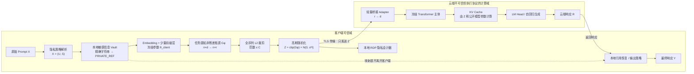
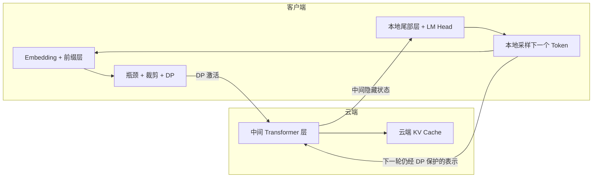

# TAPB-LLM：面向分割式大语言模型推理的任务感知隐私预算瓶颈

> **Task-Aware Privacy-Budgeted Bottleneck for Split LLM Inference**\
> 研究设计说明 / Research Proposal\
> Version: 0.2 · Date: 2026-11-06 · Status: 待理论与实验验证

------------------------------------------------------------------------

## 0. 一句话概括

TAPB-LLM
将用户输入拆分为"允许云端获知的任务上下文"与"需要保护的敏感信息"，在客户端完成少量模型计算后，通过**非残差低维瓶颈 +
范数裁剪 +
校准高斯随机化**生成上传表示；云端执行冻结的大模型主体计算。由于服务器可见的隐藏状态、KV
Cache、Logits
和生成响应都是该随机化表示的后处理，整个服务器可观测视图继承同一差分隐私保证；跨轮交互则由
RDP
隐私会计器统一记账。客户端再通过本地引用表恢复不需要云端知道的精确敏感字符串。

**核心不是声称"某个 Adapter
让攻击者无法反演"，而是把可证明的隐私边界放在客户端最后一次向云端释放信息的位置。**

> 重要：本文给出的是一个有明确假设和可证明条件的研究方案，不是已经完成安全审计或实验验证的成熟系统。差分隐私保证只在下文定义的隐私单元、邻接关系和侧信道假设成立时有效；它不等于零泄露，也不保证任意任务都能无损完成。

------------------------------------------------------------------------

## 1. 为什么要修正上一版 TAPB 方案？

此前方案提出了"未来查询感知的 KV
隐私瓶颈"，试图寻找"对任务影响小、对隐私恢复影响大"的 KV
方向。这个思路可以作为**KV
压缩和效用优化**的研究模块，但不能单独作为严格的隐私证明，原因如下：

1.  未来 Query
    的协方差通常来自有限校准数据。低特征值方向只意味着对所采样 Query
    分布的平均影响可能较小，不代表对所有可能
    Query、所有上下文和自适应攻击都无影响。
2.  隐私攻击者可以利用候选 Token
    前向匹配、辅助模型、语义先验和多轮关联。仅仅破坏某种线性逆映射，并不能证明无法反演。
3.  如果云端 Adapter 在原始 K/V
    已经生成之后才做混淆，诚实但好奇的服务器仍可能读取混淆前的 K/V。
4.  "攻击网络重建率下降"是经验性证据，不等于对未知攻击者的形式化保证。

因此，v0.2 对方案作出以下调整：

-   **正式隐私保证：** 由客户端边界处的条件本地差分隐私（conditional
    local DP）提供。
-   **全链路覆盖：** 云端所有激活、KV
    Cache、Logits、生成结果和攻击算法都作为客户端随机化表示的后处理处理。
-   **KV 模块定位：** KV
    压缩主要服务于显存、通信和推理效率；不把它本身当作隐私证明。
-   **任务效用：** 通过任务感知瓶颈、噪声感知训练和小型桥接 Adapter
    尽量恢复效用，但不承诺任意任务下无损。
-   **输出保护：** 普通模式下，服务器看到的响应仍受输入隐私机制的 DP
    保证；精确敏感字符串由客户端本地引用恢复。若要求服务器连生成文本本身都看不到，则启用更昂贵的客户端尾部解码模式。

这使方案的理论主线更清楚：**先证明服务器可观测信息受到约束，再优化这个约束下的模型效用和系统效率。**

------------------------------------------------------------------------

## 2. 研究目标与系统边界

### 2.1 目标

用户在本地输入 Prompt，客户端只承担少量计算，云端承担大部分 Transformer
计算，最终由客户端完成必要的本地恢复。

希望同时达到：

1.  **隐私：**
    服务器难以恢复用户定义的敏感信息，包括原始输入中的敏感字段、敏感属性以及响应中由这些字段导致的泄漏。
2.  **效用：**
    尽可能接近未保护模型的生成质量、任务准确率和指令遵循能力。
3.  **效率：** 客户端只执行少量前缀层和轻量保护模块；通信、KV
    显存和端到端时延可控。
4.  **模型兼容：**
    基础模型参数原则上冻结，只训练客户端瓶颈和少量云端桥接 Adapter。

### 2.2 适用场景

本方案首先面向**可控制推理流水线的开源权重模型或自建云端推理服务**，例如能够自行划分
Transformer 层、插入 Adapter、访问中间激活和管理 KV Cache 的部署环境。

它不能直接套用到完全封闭、只提供普通文本
API、且不允许控制中间计算的第三方 API。黑盒 API
场景需要另行采用文本脱敏、请求混淆或安全计算方案。

### 2.3 输入拆分

将用户输入表示为：

$$
X=(U,S)
$$

-   $U$：用户允许云端获知、且完成任务所需的上下文；
-   $S$：用户希望保护的敏感信息，例如姓名、证件号、地址、病历细节、商业秘密或其他私有属性。

这里的划分必须由用户隐私策略、规则或经过验证的本地识别器确定。**没有被识别为
$S$ 的信息不自动享有本方案的隐私保证。** 如果目标是保护整个 Prompt，应令
$U=\emptyset$，把整个输入都纳入受保护单元；这通常会带来更强的效用损失。

对于精确字符串（姓名、账号、地址、编号等），优先在客户端替换成引用标记：

$$
\texttt{PRIVATE\_REF}_i
$$

真实字符串及其映射表只保存在客户端。对于确实需要参与语义推理的敏感事实，则不宜简单删除，而是通过后续
DP 表示向云端提供受限信息。

为保证相邻输入的机制输出维度一致，应使用固定长度或固定长度桶。若桶长度被公开，则隐私定义应明确把该桶作为允许泄露的元数据；精确长度、有效
Token mask、占位符数量/位置等若依赖 $S$，就必须纳入 DP
释放，或使用不会泄露这些信息的填充协议。不能在 DP
向量之外明文发送依赖敏感字段的长度、mask 或标签。

------------------------------------------------------------------------

## 3. 总体架构

### 3.1 默认模式：云端完成生成，客户端本地恢复

**默认模式的关键事实：**

-   服务器会看到 $Z$、由 $Z$ 计算的中间激活、KV
    Cache，以及云端生成的响应。
-   服务器看不到客户端本地保存的原始敏感字符串及映射表。
-   服务器看到的所有模型内部状态均由 DP 表示 $Z$
    和公开/已知模型参数计算得到，因此在假设成立时继承 $Z$ 的 DP 保证。
-   云端响应本身仍然对服务器可见，但它是 DP
    表示的后处理；这限制了它对受保护秘密 $S$ 的额外依赖。
-   如果响应需要包含精确姓名、编号等字符串，云端只输出引用标记，由客户端恢复。

### 3.2 可选严格输出模式：客户端保留尾部层与 LM Head

如果研究目标要求**服务器不能直接看到最终生成 Token
或明文响应**，可以将最后 $q$ 层 Transformer 和 LM Head 留在客户端：

该模式需要按 Token 或按块进行客户端---云端往返：

1.  客户端前缀层处理当前 Token；
2.  经过 DP 机制后上传；
3.  云端执行中间层并返回隐藏状态；
4.  客户端尾部层和 LM Head 计算下一个 Token；
5.  客户端继续下一轮，并对新的上传表示使用新随机数。

**代价：** 自回归生成会引入额外网络往返；客户端还需要保存尾部模型参数和
KV 状态。可研究 lookahead/speculative decoding 来摊薄
RTT，但必须单独证明输出一致性，不能默认其零损失。

因此，建议先实现默认模式；严格输出模式作为第二阶段扩展和性能对照。

------------------------------------------------------------------------

## 4. 核心算法

### 4.1 客户端前缀计算

设基础模型为 $F_\theta$，总共有 $L$ 层。客户端运行 Embedding 和前 $k$
层：

$$
H_c=F_{\theta_c}^{(1:k)}(X')
$$

其中 $X'$ 是完成本地精确字符串替换后的输入。基础模型参数 $\theta_c$
冻结。

### 4.2 任务感知的低维瓶颈

将切分处表示映射到低维空间：

$$
R=G_\phi(H_c)
=\operatorname{LN}
\left(
W_{\uparrow}\,
\sigma\left(
\operatorname{LN}(W_{\downarrow}H_c)
\right)
\right)
$$

其中：

$$
W_{\downarrow}\in\mathbb R^{r\times d},\qquad
W_{\uparrow}\in\mathbb R^{d\times r},\qquad r\ll d
$$

-   $d$：原始隐藏维度；
-   $r$：瓶颈维度；
-   $\phi=\{W_{\downarrow},W_{\uparrow}\}$：需要训练的少量参数。

这里建议采用**非残差瓶颈**，让输出真正经过低维信息通道，而不是仅仅计算
$H_c+\Delta(H_c)$。

需要准确区分：非残差、低秩瓶颈有助于限制表示容量和通信量；但**真正的形式化隐私保证来自下一步的随机化机制，而不是"低秩"或"非残差"本身**。如果只做确定性降维，仍可能被学习式反演攻击利用。

### 4.3 范数裁剪

将整个待上传表示展平为向量 $r\in\mathbb R^m$，其中通常
$m=n\times r$。进行全局 L2 裁剪：

$$
\bar r
=
\operatorname{Clip}_C(r)
=
r\cdot \min\left(1,\frac{C}{\|r\|_2}\right)
$$

于是对任何输入都有：

$$
\|\bar r\|_2\le C
$$

这里的 $C$ 是固定公开的裁剪阈值，不能根据敏感值 $S$
动态改变并将其直接暴露给服务器。

### 4.4 客户端高斯随机化

客户端独立采样：

$$
\xi\sim\mathcal N(0,\sigma^2I_m)
$$

并发送：

$$
\boxed{Z=\bar r+\xi}
$$

随机数必须由客户端安全随机数生成器产生；不同请求/块不得复用同一噪声样本或向服务器泄露随机种子。

这一步是本方法的**形式化隐私边界**。

### 4.5 云端计算

云端使用轻量桥接 Adapter 将低维表示映射回模型主体需要的维度：

$$
\tilde H_c=W_{\mathrm{bridge}}Z
$$

随后执行冻结的大模型主体：

$$
H_s=F_{\theta_s}^{(k+1:L)}(\tilde H_c)
$$

再计算 KV Cache、Logits 和响应：

$$
(K,V,\text{Logits},R)=\mathcal F_\theta(U,Z;\omega)
$$

其中 $\omega$ 表示与秘密 $S$ 无关的云端随机性。

云端桥接 Adapter
可以离线训练；基础模型主体原则上保持冻结。训练数据优先使用公开、合成或获得授权的数据。若
Adapter 使用用户私有数据训练，则还需要对训练过程单独实施 DP-SGD
等训练隐私机制。

### 4.6 客户端输出恢复

-   云端输出 `PRIVATE_REF_1` 等占位符；
-   客户端根据本地 Vault 将占位符恢复为原始字符串；
-   恢复后的明文不应自动回传云端；
-   若云端响应中包含敏感语义推断，仍由 DP 机制限制其对 $S$ 的依赖。

------------------------------------------------------------------------

## 5. 形式化隐私定义与证明

这是本方案最重要的部分。以下结论在明确定义的威胁模型下成立，不依赖攻击者是否使用
KNN、梯度优化、辅助语言模型或更强的未知攻击。

### 5.1 隐私邻接关系

固定允许云端知道的上下文 $U$。若两个输入只在受保护字段上不同：

$$
X=(U,S),\qquad X'=(U,S')
$$

则定义：

$$
X\sim_S X'
$$

为一对邻接输入。

本方案默认保护单位是**单次请求中的整个敏感字段集合**。如果只希望保护某一个字段，则应把邻接关系改为"只替换该字段"；如果要保护一个用户跨多轮会话的全部秘密，则必须把多轮释放纳入同一个隐私会计器。

注意：条件隐私保证是在固定 $U$ 的前提下保护 $S$。如果 $U$
本身已经包含了能够直接确定 $S$ 的信息，那么攻击者仍可能从 $U$ 推断
$S$。因此，隐私策略必须避免把敏感信息的明显代理变量错误地划入 $U$。

### 5.2 引理一：裁剪后的全局敏感度有界

定义：

$$
f_\phi(U,S)=\operatorname{Clip}_C(g_\phi(U,S))
$$

由于裁剪保证：

$$
\|f_\phi(U,S)\|_2\le C
$$

对任意邻接的 $S,S'$，由三角不等式：

$$
\begin{aligned}
\|f_\phi(U,S)-f_\phi(U,S')\|_2
&\le \|f_\phi(U,S)\|_2+\|f_\phi(U,S')\|_2\\
&\le 2C
\end{aligned}
$$

因此：

$$
\boxed{\Delta_2(f_\phi)\le 2C}
$$

**结论：** 无论瓶颈网络如何训练，只要输出经过固定范数 $C$
的裁剪，其替换敏感度就不会超过
$2C$。这避免了把"训练集上观察到的平均敏感度"误当成全局敏感度。

### 5.3 定理一：客户端释放满足高斯机制差分隐私

客户端释放机制为：

$$
M(U,S)=f_\phi(U,S)+\mathcal N(0,\sigma^2I)
$$

由引理一，$\Delta_2\le2C$。

对 $0<\epsilon<1$，采用经典高斯机制的一个充分条件：

$$
\boxed{
\sigma\ge
\frac{2C\sqrt{2\ln(1.25/\delta)}}{\epsilon}
}
$$

则 $M$ 满足 $(\epsilon,\delta)$-DP。

更推荐在实际实现中直接采用高斯机制的 RDP 分析或 analytic Gaussian
accountant，以获得更紧的隐私预算，而不是把上述经典充分条件当作最优噪声尺度。

高斯机制的 RDP 表达式为：

$$
D_\alpha\left(
M(U,S)\parallel M(U,S')
\right)
\le
\frac{\alpha\Delta_2^2}{2\sigma^2}
\le
\frac{2\alpha C^2}{\sigma^2},
\quad \alpha>1
$$

其中 $D_\alpha$ 为 Rényi 散度。

**重要解释：** 这个保证针对的是客户端实际释放的随机表示
$Z$，而不是仅针对某一个训练出来的攻击网络。攻击者即使知道基础模型、桥接
Adapter、瓶颈参数和高斯噪声分布，也不能绕过该 DP
机制的概率界；但随机数样本和随机种子不能泄露。

### 5.4 定理二：服务器全部后续计算继承同一隐私保证

设服务器可观察视图为：

$$
V=
\left(
U,Z,
H_{k+1:L},
K_{1:T},V_{1:T},
\text{Logits},
R,
\text{其他协议输出}
\right)
$$

在以下条件下：

1.  服务器收到的所有与 $S$ 有关的信息都经过 $M(U,S)$；
2.  服务器模型参数 $\theta$ 在当前请求发生前已固定，且不依赖本次受保护的
    $S$；攻击者可以完全知道这些参数。若模型曾使用该用户的私有数据进行训练或个性化微调，则模型参数本身可能泄漏信息，需要另行采用训练阶段
    DP 或其他保护；
3.  云端中间激活、KV Cache、Logits、生成响应和攻击算法输出均由
    $(U,Z,\theta)$ 及独立随机数计算；
4.  没有未纳入机制的明文日志、外部工具调用、共享缓存侧信道或其他直接泄漏通道；网络长度、时序、请求
    ID、占位符数量和 mask
    等元数据要么被纳入释放机制，要么被明确列为公开信息并在威胁模型中披露；

则存在一个与 $S$ 无关的随机映射 $Q$，使：

$$
V=Q(U,Z,\theta)
$$

由差分隐私的后处理性质，若 $Z$ 满足 $(\epsilon,\delta)$-DP，则：

$$
\boxed{V\text{ 也满足 }(\epsilon,\delta)\text{-DP}}
$$

证明对任意可测事件 $A$：

$$
\begin{aligned}
P[V\in A\mid U,S]
&=\int Q(A\mid U,z,\theta)\,dP(z\mid U,S)\\
&\le e^\epsilon
\int Q(A\mid U,z,\theta)\,dP(z\mid U,S')
+\delta\\
&=e^\epsilon P[V\in A\mid U,S']+\delta
\end{aligned}
$$

因此，以下对象不需要各自重新证明一遍 DP，只要确实是 $Z$
的后处理，就继承相同的保证：

-   云端各层隐藏状态；
-   云端持久化或传输的 KV Cache；
-   Attention 输出；
-   Logits；
-   云端生成的 Prompt/Response 相关内容；
-   攻击者在这些数据上运行的任意反演算法。

这正是本方案的关键理论优势：**保护边界在客户端，服务器后续计算越复杂，也不会凭空增加关于
$S$ 的信息。**

但请注意：如果云端同时收到未经保护的原始 Token、真实姓名、敏感
mask、明文长度、用户身份或未保护的外部检索结果，那么上述
$V=Q(U,Z,\theta)$
的前提不成立。此时必须将这些额外信息纳入保护机制，或明确列为公开元数据。

### 5.5 定理三：多轮交互必须组合隐私预算

如果同一个敏感信息在多个请求中反复出现，不能每次都单独报告一个
$\epsilon$，然后忽略累计泄漏。

设第 $t$ 次释放机制满足 RDP：

$$
\rho_t(\alpha)
=
\frac{\alpha\Delta_t^2}{2\sigma_t^2}
$$

根据 RDP 的自适应组合性质：

$$
\rho_{\mathrm{total}}(\alpha)
=
\sum_{t=1}^{T}\rho_t(\alpha)
$$

转换为 $(\epsilon,\delta)$-DP：

$$
\boxed{
\epsilon_{\mathrm{total}}(\delta)
=
\min_{\alpha>1}
\left[
\rho_{\mathrm{total}}(\alpha)
+
\frac{\ln(1/\delta)}{\alpha-1}
\right]
}
$$

因此，系统需要实现一个**会话级隐私会计器**：

-   每次上传前记录本次机制的 $\sigma_t,\Delta_t$；
-   更新 RDP 账本；
-   计算当前累计 $\epsilon_{\mathrm{total}}$；
-   达到用户设定预算后，停止继续释放、要求重新授权，或切换到更强的本地处理模式。

如果每轮只是服务器根据已有 $Z$
继续生成，而客户端没有再次释放新的敏感信息，则这些服务器内部生成步骤属于后处理，不需要额外消耗客户端释放预算。若客户端每轮都上传新的、依赖
$S$ 的表示，则必须组合记账。

### 5.6 这项证明究竟保证了什么？

对任意服务器攻击算法 $\mathcal A$，其输出：

$$
\hat S=\mathcal A(V)
$$

仍是 DP 视图的后处理。因此，对任意事件 $B$：

$$
P[\mathcal A(V)\in B\mid U,S]
\le
e^\epsilon
P[\mathcal A(V)\in B\mid U,S']
+\delta
$$

这意味着：攻击者即使使用更强的优化反演、辅助语言模型、KV
碰撞匹配或多轮联合分析，也无法突破该机制的 DP 概率界。

但 DP **不意味着攻击成功率必然接近零**。如果攻击者原本就知道 $S$，或者
$U$ 已经强烈暗示 $S$，DP 不会消除这些先验知识。DP
约束的是机制额外泄露的信息，而不是抹除攻击者已有知识。

------------------------------------------------------------------------

## 6. 正确率与任务效用：能证明到什么程度？

### 6.1 不能承诺任意任务下无损

假设任务必须精确输出敏感值本身，例如用户输入一个秘密数字，要求云端返回完全相同的数字。若云端输出必须精确等于
$S$，则输出会直接区分相邻的 $S$ 和 $S'$，不可能同时满足有意义的强 DP
保证。

例如，若 $Y=S$，取事件 $A=\{Y=S\}$，则：

$$
P(A\mid S)=1,\qquad P(A\mid S')=0
$$

对 $\delta<1$，这不满足有限 $\epsilon$ 的 DP 不等式。

因此，以下目标不能被无条件同时保证：

-   云端完全不知道敏感值；
-   云端精确完成所有依赖该敏感值的计算；
-   输出与原始模型完全一致；
-   额外开销为零。

这不是算法设计不够好，而是隐私与任务信息需求之间的基本冲突。

### 6.2 可给出的条件性效用界

令云端后续任务损失为：

$$
\ell_y(z)=\mathcal L(F_\theta(z),y)
$$

若在所考虑的输入区域内，$\ell_y(z)$ 关于 $z$ 是 $L$-Lipschitz，即：

$$
|\ell_y(z_1)-\ell_y(z_2)|
\le L\|z_1-z_2\|_2
$$

则对高斯噪声 $\xi\sim\mathcal N(0,\sigma^2I_m)$：

$$
\begin{aligned}
\left|
\mathbb E_\xi[\ell_y(\bar r+\xi)]
-\ell_y(\bar r)
\right|
&\le
L\mathbb E\|\xi\|_2\\
&\le L\sigma\sqrt m
\end{aligned}
$$

这里使用了：

$$
\mathbb E\|\xi\|_2
\le
\sqrt{\mathbb E\|\xi\|_2^2}
=\sigma\sqrt m
$$

这个界说明：

-   噪声越大，潜在任务误差越大；
-   表示维度 $m$ 越大，噪声总能量越大；
-   低维瓶颈可以降低通信量，也有机会降低噪声对效用的总影响；
-   模型的局部 Lipschitz 常数越大，越需要谨慎控制噪声。

**限制：** Transformer 和离散生成损失不一定在整个空间内具有较小的全局
Lipschitz 常数。因此该式是附加正则性条件下的误差界，不是"所有 LLM
任务准确率下降不超过某个固定百分比"的普遍证明。最终准确率必须通过实验验证。

### 6.3 噪声感知训练目标

冻结基础模型参数 $\theta$，训练客户端瓶颈 $\phi$ 与云端桥接参数 $\psi$：

$$
\min_{\phi,\psi}
\mathbb E_{(X,y),\xi}
\left[
-\sum_t
\log p_{\theta,\psi}
(y_t\mid Z,y_{<t})
\right]
$$

其中：

$$
Z=
\operatorname{Clip}_C(G_\phi(H_c))
+\xi
$$

训练必须在**真实部署时使用的噪声尺度**下进行，而不是先用无噪声表示训练、部署时再突然加大噪声。

可增加蒸馏项：

$$
\mathcal L_{\mathrm{KD}}
=
D_{\mathrm{KL}}
\left(
p_\theta(\cdot\mid X)
\parallel
p_{\theta,\psi}(\cdot\mid Z)
\right)
$$

但教师输出也不能把本来应该保护的精确敏感值泄露到云端训练数据中。训练集应使用公开、合成或获得授权的数据。

### 6.4 任务感知的反事实训练

为了避免把所有语义都当作隐私信息而破坏任务能力，可以构造：

$$
X=(U,S),\qquad X'=(U,S')
$$

当某个任务在 $S$ 与 $S'$ 变化时本应给出相同答案，可加入：

$$
\mathcal L_{\mathrm{cf}}
=
\mathbb E
\left[
\|G_\phi(H_c(U,S))-G_\phi(H_c(U,S'))\|_2^2
\right]
$$

只对"任务等价"的反事实样本施加该项。

如果任务确实需要 $S$，则不能强迫两种表示完全相同；应让 DP
预算和任务损失共同决定可释放的信息量。

该反事实损失是**训练优化项，不是隐私证明**。DP
证明仍然来自固定裁剪阈值和校准随机化。

------------------------------------------------------------------------

## 7. KV Cache：隐私保证与效率优化分开处理

### 7.1 为什么 KV Cache 不需要再单独承担隐私证明？

云端 KV Cache 满足：

$$
(K,V)=F_{\mathrm{KV}}(U,Z,\theta)
$$

只要它确实由 DP 表示 $Z$ 和公开模型参数计算得到，那么根据后处理定理，KV
Cache 自动继承 $Z$ 的 $(\epsilon,\delta)$-DP 保证。

这比"假设某个 KV 投影方向对攻击无效"更稳健，因为证明不依赖攻击者是否知道
KV 的具体矩阵结构。

但如果服务器还存在未保护的原始
Token、原始激活、跨租户缓存命中时间或其他旁路信息，则不能仅凭这一条后处理定理宣称系统整体安全。

### 7.2 可选：未来 Query 感知的 KV 压缩

KV 压缩可作为独立的性能模块。其目标是保持未来 Attention
输出，而不是直接宣称提供隐私：

$$
\min_{P_K,P_V}
\mathbb E_{q\sim\mathcal Q}
\left[
\left\|
\operatorname{Attn}(q,K,V)
-
\operatorname{Attn}(q,\tilde K,\tilde V)
\right\|_2^2
\right]
+\lambda(r_K+r_V)
$$

其中：

$$
\tilde K=KP_KP_K^\top,\qquad
\tilde V=VP_VP_V^\top
$$

$P_K,P_V$ 为低秩投影，$\mathcal Q$ 为校准数据上的未来 Query 分布。

这个目标可帮助选择在典型未来查询下对任务影响较小的压缩方向。它有机会减少
KV
显存和访存成本，但存在分布偏移风险，必须测试长上下文、分布外任务和对抗性
Query。

**不要把"低 Query 敏感度"解释为"高隐私安全性"。** 隐私安全由客户端 DP
边界证明；KV 压缩负责效率。

### 7.3 仍需单独防护的 KV 系统侧信道

DP 表示不自动隐藏：

-   共享 Prefix Cache 的命中时间；
-   跨租户缓存索引；
-   内存访问模式和 GPU 时序；
-   未保护的日志、调试信息和崩溃转储。

建议采用租户隔离的 KV
命名空间、禁止跨租户共享敏感前缀缓存、固定长度桶/填充，并单独评估时序侧信道。若威胁模型包含
GPU 微架构侧信道，需要额外的硬件/系统级防护。

------------------------------------------------------------------------

## 8. 安全、准确率与性能的联合优化

不建议只写一个加权和，然后声称三个目标自然平衡。更清晰的做法是把隐私设为硬约束，再在约束内优化任务和效率：

$$
\boxed{
\begin{aligned}
\max_{\phi,\psi,k,r,r_K}\quad
&\operatorname{Utility}(\phi,\psi)\\
\text{s.t.}\quad
&\epsilon_{\mathrm{session}}\le\epsilon_{\max}\\
&\delta_{\mathrm{session}}\le\delta_{\max}\\
&T_{\mathrm{client}}\le T_{\max}\\
&T_{\mathrm{end2end}}\le T_{\mathrm{SLA}}\\
&M_{\mathrm{client}}\le M_{\max}\\
&\operatorname{Comm}(Z)\le B_{\max}
\end{aligned}
}
$$

可调变量：

  ------------------------------------------------------------------------------------------------
  变量                    影响                    主要权衡
  ----------------------- ----------------------- ------------------------------------------------
  $k$                     客户端本地 Transformer  越大通常越耗本地算力；切分层变化也会改变攻击面
                          层数                    

  $r$                     瓶颈维度                越小通信量越低，但任务信息容量可能不足

  $C$                     裁剪阈值                越小敏感度上界越低，但表示被裁剪的概率可能上升

  $\sigma$                高斯噪声标准差          越大隐私预算越小，但任务噪声越大

  $\epsilon$              隐私预算                越小通常需要更多噪声，隐私约束更强

  $r_K,r_V$               KV 压缩秩               越小缓存越小，但 Attention 近似误差可能增大

  输出模式                云端解码 /              后者输出机密性更强，但增加客户端计算和网络往返
                          客户端尾部解码          
  ------------------------------------------------------------------------------------------------

**不应预先承诺固定的"准确率下降不超过 1%"或"推理速度提高 2 倍"。**
这些都需要在具体模型、硬件、上下文长度、隐私预算和网络条件下测量。

------------------------------------------------------------------------

## 9. 与已有工作的区别及创新性判断

本方案不能把"低维瓶颈""Prompt/Response 双向保护"或"KV
保护"单独作为创新点，因为相关方向已经有较强工作。

  -------------------------------------------------------------------------------------------------------------------
  工作                    主要机制                                       与 TAPB-LLM 的关系
  ----------------------- ---------------------------------------------- --------------------------------------------
  TWIST                   模型参数与 Token 联合协变变换，并进行隐私分析  适合对照模型权重与输入联合变换；TAPB
                                                                         不要求全模型权重变换

  DualGuard               分割微调中的参数空间预热与保持                 主要面向微调阶段，不等同于推理阶段 DP 机制

  SnD                     客户端 Embedding 加噪，客户端去噪              提供 LDP 思路；TAPB
                                                                         面向分割式生成推理和服务器全视图

  SGT                     学习序列相关随机混淆                           可作为随机表示变换对照

  Privacy Adapters        低维非残差信息瓶颈、互信息最小化与攻击者训练   与 TAPB 的瓶颈结构非常接近；因此 TAPB
                                                                         的创新不能只写成"再提出一个 Adapter"

  OSNIP                   语义零空间与密钥相关随机混淆                   可作为几何混淆基线；不能把近正交直接等同于
                                                                         DP

  PIDI / ADMI             Prompt 与 Response 双侧反演和经验防御          用于攻击评测和双侧隐私对照

  KV-Cloak                KV Cache 可逆矩阵混淆与算子融合                作为 KV 安全基线；TAPB 的 KV DP
                                                                         来自客户端释放边界

  DP-Fusion               对敏感 Token 对输出分布的影响进行 DP 约束      说明 Token 级输出 DP 已有研究；需要突出 TAPB
                                                                         的分割激活与会话级视图保护

  Talaria                 CVM + Reversible Masked Outsourcing            作为 TEE/机密计算强基线；TAPB 不依赖
                                                                         TEE，但保证类型和威胁模型不同
  -------------------------------------------------------------------------------------------------------------------

### 9.1 建议重点论证的创新点

**创新点 A：任务条件化的隐私单元定义。**

不是把整个 Prompt 的所有信息一概压缩，而是显式区分 $U$ 和
$S$，以"固定任务上下文、替换敏感字段"的邻接关系定义隐私目标。对任务不需要的精确字符串，本地引用替换；对任务需要的敏感语义，则通过受控
DP 表示参与推理。

**创新点 B：从单一激活保护扩展为服务器全视图的形式化保证。**

把客户端最后一次释放作为安全边界。只要服务器的所有可见状态都能表示为该
DP 释放的后处理，便可以用同一个定理覆盖隐藏状态、KV、Logits
和响应，而不是逐个攻击设计一个启发式补丁。

**创新点 C：跨轮次、跨块的 RDP 隐私预算管理。**

对同一敏感字段在多轮对话中的重复释放进行组合记账，避免单轮实验看起来安全、长对话累计泄漏却失控。

**创新点 D：认证敏感度驱动的噪声---效用联合优化。**

在固定裁剪保证之外，探索通过谱范数约束或可验证 Lipschitz
上界降低瓶颈映射对敏感字段的全局敏感度。训练时可以使用反事实样本降低经验敏感度，但
DP 噪声必须使用可证明的全局上界，不能只用训练集平均值。

### 9.2 必须正面承认的创新风险

-   低维隐私 Adapter 已经有 2026 年的相关预印本；
-   Embedding 端的 LDP、Token 级 DP、双侧 Prompt/Response 防御和 KV
    Cache 混淆都已有相关工作；
-   "Adapter + Gaussian noise + RDP
    accountant"如果没有新的任务定义、算法设计或系统贡献，可能被审稿人认为是已有模块的直接组合；
-   因此，真正需要验证的研究问题是：**任务条件化的隐私单元 +
    可认证敏感度优化 + 会话级服务器全视图
    DP，是否能在相同隐私预算下比现有瓶颈/噪声方法保留更多任务效用，并控制端云开销。**

在完成更全面的文献检索和实验前，不应宣称"首次提出"或"优于所有现有方法"。

------------------------------------------------------------------------

## 10. 威胁模型与不覆盖范围

### 10.1 默认威胁模型

-   云端是诚实但好奇的服务器，按协议完成推理，但会保存并分析其可见数据；
-   攻击者知道基础模型参数、云端 Adapter、瓶颈结构、噪声分布和公开算法；
-   攻击者可以读取上传的 $Z$、云端中间激活、KV Cache、Logits 和响应；
-   攻击者可以使用公开语料、辅助模型、优化反演、候选匹配和多轮关联；
-   客户端本地原始输入、随机数生成器、Vault 和本地密钥不被攻破。

### 10.2 不在当前形式化保证范围内

1.  客户端设备被攻破、恶意软件读取原始输入；
2.  GPU 微架构、缓存命中时间、功耗、电磁等硬件侧信道；
3.  服务器通过未保护的工具调用、身份系统或外部数据库获得秘密；
4.  用户主动把恢复后的明文再次发回云端；
5.  基础模型参数本身已经记忆了该用户的私有训练数据；
6.  恶意服务器篡改输出、拒绝服务或伪造模型结果（这是完整性问题，不是本方案的隐私保证）；
7.  敏感信息识别器漏检的字段；
8.  已经包含在 $U$ 中、可由公开上下文直接推断的秘密。

此外，敏感字段识别器漏检的内容不受保护；若隐私策略将某个敏感代理变量放入
$U$，条件 DP
不会消除攻击者从该代理变量得到的先验推断。实际系统应把用户身份、会话元数据、工具调用参数、日志和错误追踪都纳入信息流审计。

DP
不等于加密，也不保证服务器看不到表示。它保证的是：在给定邻接关系下，服务器观察到的随机视图不会因受保护字段变化而发生超过
$(\epsilon,\delta)$ 所允许的统计变化。

------------------------------------------------------------------------

## 11. 实验设计

### 11.1 模型与切分设置

建议从可控的小模型开始，逐步扩展：

-   Qwen3-0.6B：快速验证机制和攻击；
-   Qwen3-1.7B / 4B：主要消融；
-   Qwen3-8B：规模扩展；
-   更大模型：在资源允许时验证系统可扩展性。

切分层 $k$ 可测试 1、2、4、6 层等设置；瓶颈秩 $r$ 可从隐藏维度的
1/8、1/4、1/2 开始搜索。具体值应依据模型维度与显存条件调整。

### 11.2 攻击基线

  -----------------------------------------------------------------------
  攻击                    目标                    评价
  ----------------------- ----------------------- -----------------------
  Embedding / KNN         Token 身份恢复          Token Accuracy
  inversion                                       

  Prompt Inversion Attack 从切分激活恢复 Prompt   Token Accuracy、F1
  (PIA)                                           

  PIDI                    双侧 Prompt / Response  双侧恢复率、ROUGE-L
                          恢复                    

  KV Inversion            从 KV 直接反演          Token Recovery

  KV Collision            候选输入匹配 KV         Token Accuracy

  KV Injection            语义注入式恢复          ROUGE-L、BERTScore

  Sensitive Attribute     推断隐私属性            AUC、F1、Top-1
  Inference                                       

  Cross-session Linkage   多轮请求关联            Linkage Accuracy
  -----------------------------------------------------------------------

测试必须使用**未参与防御训练的新攻击器**，并在白盒设置下向攻击者公开模型与
Adapter
参数。否则容易出现防御只记住训练攻击器、却没有真正限制信息的情况。

### 11.3 效用指标

-   Perplexity / Next-token NLL；
-   GSM8K、MMLU、IFEval 等任务指标；
-   生成质量与原始模型输出的 KL / 一致性；
-   多轮对话任务成功率；
-   对敏感字段必须参与计算的任务，单独报告数值误差和任务成功率。

### 11.4 性能指标

-   客户端前缀计算时间；
-   Bottleneck + clipping + noise 时间；
-   客户端峰值内存；
-   上传/下载字节数；
-   Prefill 延迟；
-   每 Token Decode 延迟；
-   端到端时延；
-   KV Cache 显存；
-   吞吐量；
-   严格输出模式下的网络 RTT 次数。

注意：如果桥接 Adapter 把 $r$ 维表示扩展回 $d$ 维，**通信量可以按 $r/d$
缩小，但云端后续 KV Cache 不会自动缩小**。只有真正实现 KV 低秩缓存和相应
Attention 算子后，才能报告 KV 显存压缩收益。

### 11.5 必做消融

1.  无保护；
2.  仅确定性低维瓶颈；
3.  仅 Gaussian DP；
4.  瓶颈 + Gaussian DP；
5.  瓶颈 + DP + 噪声感知训练；
6.  是否使用本地精确字符串 Vault；
7.  不同 $k$、$r$、$C$、$\sigma$；
8.  不同 $(\epsilon,\delta)$；
9.  单轮与多轮隐私会计；
10. 有无 KV 压缩；
11. 云端解码与客户端尾部解码；
12. 训练攻击器与全新攻击器对比。

### 11.6 隐私预算实验

至少报告多组 $\epsilon$ 和固定 $\delta$ 下的结果，例如：

$$
\epsilon\in\{0.5,1,2,4,8\}
$$

这只是实验扫描点，不代表这些预算都具有同等强度。必须同时报告实际噪声尺度、RDP
accountant 的累计结果和多轮组合后的预算，不能只报告单轮 $\epsilon$。

------------------------------------------------------------------------

## 12. 推荐实施路线

### Phase 1：攻击基线与信息流审计

-   选择 Qwen3 小模型；
-   建立客户端---云端切分推理；
-   导出切分激活、KV Cache、Logits 和响应；
-   复现 PIA、PIDI 与 KV Inversion/Collision；
-   建立白盒攻击者基线。

交付物：可重复的攻击评测脚本和基线数据。

### Phase 2：最小可行 TAPB

-   客户端运行 Embedding + 少量前缀层；
-   插入非残差瓶颈；
-   实现全序列 L2 clipping；
-   实现 Gaussian mechanism；
-   云端用小型 bridge 接收表示；
-   冻结原始 Transformer 主体；
-   记录每次释放的隐私预算。

交付物：第一个具有可计算 $(\epsilon,\delta)$ 保证的端云推理原型。

### Phase 3：任务感知优化

-   构建 $U,S$ 敏感字段标注；
-   加入本地引用替换；
-   在真实噪声下训练瓶颈和 bridge；
-   加入任务等价反事实样本；
-   对比相同隐私预算下的任务质量。

交付物：安全---效用 Pareto 曲线。

### Phase 4：全轨迹与多轮验证

-   将服务器中间激活、KV、Logits、响应纳入统一视图；
-   验证后处理定理的系统前提；
-   实现 RDP accountant；
-   测试多轮关联、重复提问和自适应攻击。

交付物：完整威胁模型和会话级隐私报告。

### Phase 5：系统效率优化

-   研究 KV 查询感知压缩；
-   评估固定长度桶和填充策略；
-   优化序列传输、批处理和缓存隔离；
-   评估严格输出模式的网络 RTT；
-   在不同客户端算力和网络条件下测试。

交付物：端到端性能分析和系统消融。

------------------------------------------------------------------------

## 13. 最终研究主张应如何写？

建议论文不要声称：

> 我们提出一种不可逆的 KV 变换，从而彻底防止所有攻击。

也不要声称：

> 服务器无法恢复任何用户信息，且模型准确率和速度完全不受影响。

建议将主张限定为：

> We propose a task-aware, privacy-budgeted split inference framework
> for large language models. The client maps sensitive prompts into a
> clipped, low-dimensional representation and applies a calibrated
> Gaussian mechanism before outsourcing computation. Under an explicit
> conditional adjacency relation and a server-view closure assumption,
> the entire cloud-observable transcript---including intermediate
> activations, KV caches, logits, and generated responses---satisfies
> the same differential privacy guarantee by post-processing. A
> session-level Rényi accountant composes privacy loss across repeated
> releases. We further optimize task utility and system efficiency
> through noise-aware bottleneck training and optional query-aware KV
> compression.

中文：

> 本文提出一种面向分割式大语言模型推理的任务感知隐私预算框架。客户端将敏感输入映射为经范数裁剪的低维表示，并在上传前施加经过校准的高斯随机化。在明确的条件邻接关系和服务器可观测视图闭包假设下，服务器可见的中间激活、KV
> Cache、Logits
> 和生成响应均作为该随机化表示的后处理，继承相同的差分隐私保证。进一步采用会话级
> Rényi 隐私会计器组合多轮释放，并通过噪声感知瓶颈训练和可选的查询感知
> KV 压缩改善任务效用与系统效率。

------------------------------------------------------------------------

## 14. 参考文献与必须对比的工作

以下链接用于后续精读和实验对照。文献状态应以正式论文页面为准。

1.  **TWIST: Private Tenant-Dedicated LLM Serving via Joint Model-Token
    Transformation.** ACM CCS 2026（会期为 2026 年 11
    月，当前文档日期早于会期）。\
    https://scholars.cityu.edu.hk/en/publications/twist-private-tenant-dedicated-llm-serving-via-joint-model-token-/

2.  **Split-and-Denoise: Protect Large Language Model Inference with
    Local Differential Privacy.** ICML 2024.\
    https://proceedings.mlr.press/v235/mai24a.html

3.  **Learning Obfuscations of LLM Embedding Sequences: Stained Glass
    Transform.** arXiv, 2025.\
    https://arxiv.org/abs/2506.09452

4.  **Defense Against Prompt Inversion Attacks: An Information-Theoretic
    Approach for LLM Collaborative Inference.** arXiv, 2026.\
    https://arxiv.org/abs/2606.11592

5.  **OSNIP: Balancing the Privacy-Utility-Efficiency Trilemma in LLM
    Inference via Obfuscated Semantic Null Space.** ICML 2026.\
    https://proceedings.mlr.press/v306/cao26q.html

6.  **From Prompts to Responses: Dual-Sided Data Leakage and Defense in
    Split Large Language Models.** ICML 2026.\
    https://proceedings.mlr.press/v306/gu26o.html

7.  **Shadow in the Cache: Unveiling and Mitigating Privacy Risks of
    KV-cache in LLM Inference.** NDSS 2026.\
    https://www.ndss-symposium.org/ndss-paper/shadow-in-the-cache-unveiling-and-mitigating-privacy-risks-of-kv-cache-in-llm-inference/

8.  **DP-Fusion: Token-Level Differentially Private Inference for Large
    Language Models.** ICLR 2026.\
    https://proceedings.iclr.cc/paper_files/paper/2026/hash/f5198bc255e1d5f959edd6d1d1a86fab-Abstract-Conference.html

9.  **Your Inference Request Will Become a Black Box: Confidential
    Inference for Cloud-based Large Language Models (Talaria).** ACL
    2026.\
    https://aclanthology.org/2026.acl-long.4/

10. **No Free Lunch Theorem for Privacy-Preserving LLM Inference.**
    Artificial Intelligence, 341, 104293, 2025.\
    https://doi.org/10.1016/j.artint.2025.104293

11. **Rényi Differential Privacy.** Ilya Mironov, CSF 2017.\
    https://research.google/pubs/r%C3%A9nyi-differential-privacy/

12. **Improving the Gaussian Mechanism for Differential Privacy.** Balle
    and Wang, ICML 2018.\
    https://proceedings.mlr.press/v80/balle18a.html

------------------------------------------------------------------------

## 15. 当前结论

TAPB-LLM v0.2 相比"只做 Adapter / 只做 KV 混淆"的方案，最重要的变化是：

1.  把隐私目标从"攻击者是否能恢复
    Token"提升为"服务器整个可观测视图对敏感字段满足什么概率保证"；
2.  把客户端裁剪与高斯随机化作为可证明的安全边界；
3.  利用后处理性质统一覆盖云端激活、KV、Logits 和响应；
4.  用 RDP 处理多轮交互的累计隐私损失；
5.  将 KV
    查询感知压缩明确定位为性能模块，不再把经验上的低敏感方向当成安全定理；
6.  将精确字符串本地引用恢复与敏感语义 DP
    处理分开，减少不必要的效用损失。

**最需要验证的核心科学问题：**

> 在相同的会话级 DP
> 预算下，任务感知的低维瓶颈能否比直接对原始激活加噪、普通 Privacy
> Adapter 或 SnD
> 保留更多生成任务效用，同时把客户端计算、通信量和端到端时延控制在可接受范围内？

如果答案是肯定的，并且能够通过白盒攻击、跨轮攻击、严格隐私会计和端到端系统实验验证，这才构成一篇有说服力的研究工作。

在完成这些实验之前，本方案应称为**有形式化隐私边界的研究设计**，不应称为"已经证明绝对安全、准确率无损且性能最优的方法"。
