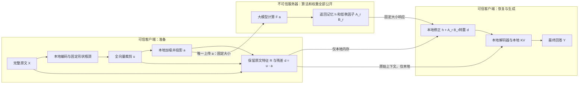

# TAPB-LLM 审阅与改进：公开低秩响应、本地私有残差

日期：2026-11-06。性质：研究方案与条件性数学推导，尚未完成 LLM 训练、攻击评测或性能测量。

审阅对象：[TAPB-LLM_README.md](TAPB-LLM_README.md)，结合此前的 [RESEARCH_PROPOSAL_zh.md](RESEARCH_PROPOSAL_zh.md) 第 5–6 节。保留原文件，本文记录审阅结论和新的研究路线。

## 1. 结论与研究定位

TAPB v0.2 的主要优点是把可证明的隐私边界放在客户端最后一次上传之前，而不是把“攻击器暂时失败”当成安全证明。其裁剪敏感度、高斯机制、全服务器视图后处理和 RDP 组合，是可以保留的基础。

但它的默认协议不满足本次要求：服务器生成并看见响应，本地仅作敏感字符串恢复；同时使用引用替换。即使上传满足 DP，也不能说服务器不知道它亲自生成的响应。必须把**完整最终解码移到本地**，取消引用替换，并对实际发生的所有上传统一记账。

更大的问题是可行性：整段提示词级强本地 DP 对信息传输限制很严。低维瓶颈和 Adapter 不会自动消除这个限制。因此不能承诺“算法公开后任何攻击者都无法恢复输入输出，同时任意任务无损且几乎无开销”。可以证明的是明确威胁模型下的分布不可区分界、条件性恢复概率界和计算近似误差界；模型效果与耗时需要实际验证。

建议研究候选 **TAPB-PR：Task-Aware Privacy-Budgeted inference with Private Residuals**。其具体研究问题是：

> 能否让服务器返回由隐私化锚点决定的低秩计算响应，由客户端用永不上传的真实残差确定修正系数，使端到端生成在固定整段隐私预算下，比通用本地去噪获得更好的质量、延迟、通信折中？

这个方案不是已经验证的新 SOTA，也不是密码学加密。创新候选在“返回什么计算响应、如何按残差统计分配有限响应秩、何时可保证修正误差”，不在高斯 DP、Taylor 展开或本地解码这些已知工具本身。

## 2. 对 TAPB v0.2 的逐项审阅

| 原文位置 | 判断 | 修订方向 |
|---|---|---|
| §3.1、§4.6 默认云端生成，再本地恢复引用 | 云端知道生成内容，不满足最终输出保护；引用替换也不符合本次约束 | 完整原文留在本地，所有最终 token、logits、生成 KV 留在本地 |
| §3.2 可选本地尾部 | 方向正确，但逐 token 重新上传会产生通信往返和累计泄漏 | 优先研究一次上传、云端返回计算记忆、本地完成整个回答 |
| §4.2–4.5 瓶颈维度 | 公式先用 W_up 升回 d 维，后文却按 n×r 维展平、加噪和传输 | 客户端真正输出 r 维，升维桥放到服务器；或明确承认传的是 d 维 |
| §5.2 裁剪敏感度 ≤2C | 正确，要求整个上传向量统一裁剪 | 不要把逐 token 裁剪误算成整段同样的敏感度 |
| §5.3 高斯与 RDP | 主干正确；经典高斯充分公式不能任意用于 ε≥1 | 单次使用解析高斯校准；多次报告 RDP 会计上界 |
| §5.4 全视图后处理 | 只有全部私有依赖都经过上传机制时成立 | 把长度、时间、路由、异常、重试、训练梯度纳入边界检查 |
| §5.5 交互组合 | 要求每个已发生历史条件下都有统一敏感度界 | 新 token、跨轮追问、同一秘密重复发布都计入，不能换会话清零 |
| §6.2 效用界 | 局部 Lipschitz 假设不能直接覆盖无界高斯支持；损失界不是准确率保证 | 使用有界投影域，并分别分析近似误差、logit 间隔与原模型差距 |
| §9.1 创新主张 | 裁剪、后处理、RDP、条件邻接本身主要是标准工具 | 把论文贡献集中到新计算接口与同预算实证收益 |
| §9.2 学习降低敏感度 | 缩放信号和噪声不一定改善信噪比 | 证明减少的是任务不需要的差异，而非仅改坐标尺度 |

原文已经有“待验证”的限定，因此这里不是把它当作已经完成的论文来否定。需要调整的是默认协议与研究重心。

## 3. 公开算法下，我们究竟保护什么

### 3.1 本文采用的强威胁模型

- 单个不可信服务器；攻击者知道编码器、瓶颈、云模型、响应头、本地解码器、全部权重、训练方法和噪声分布。
- 攻击者能读取全部网络消息、服务器内存、所有云端隐藏层、KV、logits、服务端随机数和历史日志，并自行生成任意已知明文训练对。
- 客户端、原始输入 X、当前运行的随机样本、私有残差、真实生成历史与本地 KV 不被攻破。
- 默认保护整个提示词：任意两个允许输入 X、X' 都相邻。公开的仅是固定协议配置，不偷偷把用户任务内容定义成“公共信息”。
- 最大输入长度、上传形状、响应大小和云调用次数预先固定；真实长度、是否生成 EOS、客户端异常细节不另行泄露。证明针对这套消息协议；真实部署还要核查时间和流量元数据。
- 模型与参数在服务本次请求前已固定，训练数据是公共或合成数据。当前用户私有样本的梯度、个性化权重上传不在本证明内。

算法和权重可以开源，随机样本不能同步公开。这和“靠别人不知道变换方法”不同。客户端如果把随机种子和隐私化向量一并发送，攻击者往往能扣除噪声；任何以下证明都不覆盖那种协议。

### 3.2 两个不应混淆的目标

**输入保护**：服务器全部视图 V 满足整段输入级 (ε,δ)-LDP：

\[
\Pr[V(X)\in E]\le e^\varepsilon\Pr[V(X')\in E]+\delta,
\quad\forall X,X',E.
\]

**输出保护**：最终文本 Y 和其生成状态不直接发送到服务器，并分析服务器从 V 推断 Y 的能力。输入 DP 不自动等于对任意随机 Y 的不可恢复保证；例如故意定义 Y 为上传向量的一个函数，服务器当然知道 Y。第 7 节给出带明确条件的回答恢复界。

完全确定、非恒定的公开上传映射不能满足上述有限 ε、δ<1 的整段 DP：选择两个输出不同的输入和只包含第一个输出的事件，可得到 1≤δ 的矛盾。低秩、旋转或非线性本身并不改变这一点。秘密密钥方案需要另行给出密钥与攻击模型，不能从“变换复杂”推出安全。

## 4. 为什么单纯给瓶颈加噪可能不够可用

令确定性编码 f(X) 满足 ||f(X)||₂≤C，未投影上传为 Z=f(X)+ξ，ξ∼N(0,σ²I)。对任意输入分布，取 Q=N(0,σ²I)，有

\[
\begin{aligned}
I(X;Z)
&\le\mathbb E_X D_{KL}(P_{Z|X}\|Q)\\
&=\frac{\mathbb E\|f(X)\|^2}{2\sigma^2}
\le\frac{C^2}{2\sigma^2}\quad\text{nats}.
\end{aligned}
\]

第一步来自恒等式 E KL(P_{Z|X}||Q)=I(X;Z)+KL(P_Z||Q)。后续投影和服务器计算不会增大互信息。该界也可在固定公开侧信息的条件分布下使用；它不抹去攻击者本来就知道的信息。

按全局敏感度上界 Δ=2C、δ=10⁻⁶ 校准，附带脚本得到：

| ε | RDP 充分校准 σ/C | 对应互信息上界 / bit | 解析高斯校准 σ/C | 对应互信息上界 / bit |
|---:|---:|---:|---:|---:|
| 1 | 10.7000 | 0.00630 | 8.4494 | 0.01010 |
| 2 | 5.4403 | 0.02437 | 4.4610 | 0.03625 |
| 4 | 2.8064 | 0.09159 | 2.3870 | 0.12660 |
| 8 | 1.4827 | 0.32811 | 1.3059 | 0.42300 |

解析高斯校准解的是

\[
\Phi\left(\frac{\Delta}{2\sigma}-\frac{\varepsilon\sigma}{\Delta}\right)
-e^\varepsilon\Phi\left(-\frac{\Delta}{2\sigma}-\frac{\varepsilon\sigma}{\Delta}\right)\le\delta.
\]

这一方法来自 [Balle & Wang, ICML 2018](https://proceedings.mlr.press/v80/balle18a.html)。这里用 Δ 的上界，若能严格证明更小真实敏感度，可以重新校准；不能只测几个训练样本便当成全局证明。

这些数字是**这一有界编码、各向同性高斯机制及其校准的界**，不是所有 DP 协议的通用信息上限，也不是实验测得的泄漏。不能据此断言本地最终回答不可能准确：本地还持有 X。它揭示的是云端收到的任务特定信息很少，必须检查云端究竟贡献了什么。

降低上传维度能减少总噪声能量和通信，但不自动增加上述信息上限；将 f、C、σ 一起缩小也不改变 C²/σ²。服务器看不懂 X 时，客户端需要自己完成更大比例的任务，或者利用服务器返回的可在本地具体化的计算结果。

## 5. TAPB-PR 的完整协议

### 5.1 直观流程



图中的两个客户端方框在同一设备。最终 Y、真实生成 token、对应 logits 和 KV 没有返回云端的箭头。该版本每个请求只调用云端一次；之后的输出生成完全在本地。

### 5.2 具体步骤和维度

**步骤 1：本地保留完整信息。** 输入不做敏感词删除、不做 PRIVATE_REF 替换。客户端计算 H=Eθ(X)，保留原文或供本地解码使用的私有上下文 R。用固定数量的学习查询或池化生成 fφ(H)∈Rᵐ。

客户端可能运行前 k 层，但不能假设“前 k 层 + 后 q 层”直接拼上新记忆就仍等价于原 decoder-only LLM。新方案是需要训练的端云协同生成结构。

**步骤 2：唯一公开锚点。**

\[
u=\operatorname{clip}_C(f_\phi(H)),\quad
\xi\sim\mathcal N(0,\sigma^2I_m),\quad
a=\Pi_{\mathbb B_C}(u+\xi),\quad d=u-a.
\]

只上传 a；u、ξ、d 和 R 都留在本地。Π 是固定欧氏球的投影，与 X 无额外依赖。于是 a、u 都在球内，且投影非扩张给出

\[
\|d\|\le\min\{2C,\|\xi\|\}.
\]

这个投影有两个作用：继承高斯隐私保证；让后续近似误差分析发生在有界域中。投影是否改善模型效果仍要消融验证。

**步骤 3：云端计算响应。** 云端桥将 a 变成固定数量的 soft tokens，运行大模型主体，再用记忆头形成 h=Fψ(a)∈Rᵖ。响应头还返回

\[
A_r(a)\in\mathbb R^{p\times r},\qquad
B_r(a)\in\mathbb R^{m\times r},\qquad
A_r(a)B_r(a)^T\approx J_F(a).
\]

这里 r 是响应近似的秩，m 是上传总维度，p 是记忆总维度，不能混为同一个“瓶颈维度”。云端全过程只能读取 a、固定参数和自身随机数，不能读取 u 或 d。

**步骤 4：本地用私有残差修正。**

\[
c=B_r(a)^Td,\qquad
\widehat h=h+A_r(a)c.
\]

服务器知道“输入变化如何影响结果”的近似响应，却不知道本次真实残差 d 与系数 c。这些因子即使全部公开，也不产生新的输入信息通道：它们已经是 a 的函数。

这里必须严谨：d 和 c 不是信息论意义上必然不可推断的独立秘密，攻击者仍可从 a 与先验估计它们；我们保证的是这种估计受同一视图隐私界约束，不能说“缺少系数所以数学上绝对解不出来”。

**步骤 5：本地生成整个回答。**

\[
y_t\sim D_\omega(R,\widehat h,y_{<t},KV_{\mathrm{local}}).
\]

原型优先固定 greedy 解码，便于验证精确 token 一致性。自由采样可以后续增加，但要分别定义回答分布与攻击指标。本地解码器可以是带私有上下文注意力和云端记忆交叉注意力的小模型，不只是线性 LM head。

若长任务必须刷新云端记忆，应作为新协议：每次新增隐私化上传都记账，且调用次数与停止条件不能额外泄露原文。不把“按本地秘密判断是否追加调用”视为免费操作。

## 6. 可证明的输入与服务器全状态保护

### 命题 1：上传的 RDP 界

任意 u,u' 都满足 ||u−u'||≤2C。相同协方差的高斯分布满足

\[
D_\alpha(\mathcal N(u,\sigma^2I)\|\mathcal N(u',\sigma^2I))
=\frac{\alpha\|u-u'\|^2}{2\sigma^2}
\le\frac{2\alpha C^2}{\sigma^2}.
\]

记 κ=2C²/σ²，则上传是 (α,ακ)-RDP。投影 a=Π(u+ξ) 为后处理，因此界保持。对任意 δ∈(0,1)，可认证

\[
\varepsilon_{\mathrm{cert}}
=\inf_{\alpha>1}\left\{\alpha\kappa+
\frac{\log(1/\delta)}{\alpha-1}\right\}
=\kappa+2\sqrt{\kappa\log(1/\delta)}.
\]

这是充分会计上界，不能声称它就是机制的最小真实 ε。[RDP 原始文献](https://arxiv.org/abs/1702.07476)。

### 命题 2：服务器整条计算轨迹不会增加该泄漏界

把所有服务器可见内容写成

\[
V=(a,F(a),A_r(a),B_r(a),KV(a),\text{all intermediate states},\ldots).
\]

固定公共参数后，存在与原始 X 无直接依赖的条件核 K，使 P(V∈E|X)=∫K(E|a)dP(a|X)。上传的 DP 不等式对有界函数 K(E|a) 积分，即得到 V 的同一 DP 不等式；RDP 也满足数据处理不等式。

因此以下变化不影响这个理论界：攻击者获知所有权重；读取所有云端 KV；训练更强反演模型；在服务器上额外运行任意算法；服务端返回更多由 a 计算的因子。它们可能让攻击更接近理论允许的极限，但不会突破一个正确实现的机制的界。

“返回更多”不增加隐私预算，却可能显著增加下载量和延迟，两者不要混淆。

### 命题 3：重复请求必须组合

若每轮对任意历史 h 的条件编码都满足同样的球约束，且采用新的独立噪声，则

\[
\rho_{1:K}(\alpha)\le\sum_{t=1}^K
\frac{2\alpha C_t^2}{\sigma_t^2}.
\]

再统一转换到总 (ε,δ)。这一结论要求对**每个可能历史**成立，而不只是训练分布上的平均情况。固定次数、固定参数的原型最容易审计。把每个 token 的 ε 直接称为整段或整次会话的 ε 是错误的。

### 主动恶意服务器的边界

一次上传后，如果客户端仅本地处理回复，并不发送错误反馈、解码结果、额外网络请求或遥测，服务器无论怎样构造回复，其自身视图仍只是 a 的后处理，因此机密性界仍成立。但是它可以破坏回答正确率；本文不提供计算完整性证明。

这个结论假设客户端只将回复解析成有大小限制的张量，不执行云端提供的代码，不允许回复诱发秘密相关的回传。不要直接推广到可调用外部工具的 agent 或带自动重试的网络客户端。

连续高斯是本文数学模型。部署中的随机数、有限精度、序列化、投影实现应另行核验；“先正确采样再做固定量化”可视作后处理，但并不意味着任意低精度噪声生成代码都自动满足连续模型证明。实验固定种子只能用于复现，不能用于真实用户请求。

## 7. 输出保护：给出能成立的结论，而不是口号

### 7.1 输入候选恢复概率界

在固定侧信息后，假设 X 等概率取 M 个候选 x₁,…,x_M，且上述全对邻接 DP 成立。任何攻击者从完整 V 猜候选索引的平均成功率满足

\[
P_{\mathrm{guess}}\le
\frac{e^\varepsilon+(M-1)\delta}{e^\varepsilon+M-1}.
\]

证明：把随机攻击并入后处理，令 Aᵢ 为猜 i 的互斥事件，pᵢ=Pᵢ(Aᵢ)。对 j≠i，pᵢ≤e^εPⱼ(Aᵢ)+δ。对所有 i,j≠i 求和，并用 ΣᵢPⱼ(Aᵢ)=1，得到

\[
(M-1)\sum_i p_i\le e^\varepsilon(M-\sum_i p_i)+M(M-1)\delta.
\]

整理再除以 M 即得。若攻击允许弃权，事件和≤1，结论仍成立。

这不是任意先验下的统一成功率。若攻击者本来以 99% 概率知道输入，隐私协议不能把其已有知识清空。M=2、ε=4 时上述一般界约为 98.2%，也说明只报告 ε 而不说明威胁和候选空间，远远不够。δ 不是“实际泄漏概率”的直接同义词。

98.2% 是通用于所有相应 DP 机制的上界，不是本方案测得或必然达到的攻击成功率。对于本方案的单次各向同性高斯上传，可以更紧：两个等先验候选的最优识别成功率在投影前为 Φ(||u−u'||/(2σ))，投影及后处理不能改善攻击者的最优成功率，所以至多 Φ(C/σ)。这能给出更具体的机制级评估，但仍不是“绝不可能猜中”。

### 7.2 从输入保护推到回答恢复的一个充分条件

定义 Y₀(x) 为**本方案无上传噪声时的干净参考回答**，使用固定 greedy 解码。注意它不是自动等于原始完整 LLM 的回答。

假设上面的 M 个输入对应互不相同的参考回答，且实际协议满足

\[
\Pr[Y\ne Y_0(x_i)\mid X=x_i]\le\eta\quad\forall i.
\]

那么任何从 V 猜实际完整回答 Y 的攻击者都有

\[
\Pr[\widehat Y(V)=Y]
\le\min\left\{1,
\frac{e^\varepsilon+(M-1)\delta}{e^\varepsilon+M-1}+\eta\right\}.
\]

证明：攻击命中实际回答，只可能是命中参考回答，或实际回答偏离参考。前者因 Y₀(xᵢ) 互不相同可归约到输入候选识别，后者概率至多 η。

这是**有条件的输出恢复界**。共同回答、强先验、随机采样、只猜一个敏感属性等情况必须按相应目标另行分析。如果所有请求答案都是“好的”，任何算法都无法保证攻击者猜不出这个共同答案。不能要求输入 DP 自动隐藏所有可预测输出。

第 8 节给出 η=0 的充分条件；实际大模型尚未证实这些条件，故当前不能宣布最终输出已有全任务认证。

## 8. 本地修正为什么可能有效，以及什么时候失效

### 8.1 一阶修正的确定性误差界

假设 F 在球 B_C 上可微，且其 Jacobian 在该球上满足

\[
\|J_F(z)-J_F(z')\|_{op}\le L_J\|z-z'\|.
\]

令 T_r(a)=A_r(a)B_r(a)ᵀ，并有 ||J_F(a)−T_r(a)||op≤η_r(a)。沿 a 到 u 的线段积分：

\[
F(u)=F(a)+J_F(a)d+R_2,\qquad
\|R_2\|\le\tfrac12L_J\|d\|^2.
\]

所以

\[
\boxed{\|\widehat h-F(u)\|
\le\eta_r(a)\|d\|+\tfrac12L_J\|d\|^2
\le 2C\eta_r(a)+2L_JC^2.}
\]

F 为仿射映射且响应因子准确覆盖其秩时，修正严格精确，即使噪声很大也成立。这说明本地知道残差确实可以创造效果上的优势，并不违反服务器视图的隐私界。

F 高度非线性或近似秩不足时，界可能很松甚至毫无实用意义。精确 Jacobian 时剩余误差是二阶，但不能据此断言“大噪声下也更好”。强整段 DP 下锚点可能距真实编码很远，这是本方案最主要的可行性风险。

通过训练样本估计出来的小曲率不是全域认证；若要在论文中宣称经过认证的全域界，需要真正控制网络谱范数、平滑性、归一化分母等，且把数值误差算进去。普通量化或不连续路由可能破坏可微条件，应单独加入扰动误差或换用适用的界。

### 8.2 更具体的创新候选：按私有残差的公开统计分配响应秩

普通截断 SVD 只近似 J_F(a)。但我们的目的，是准确计算 J_F(a)d，并不需要在所有方向同样精确。

对公共训练分布与部署噪声机制，固定 a，定义残差的**未中心化二阶矩**

\[
S_a=\mathbb E[dd^T\mid a].
\]

不能把它误写成 Cov(d|a)：残差的条件均值一般不为零。S_a 只由公共/合成样本学习，或由 a 和公共参数预测，禁止上传当前用户私有残差来更新它。

在给定 J=J_F(a)、S_a 下，最优秩 r 响应问题为

\[
\min_{\operatorname{rank}(T)\le r}
\mathbb E[\|(J-T)d\|^2\mid a]
=\min_{\operatorname{rank}(T)\le r}\|(J-T)S_a^{1/2}\|_F^2.
\]

若 S_a 可逆，解为

\[
T_r^*=(J S_a^{1/2})_rS_a^{-1/2},\qquad
\mathcal E_r^*=\sum_{i>r}s_i(JS_a^{1/2})^2.
\]

其中 (·)_r 为最佳截断 SVD。证明是变量替换 W=T S_a^{1/2} 后的最佳低秩逼近。S_a 奇异时在其支撑子空间使用伪逆，零方差方向不影响目标。

这给出一个可检验的设计原则：响应容量应该优先覆盖“真实残差可能出现、且会影响云端记忆”的方向。它是一个标准矩阵逼近结果在本协议中的使用，不应包装成新的线性代数定理。

若使用上述最优响应，结合平方和界，还得到条件均方误差上界

\[
\mathbb E[\|\widehat h-F(u)\|^2\mid a]
\le 2\sum_{i>r}s_i(JS_a^{1/2})^2
+\frac{L_J^2}{2}\mathbb E[\|d\|^4\mid a].
\]

实际学习的响应头还存在估计误差，分布漂移也会影响效果；两者不破坏 DP 隐私证明，却会使上述最优性不再适用于实际测试分布。

### 8.3 何时能保证生成 token 不变

固定输入 R，令干净参考记忆 h₀=F(u)，修正误差至多 e。对于参考生成前缀上的第 t 步，若本地解码器 logits 对记忆满足

\[
\|\ell_t(R,h,y_{<t})-\ell_t(R,h_0,y_{<t})\|_\infty
\le K_t\|h-h_0\|,
\]

且参考 top-1 与 top-2 间隔 γ_t>2K_t e，则该步 greedy token 相同。如果每一步（包括 EOS）均成立，可由归纳证明整个生成序列与本方案干净参考完全一致。

这个结论要求 K_t 覆盖 h₀ 到实际修正记忆之间的区域。若使用统计估计的 K_t 或只观察到部分 token 间隔，不能声称得到全任务确定性保证。

总体质量还包含独立的“架构/蒸馏差距”：本方案干净参考是否比原始 LLM 差。减小隐私扰动误差不能证明这个基础差距也小。因此必须同时报告原始 LLM、无噪新结构、有噪新结构的质量。

## 9. 如何训练与实现，避免推理时求巨大 Jacobian

### 9.1 离线训练顺序

1. **先验证无噪结构。** 用公共/合成任务训练编码器、云端记忆桥与本地解码器，匹配完整教师的任务答案或 logits。无噪结构不达标就先停止，不能用隐私损失解释它。
2. **加入按整段预算校准的真实噪声和投影。** 按部署分布采样 (u,a,d)，训练本地解码器适应新记忆。
3. **训练低秩响应头。** 教师阶段用 JVP 或有限差分得到方向响应；学生头在推理时直接预测 A_r、B_r，不在线计算完整 Jacobian。
4. **优化加权响应。** 目标包含 E||J_F(a)d−A_r(a)B_r(a)ᵀd||²，其中 d 来自公共样本及噪声；也可先以随机 v 的 JVP 蒸馏初始化。E_{v∼N(0,I)}||(J−T)v||²=||J−T||_F²，是未加权版本。
5. **端到端评估并有限联合训练。** 加入修正记忆重建、最终回答损失、教师 KL。可尝试小范围曲率正则，但它只是优化手段；不能把正则值当安全证书。

所有这些训练在可信环境或公共数据上完成。若以真实用户私有数据在线训练并把梯度传回云端，需要新增机制和证明。

### 9.2 消费级 GPU 的原型范围

首轮可从公共 1–3B 级云模型与更小本地解码器开始，固定短上下文和输出长度，之后再验证 7–8B 云端和更长上下文。数值是实验规模建议，不是已经测得的显存保证。

扫描上传总维度 m、记忆维度 p、响应秩 r∈{0,2,4,8}、本地解码大小以及 ε∈{1,2,4,8}；更大 ε 只能作为弱保护压力测试，不能在汇报中和小 ε 混为“同等安全”。

对 m、p 应先选真正能承载任务的小型原型。不能简单把整个 n×d 隐藏态展平后再返回 r 份完整响应，那可能比原协议还贵。

### 9.3 显式成本账

若每个浮点数 b 字节，上传约 bm 字节；返回完整因子约

\[
b\,[p+pr+mr]\ \text{字节}.
\]

客户端修正成本 O(mr+pr)，云端还有响应头成本。本地全部生成成本不能忽略。粗略端到端延迟为

\[
T\approx T_E+T_{\mathrm{upload}}+RTT+T_F+T_{\mathrm{head}}
+T_{\mathrm{download}}+T_{\mathrm{correct}}+T_D.
\]

响应秩 r 应预先固定，或仅由公开锚点 a 决定。如果客户端根据私有 d 选择 r 并向服务器提出请求，选择本身就是新的私有信息通道，不能沿用单次发布证明。

如果 B_r 可以由 a 和一个本地公共小网络生成，可省 mr 个下载数；公共固定 B 也可缓存，但可能损失自适应效果。必须把多出来的本地网络计算计入。

逐 token 的 U 型切分通常有随生成长度增长的交互次数，本方案通过本地完整解码减少该项，但改变了计算结构。不能将它与原模型单次前向直接对比后宣布加速。推理时在线做 r 次大模型 JVP 也不能当成“一个小 Adapter 的开销”。

## 10. 与已有工作的关系与创新边界

| 邻近方法 | 不能再认领的基础思想 | 本方案需要证明的额外贡献 |
|---|---|---|
| TAPB v0.2 | 客户端随机化、整条云端视图后处理、RDP | 取消引用替换，保护最终生成，给出可用性分析 |
| 此前方案 §5–6 | 本地私有状态、少次发布、云端响应基 | 具体投影协议、残差加权秩优化、误差及恢复界 |
| SnD | 上传扰动表示、本地去噪 | 对整段预算、生成任务与低秩响应接口做公平比较 |
| HiddenEcho | 结合干净本地表示与云端中间层做纠正，压缩返回内容 | 比较显式响应与通用学习去噪的收益，不能只改名字 |
| NOIR | 编码与解码放客户端，同时考虑提示词和生成内容 | 按本研究公开权重、整段邻接与运行轨迹重新对齐评测 |

[SnD（ICML 2024）](https://proceedings.mlr.press/v235/mai24a.html)；[HiddenEcho（ICLR 2026 正式论文）](https://proceedings.iclr.cc/paper_files/paper/2026/file/0a13eb0c08247364066e8d86551c3090-Paper-Conference.pdf)；[NOIR 原文](https://arxiv.org/html/2601.16354v1)。

本次补充阅读 HiddenEcho 主方法后，已明确不能将“本地干净信息 + 云端中间状态 + 纠正网络”列为原创。本文的低秩残差响应仍需持续查重；目前的定向检索不能证明不存在等价先例。

比较形式化保证时，必须区分 token-level、metric DP、整段全对邻接、以及秘密词表/秘密参数假设。它们的 ε 数值不能直接横比。TWIST、DualGuard 等方法应保留为经验防御基线，但不把其参数变换本身当成本方案的安全证明。

建议论文贡献最多聚焦三项：

1. 固定上传预算下的公开响应因子与本地私有残差计算接口。
2. 残差二阶矩加权的响应秩分配，以及条件性修正误差/生成一致性分析。
3. 对输入和输出分别进行全权重白盒攻击，在同本地资源约束下展示真实 Pareto 改善。

前三项是否具有足够论文价值，取决于同预算实验能否明显胜出，而不是理论公式数量。

## 11. 最小可证伪实验与停止条件

### 11.1 必须包含的基线

- 原始明文云模型：只作质量与时间参考，不满足隐私要求。
- 同本地显存、同本地推理预算的小模型：防止全部效果其实来自本地。
- 新结构无噪版本：隔离架构改变造成的质量损失。
- r=0 的高斯上传 + 本地解码版本；加入通用去噪 Adapter 的版本。
- SnD、HiddenEcho 类恢复方案，尽可能统一模型、数据、完整输入隐私预算。
- 普通 Jacobian 截断、残差加权响应、同下载字节数的额外隐藏状态。
- 将云端回复换成零、固定公共回复、与 X 独立的随机锚点回复或错配回复：检验云端任务相关计算的边际价值。

如果固定公共响应可离线缓存且效果一样好，在线云推理就没有被证明有必要。若所有收益来自更大本地解码器，应将结论改为本地模型改进，不能宣称隐私云计算突破。

### 11.2 攻击必须知道机制和权重

攻击对象至少包括上传 a、全云端 hidden/KV、返回的 h/A/B、所有重复请求记录。分别进行输入文本反演、最终回答反演、敏感属性分类、候选检索、相邻输入区分和多次观察攻击。

训练自适应攻击器时给足公共已知明文样本，让攻击器使用本地编码器、噪声分布、云端权重和本地解码器，不能只测试一个没有重新训练的 embedding 最近邻攻击。把随机字符串、数字约束、代码变量、长摘要、数学推理和领域外样本都纳入。

输出攻击不能只测“是否直接发了 token”；攻击者还应尝试根据响应记忆和公开解码器估计最终回答。在高先验任务中同时报告无观测攻击基线，区分本来就容易猜和消息带来的新增优势。

### 11.3 质量、速度、资源

报告完整回答任务分数、精确匹配、代码测试、数字正确率、分组错误；报告 TTFT、每 token 延迟、总延迟、P50/P95、上传/下载字节、端云显存、训练成本。明确 RTT、带宽、硬件、上下文及输出长度。对多随机种子给区间。

学习得到的谱、曲率、互信息估计只是诊断，不能替代最坏情况隐私证明；攻击失败也不是证明“任何攻击者都无法恢复”。

### 11.4 推荐的决策顺序

1. 先比较新结构无噪质量与原模型，确认单次云记忆协议是否承载任务。
2. 在同整段预算下比较 r=0、通用去噪、理想方向导数修正，检验方向是否存在收益。
3. 理想修正有明显收益后，再蒸馏响应头并测真实延迟；不要首先训练大而全系统。
4. 同通信/本地算力预算比较残差加权与普通截断；完成白盒输入和输出攻击。
5. 最后扩展上下文和多轮会计，不提前宣布任意长对话安全。

停止或改变路线的信号：无噪结构就严重退化；强预算下连理想修正也无收益；返回因子太大；响应头延迟抵消节省；本地基线同样好；已知明文攻击仍具有不可接受的优势。此时应诚实报告限制，不能通过偷偷放宽保护单位来制造成功。

## 12. 本次实际完成的验证

附带 [tapb_pr_math_checks.py](tapb_pr_math_checks.py)，输出 [tapb_pr_math_checks.json](tapb_pr_math_checks.json)。复现命令：

```powershell
python research_notes/tapb_pr_math_checks.py
```

检查包括：解析高斯校准与 RDP 上界；有界信号的互信息数值上界；200 次低秩仿射映射精确修正；500 次已知全局曲率的二次映射误差界；均匀候选恢复界的可达 DP 信道；共同缩放不改善信噪比；加权低秩最优误差与奇异值尾能量一致。

这些检查检验推导与实现的数值一致性，**不是**大模型安全实验。没有训练 LLM，没有测得推理加速或任务准确率提升，也没有证明实际 Transformer 满足小曲率、小秩或足够 logit 间隔。

## 13. 当前能够负责任地作出的判断

TAPB 可以作为隐私边界明确的基础，但默认模式需要重构。TAPB-PR 是更贴合本次输入/输出保护要求、并有具体可证伪问题的候选路线。

在协议假设成立时，算法和全部权重公开不破坏其整段 DP 界；在额外平滑性、响应精度和解码间隔条件成立时，可以证明恢复误差和参考生成一致性。是否同时达到实用安全、接近原模型的质量和低延迟，目前仍未确定，必须由以上实验决定。

若“无法反推”指对任何输入先验和任何可预测回答都绝对猜不出，这个目标本身不成立。若它指明确预算下限制服务器新增识别能力，并在指定任务和设备上取得优于现有方法的折中，那么这是一条可以开展、也值得先做小规模验证的研究路线。
